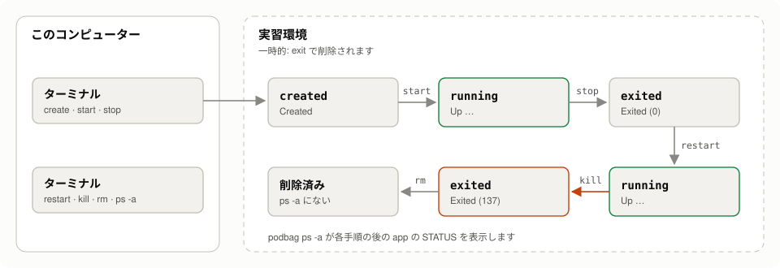

コンテナにはライフサイクルがあります。作成され、実行され、停止し、最後に削除されます。`podbag run` は最初の手順を 1 つのコマンドで行います。このモジュールでは、各手順を 1 つずつ実行し、1 つのコンテナの状態が変わる様子を確認します。

**所要時間** 10 分。



## モジュールを開始する

Podbag Desktop で **Training** を開き、**コンテナの作成から削除までをたどる**を選びます。新しいモジュールは**更新**の後に表示されます。ターミナルで次のコマンドを実行しても開始できます。

```sh
podbag lab start container-lifecycle
```

Training カタログがある Podbag のビルド（v0.3.2 より後）が必要です。`training $` プロンプトが表示されたら続けます。

## 起動せずにコンテナを作成する

`podbag create` はコンテナを作成しますが、プログラムは起動しません。このプログラムは小さなシェルのループです。停止シグナル（`TERM`）を受け取るまで動き、受け取ると終了コード `0` で終わります。

```sh
podbag create --name app docker.io/library/busybox:1.37.0 sh -c 'trap "exit 0" TERM; while sleep 1; do :; done'
```

Podbag は `app` が `created` の状態であることを確認します。

## すべてのコンテナを一覧表示する

`podbag ps` は実行中のコンテナだけを表示します。`-a` を付けると、すべてのコンテナを表示します。

```sh
podbag ps -a
```

`app` の状態は `Created` です。Podbag は出力にこの語があることを確認します。

## コンテナを起動する

`podbag start` は、作成済みまたは停止したコンテナのプログラムを実行します。

```sh
podbag start app
```

Podbag は `app` が実行中であることを確認します。

## コンテナを停止する

`podbag stop` は `TERM` シグナルを送ります。プログラムは自分のやり方で終了できます。タイムアウト（10 秒）までに終了しない場合、Podbag は `KILL` を送ります。このループはすぐに終了します。

```sh
podbag stop app
```

Podbag は `app` が `exited` の状態であることを確認します。

## 終了コード 0 を確認する

```sh
podbag ps -a
```

状態は `Exited (0)` です。プログラムはエラーなしで終了しました。コンテナはファイルと設定を持ったまま、まだ存在します。

## コンテナを再起動する

`podbag restart` は、実行中のコンテナを停止してから、もう一度起動します。同じコンテナ、同じ名前、同じコマンドを使います。

```sh
podbag restart app
```

Podbag は `app` が再び実行中であることを確認します。

## コンテナを強制終了する

`podbag kill` はすぐに `KILL` を送ります。プログラムはこれに対して何もできません。

```sh
podbag kill app
```

Podbag はコンテナの終了を待ち、終了コードが `137` であることを確認します。これは 128 + 9 です。9 は `KILL` シグナルの番号です。

## 終了コード 137 を確認する

```sh
podbag ps -a
```

状態は `Exited (137)` です。`stop` の後の `Exited (0)` と比べてください。まず `stop` を使います。`kill` は、プログラムが停止しないときだけ使います。

## コンテナを削除して終了する

`podbag rm` は停止したコンテナを削除します。実行中のコンテナには `rm -f` が必要です。

```sh
podbag rm app
exit
```

一時的な実習用のリソースが削除されます。Training にモジュールの完了が表示されます。
