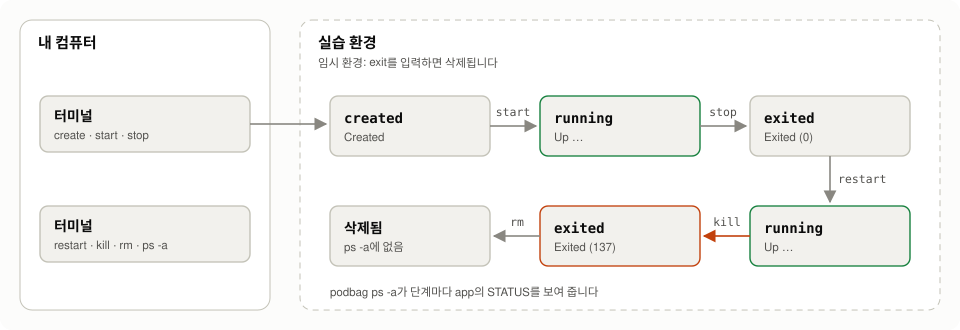

컨테이너에도 수명이 있습니다. 만들어지고, 실행되고, 멈추고, 마지막에 삭제됩니다. `podbag run`은 앞의 단계를 명령 하나로 처리합니다. 이번 트레이닝에서는 각 단계를 하나씩 실행하면서 컨테이너 하나의 상태가 바뀌는 것을 봅니다.

**예상 시간** 10분.



## 실습 시작

Podbag Desktop에서 **Training**을 열고 **컨테이너의 생성부터 삭제까지 따라가기**를 선택합니다. 새 모듈은 **새로 고침**을 누르면 나타납니다. 터미널에서 다음 명령으로 시작할 수도 있습니다.

```sh
podbag lab start container-lifecycle
```

Training 카탈로그가 있는 Podbag 빌드(v0.3.2 이후)가 필요합니다. `training $` 프롬프트가 나오면 다음 단계로 진행합니다.

Podbag Desktop 대신 TUI에서 실습하려면 `--tui`를 붙입니다.

```sh
podbag lab start container-lifecycle --tui
```

TUI에서는 `:` 키로 명령 단계용 Training 셸을 열고, `exit`를 입력해 TUI로 돌아오며, `q` 키로 실습을 끝냅니다.

## 시작하지 않고 컨테이너 만들기

`podbag create`는 컨테이너를 만들지만 프로그램을 시작하지 않습니다. 이 프로그램은 작은 셸 반복문입니다. 중지 신호(`TERM`)를 받을 때까지 실행되고, 신호를 받으면 종료 코드 `0`으로 끝납니다.

```sh
podbag create --name app docker.io/library/busybox:1.37.0 sh -c 'trap "exit 0" TERM; while sleep 1; do :; done'
```

Podbag은 `app`이 `created` 상태인지 확인합니다.

## 모든 컨테이너 목록 보기

`podbag ps`는 실행 중인 컨테이너만 보여 줍니다. `-a`를 붙이면 모든 컨테이너를 보여 줍니다.

```sh
podbag ps -a
```

`app`의 상태는 `Created`입니다. Podbag은 출력에 이 글자가 있는지 확인합니다.

## 컨테이너 시작

`podbag start`는 만들어진 컨테이너나 중지된 컨테이너의 프로그램을 실행합니다.

```sh
podbag start app
```

- **Podbag Desktop에서:** **실습 컨테이너 → app → 시작**을 누릅니다.
- **TUI에서:** **컨테이너**에서 `app` 선택 후 `s` 키를 누릅니다.

Podbag은 `app`이 실행 중인지 확인합니다.

## 컨테이너 중지

`podbag stop`은 `TERM` 신호를 보냅니다. 프로그램은 스스로 정리하고 끝날 수 있습니다. 제한 시간(10초) 안에 끝나지 않으면 Podbag이 `KILL`을 보냅니다. 이 반복문은 바로 끝납니다.

```sh
podbag stop app
```

- **Podbag Desktop에서:** **실습 컨테이너 → app → 중지**를 누릅니다.
- **TUI에서:** **컨테이너**에서 `app` 선택 후 `x` 키를 누릅니다.

Podbag은 `app`이 `exited` 상태인지 확인합니다.

## 종료 코드 0 확인

```sh
podbag ps -a
```

상태는 `Exited (0)`입니다. 프로그램이 오류 없이 끝났다는 뜻입니다. 컨테이너는 파일과 설정을 그대로 가진 채 남아 있습니다.

## 컨테이너 다시 시작

`podbag restart`는 실행 중인 컨테이너를 중지한 뒤 다시 시작합니다. 같은 컨테이너, 같은 이름, 같은 명령을 사용합니다.

```sh
podbag restart app
```

- **Podbag Desktop에서:** **실습 컨테이너 → app → 재시작**을 누릅니다.
- **TUI에서:** **컨테이너**에서 `app` 선택 후 `r` 키를 누릅니다.

Podbag은 `app`이 다시 실행 중인지 확인합니다.

## 컨테이너 강제 종료

`podbag kill`은 바로 `KILL`을 보냅니다. 프로그램은 이 신호를 막을 수 없습니다.

```sh
podbag kill app
```

Podbag은 컨테이너가 끝날 때까지 기다린 뒤 종료 코드가 `137`인지 확인합니다. 137은 128 + 9이고, 9는 `KILL` 신호의 번호입니다.

## 종료 코드 137 확인

```sh
podbag ps -a
```

상태는 `Exited (137)`입니다. `stop` 뒤의 `Exited (0)`과 비교해 보세요. 먼저 `stop`을 사용합니다. 프로그램이 멈추지 않을 때만 `kill`을 사용합니다.

## 컨테이너 삭제하고 마치기

`podbag rm`은 중지된 컨테이너를 삭제합니다. 실행 중인 컨테이너는 `rm -f`로 삭제합니다.

- **Podbag Desktop에서:** **실습 컨테이너 → app → 삭제**를 누르고 확인합니다.
- **TUI에서:** **컨테이너**에서 `app` 선택 후 `d` 키, `y` 키를 차례로 누릅니다.

```sh
podbag rm app
exit
```

임시 실습 환경이 정리되면 Training에서 **수업 완료**를 확인합니다.
