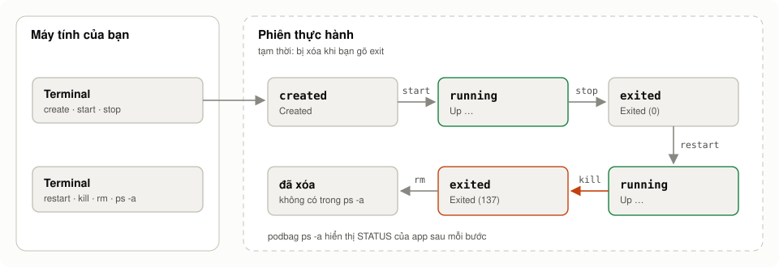

Container có một vòng đời: nó được tạo, chạy, dừng và cuối cùng bị xóa. `podbag run` làm các bước đầu chỉ bằng một lệnh. Trong mô-đun này, bạn làm riêng từng bước và xem trạng thái của một container thay đổi.

**Thời gian** 10 phút.



## Bắt đầu mô-đun

Mở **Training** trong Podbag Desktop và chọn **Theo dõi container từ lúc tạo đến lúc xóa**. Mô-đun mới xuất hiện sau khi chọn **Làm mới**. Hoặc chạy lệnh này trong terminal:

```sh
podbag lab start container-lifecycle
```

Bạn cần bản Podbag có danh mục Training (sau v0.3.2). Tiếp tục tại dấu nhắc `training $`.

Để làm các bước trong TUI thay cho Podbag Desktop, hãy thêm `--tui`.

```sh
podbag lab start container-lifecycle --tui
```

Trong TUI, nhấn `:` để mở shell Training cho bước chạy lệnh, gõ `exit` để quay lại TUI và nhấn `q` để kết thúc phiên.

## Tạo container mà không chạy

`podbag create` tạo container nhưng không chạy chương trình của nó. Chương trình là một vòng lặp shell nhỏ. Nó chạy cho đến khi nhận tín hiệu dừng (`TERM`). Sau đó nó kết thúc với mã thoát `0`.

```sh
podbag create --name app docker.io/library/busybox:1.37.0 sh -c 'trap "exit 0" TERM; while sleep 1; do :; done'
```

Podbag kiểm tra rằng `app` ở trạng thái `created`.

## Liệt kê tất cả container

`podbag ps` chỉ liệt kê các container đang chạy. Thêm `-a` để liệt kê tất cả.

```sh
podbag ps -a
```

Trạng thái của `app` là `Created`. Podbag kiểm tra rằng kết quả có chữ này.

## Chạy container

`podbag start` chạy chương trình của một container đã tạo hoặc đã dừng.

```sh
podbag start app
```

- **Trong Podbag Desktop:** Chọn **Container thực hành → app → Chạy**.
- **Trong TUI:** Chọn `app` trong **Container** rồi nhấn `s`.

Podbag kiểm tra rằng `app` đang chạy.

## Dừng container

`podbag stop` gửi tín hiệu `TERM`. Chương trình có thể tự kết thúc theo cách của nó. Nếu chương trình không kết thúc trong thời gian chờ (10 giây), Podbag gửi `KILL`. Vòng lặp này kết thúc ngay.

```sh
podbag stop app
```

- **Trong Podbag Desktop:** Chọn **Container thực hành → app → Dừng**.
- **Trong TUI:** Chọn `app` trong **Container** rồi nhấn `x`.

Podbag kiểm tra rằng `app` ở trạng thái `exited`.

## Xem mã thoát 0

```sh
podbag ps -a
```

Trạng thái là `Exited (0)`. Chương trình đã kết thúc mà không có lỗi. Container vẫn còn, cùng với các tệp và cài đặt của nó.

## Khởi động lại container

`podbag restart` dừng container nếu nó đang chạy, rồi chạy lại. Lệnh này dùng cùng container, cùng tên và cùng lệnh.

```sh
podbag restart app
```

- **Trong Podbag Desktop:** Chọn **Container thực hành → app → Khởi động lại**.
- **Trong TUI:** Chọn `app` trong **Container** rồi nhấn `r`.

Podbag kiểm tra rằng `app` đang chạy lại.

## Kill container

`podbag kill` gửi `KILL` ngay lập tức. Chương trình không thể làm gì để chặn nó.

```sh
podbag kill app
```

Podbag chờ container kết thúc và kiểm tra rằng mã thoát là `137`. Số này bằng 128 + 9, và 9 là số của tín hiệu `KILL`.

## Xem mã thoát 137

```sh
podbag ps -a
```

Trạng thái là `Exited (137)`. Hãy so sánh với `Exited (0)` sau `stop`. Dùng `stop` trước. Chỉ dùng `kill` khi chương trình không chịu dừng.

## Xóa container và kết thúc

`podbag rm` xóa container đã dừng. Container đang chạy cần `rm -f`.

- **Trong Podbag Desktop:** Chọn **Container thực hành → app → Xóa** và xác nhận.
- **Trong TUI:** Chọn `app` trong **Container**, nhấn `d`, rồi nhấn `y`.

```sh
podbag rm app
exit
```

Các tài nguyên thực hành tạm thời đã được xóa. Training hiển thị mô-đun đã hoàn thành.
