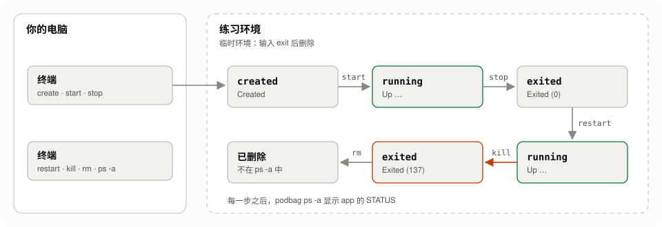

容器有自己的生命周期：被创建、运行、停止，最后被删除。`podbag run` 用一条命令完成前几步。在本模块中，你将逐步执行每一步，观察同一个容器的状态如何变化。

**预计用时** 10 分钟。



## 开始模块

在 Podbag Desktop 中打开 **Training**，选择**跟踪容器从创建到删除的全过程**。点击**刷新**后会出现新模块。也可以在终端中运行以下命令：

```sh
podbag lab start container-lifecycle
```

需要带有 Training 目录的 Podbag 版本（v0.3.2 之后）。出现 `training $` 提示符后继续。

## 创建容器但不启动

`podbag create` 会创建容器，但不会启动其中的程序。这个程序是一个小型 shell 循环。它会一直运行，直到收到停止信号（`TERM`），然后以退出码 `0` 结束。

```sh
podbag create --name app docker.io/library/busybox:1.37.0 sh -c 'trap "exit 0" TERM; while sleep 1; do :; done'
```

Podbag 会检查 `app` 是否处于 `created` 状态。

## 列出所有容器

`podbag ps` 只列出正在运行的容器。加上 `-a` 可以列出所有容器。

```sh
podbag ps -a
```

`app` 的状态是 `Created`。Podbag 会检查输出中是否包含这个词。

## 启动容器

`podbag start` 运行已创建或已停止容器中的程序。

```sh
podbag start app
```

Podbag 会检查 `app` 是否正在运行。

## 停止容器

`podbag stop` 发送 `TERM` 信号。程序可以按自己的方式结束。如果程序在超时时间（10 秒）内没有结束，Podbag 会发送 `KILL`。这个循环会立即结束。

```sh
podbag stop app
```

Podbag 会检查 `app` 是否处于 `exited` 状态。

## 查看退出码 0

```sh
podbag ps -a
```

状态是 `Exited (0)`。程序正常结束，没有错误。容器仍然存在，文件和设置也都保留。

## 重启容器

如果容器正在运行，`podbag restart` 会先停止它，然后再次启动。它使用同一个容器、同一个名称和同一条命令。

```sh
podbag restart app
```

Podbag 会检查 `app` 是否再次运行。

## 强制终止容器

`podbag kill` 会立即发送 `KILL`。程序无法对此做出任何处理。

```sh
podbag kill app
```

Podbag 会等待容器结束，并检查退出码是否为 `137`。137 等于 128 + 9，而 9 是 `KILL` 信号的编号。

## 查看退出码 137

```sh
podbag ps -a
```

状态是 `Exited (137)`。请与 `stop` 之后的 `Exited (0)` 对比。应先使用 `stop`。只有程序无法停止时才使用 `kill`。

## 删除容器并结束

`podbag rm` 删除已停止的容器。正在运行的容器需要使用 `rm -f`。

```sh
podbag rm app
exit
```

临时实验资源会被删除。Training 会显示该模块已完成。
