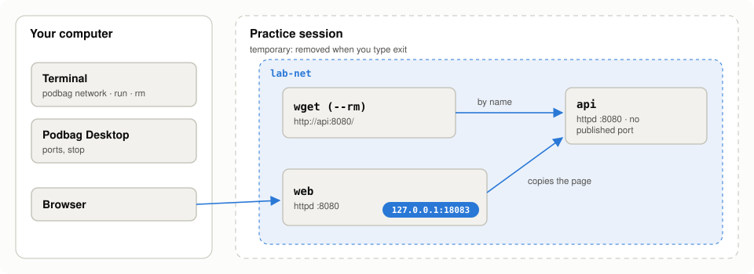
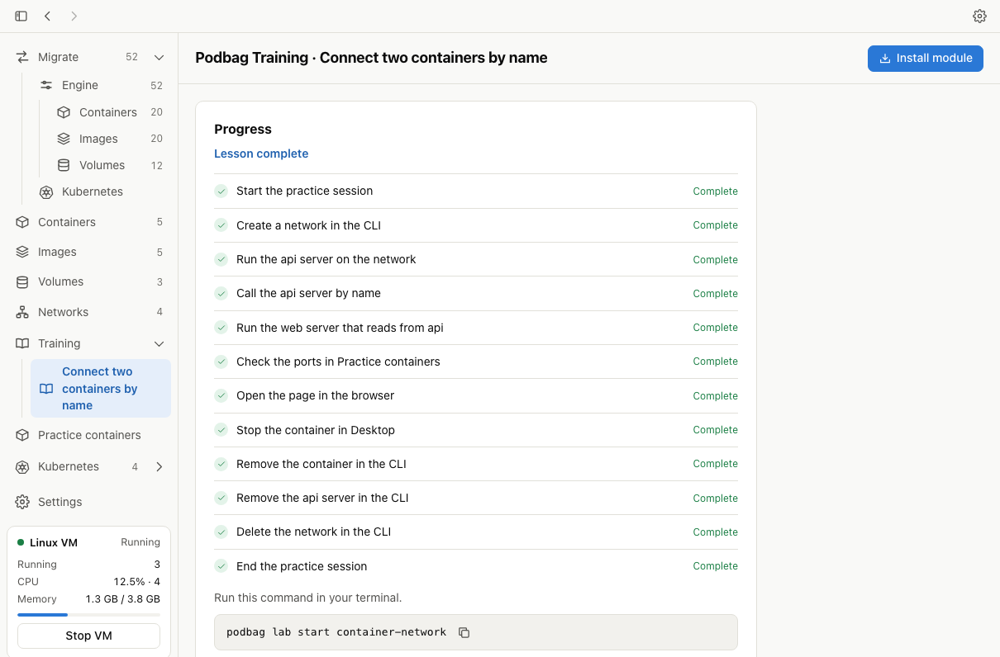

Containers on the same network can reach each other by name. In this module, you run a server with no published port. Another container calls it by name, and a web server shows its page in your browser.

**Time** 10–15 minutes. This module follows [Recover a web server with logs](../web-service-recovery/).



## Install and start the module

This module requires a build of Podbag Desktop and the CLI that supports `container-network`. It was added after v0.3.2.

[Download container-network.podbag](container-network.podbag). In Desktop, open **Training → Install module**, choose the file, and confirm. You can also install it from the download folder.

```sh
podbag lab install container-network.podbag
```

Select **Connect two containers by name** under **Training**. Run the start command in your existing terminal. Continue at the `training $` prompt.

```sh
podbag lab start container-network
```


## Create a network and run the api server

Copy each command from Training. First, create a network named `lab-net`.

```sh
podbag network create lab-net
```

Then run a small server named `api` on that network. It serves the text `Hello from api` on port `8080`. Unlike `web` later, this command does not publish a port with `-p 127.0.0.1:…`. Your computer cannot open this server directly.

```sh
podbag run -d --name api --network lab-net docker.io/library/busybox:1.37.0 sh -c 'mkdir -p /www && printf "%s\n" "Hello from api" > /www/index.html && exec httpd -f -p 8080 -h /www'
```

## Call the server by name

Run a one-time container on the same network. It asks for `http://api:8080/`. Podbag adds the name of each container on `lab-net` to the others, so `api` leads to the server. The `--rm` option removes this container when the command ends.

```sh
podbag run --rm --network lab-net docker.io/library/busybox:1.37.0 wget -qO- http://api:8080/
```


The terminal prints the page of `api`. Podbag checks this output.


## Publish a web server that uses api

Run a second server named `web` on `lab-net`. When it starts, it gets the page from `api` and serves a copy. Only `web` publishes a port. Use the port shown in Training if the default `18083` is already in use.

```sh
podbag run -d --name web --network lab-net -p 127.0.0.1:18083:8080 docker.io/library/busybox:1.37.0 sh -c 'mkdir -p /www && wget -qO /www/index.html http://api:8080/ && exec httpd -f -p 8080 -h /www'
```

Go to **Practice containers → web → View ports**. Select **Open in browser**. The page displays **Hello from api**. Podbag checks for an HTTP 200 response and this text.


## Clean up and finish

In Desktop, select **Practice containers → web → Stop**. Then remove both containers and the network in the same terminal. `api` is still running, so `-f` stops it before removing it. A network can be removed when no container uses it.

```sh
podbag rm web
podbag rm -f api
podbag network rm lab-net
exit
```

The temporary practice resources are removed. Training shows the module as complete.


