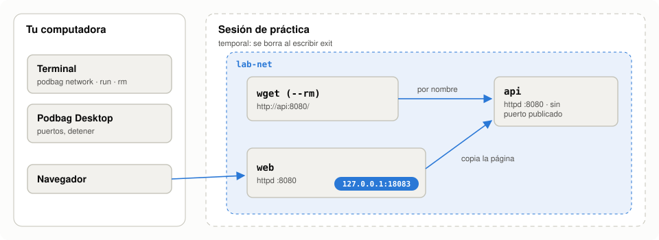
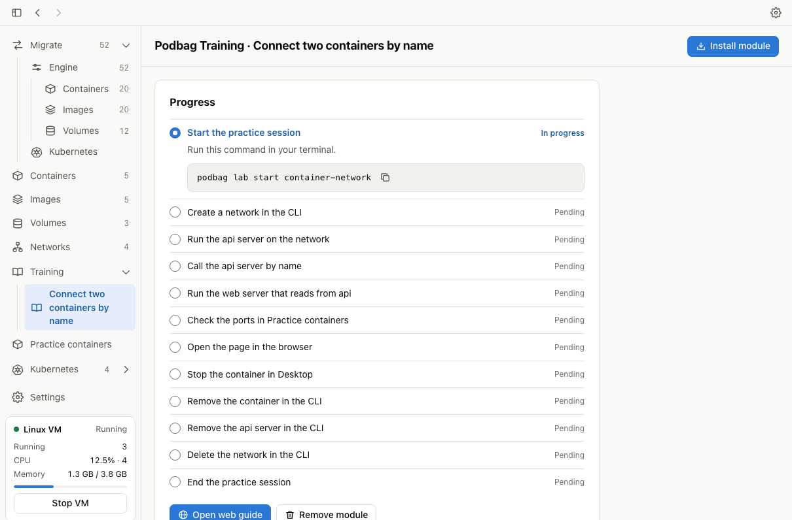

Los contenedores de la misma red pueden comunicarse por su nombre. En este módulo, ejecutas un servidor sin puerto publicado. Otro contenedor lo llama por su nombre, y un servidor web muestra su página en tu navegador.

**Tiempo** 10–15 minutos. Este módulo va después de [Recupera un servidor web con los registros](../web-service-recovery/).



## Instala e inicia el módulo

Este módulo necesita una versión de Podbag Desktop y de la CLI compatible con `container-network`. Se añadió después de v0.3.2.

[Descargar container-network.podbag](container-network.podbag). En Desktop, abre **Training → Instalar módulo**, elige el archivo y confirma. También puedes instalarlo desde la carpeta de descargas.

```sh
podbag lab install container-network.podbag
```

Selecciona **Conecta dos contenedores por su nombre** en **Training**. Ejecuta el comando de inicio en la terminal que ya tienes abierta. Continúa en el prompt `training $`.

```sh
podbag lab start container-network
```



## Crea una red y ejecuta el servidor api

Copia cada comando de Training. Primero, crea una red llamada `lab-net`.

```sh
podbag network create lab-net
```

Luego ejecuta un pequeño servidor llamado `api` en esa red. Sirve el texto `Hello from api` en el puerto `8080`. A diferencia de `web` más adelante, este comando no publica un puerto con `-p 127.0.0.1:…`. Tu computadora no puede abrir este servidor directamente.

```sh
podbag run -d --name api --network lab-net docker.io/library/busybox:1.37.0 sh -c 'mkdir -p /www && printf "%s\n" "Hello from api" > /www/index.html && exec httpd -f -p 8080 -h /www'
```

## Llama al servidor por su nombre

Ejecuta un contenedor de un solo uso en la misma red. Pide `http://api:8080/`. Podbag da a cada contenedor de `lab-net` el nombre de los demás. Así, `api` lleva al servidor. La opción `--rm` elimina este contenedor cuando termina el comando.

```sh
podbag run --rm --network lab-net docker.io/library/busybox:1.37.0 wget -qO- http://api:8080/
```


La terminal muestra la página de `api`. Podbag comprueba esta salida.


## Publica un servidor web que usa api

Ejecuta un segundo servidor llamado `web` en `lab-net`. Al iniciarse, obtiene la página de `api` y sirve una copia. Solo `web` publica un puerto. Si el puerto predeterminado `18083` ya está en uso, usa el puerto que indica Training.

```sh
podbag run -d --name web --network lab-net -p 127.0.0.1:18083:8080 docker.io/library/busybox:1.37.0 sh -c 'mkdir -p /www && wget -qO /www/index.html http://api:8080/ && exec httpd -f -p 8080 -h /www'
```

Ve a **Contenedores de práctica → web → Ver puertos**. Selecciona **Abrir en el navegador**. La página muestra **Hello from api**. Podbag comprueba que hay una respuesta HTTP 200 y este texto.


## Limpia y termina

En Desktop, selecciona **Contenedores de práctica → web → Detener**. Luego elimina los dos contenedores y la red en la misma terminal. `api` sigue en ejecución, así que `-f` lo detiene antes de eliminarlo. Una red se puede eliminar cuando ningún contenedor la usa.

```sh
podbag rm web
podbag rm -f api
podbag network rm lab-net
exit
```

Se eliminan los recursos temporales de la práctica. Training muestra el módulo como completado.


