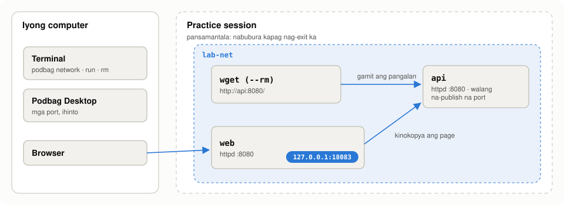

Naaabot ng mga container sa parehong network ang isa't isa gamit ang pangalan. Sa module na ito, magpapatakbo ka ng server na walang na-publish na port. Tinatawag ito ng ibang container gamit ang pangalan. Ipinapakita naman ng isang web server ang page nito sa browser mo.

**Oras** 10–15 minuto. Sumusunod ang module na ito sa [Ayusin ang web server gamit ang mga log](../web-service-recovery/).



## I-install at simulan ang module

Kailangan ng module na ito ng build ng Podbag Desktop at ng CLI na sumusuporta sa `container-network`. Idinagdag ito pagkatapos ng v0.3.2.

[I-download ang container-network.podbag](container-network.podbag). Sa Desktop, buksan ang **Training → I-install ang module**, piliin ang file, at kumpirmahin. Maaari mo rin itong i-install mula sa folder ng download.

```sh
podbag lab install container-network.podbag
```

Piliin ang **Ikonekta ang dalawang container gamit ang pangalan** sa ilalim ng **Training**. Patakbuhin ang command sa pagsisimula sa terminal na bukas na. Magpatuloy sa prompt na `training $`.

```sh
podbag lab start container-network
```


Para gawin ang mga hakbang sa TUI sa halip na sa Podbag Desktop, idagdag ang `--tui`.

```sh
podbag lab start container-network --tui
```

Sa TUI, pindutin ang `:` para buksan ang training shell sa isang hakbang na command. I-type ang `exit` para bumalik sa TUI. Pindutin ang `q` para tapusin ang practice session.

## Gumawa ng network at patakbuhin ang api server

Kopyahin ang bawat command mula sa Training. Una, gumawa ng network na `lab-net`.

```sh
podbag network create lab-net
```

Pagkatapos, magpatakbo ng maliit na server na `api` sa network na iyon. Inihahain nito ang text na `Hello from api` sa port na `8080`. Hindi tulad ng `web` mamaya, hindi nagpa-publish ng port ang command na ito gamit ang `-p 127.0.0.1:…`. Hindi direktang mabubuksan ng computer mo ang server na ito.

```sh
podbag run -d --name api --network lab-net docker.io/library/busybox:1.37.0 sh -c 'mkdir -p /www && printf "%s\n" "Hello from api" > /www/index.html && exec httpd -f -p 8080 -h /www'
```

## Tawagin ang server gamit ang pangalan

Magpatakbo ng isang beses na container sa parehong network. Hinihingi nito ang `http://api:8080/`. Idinaragdag ng Podbag ang pangalan ng bawat container sa `lab-net` sa iba pang container. Kaya papunta sa server ang `api`. Inaalis ng option na `--rm` ang container na ito kapag natapos ang command.

```sh
podbag run --rm --network lab-net docker.io/library/busybox:1.37.0 wget -qO- http://api:8080/
```


Ipinapakita ng terminal ang page ng `api`. Sinusuri ng Podbag ang output na ito.


## Mag-publish ng web server na gumagamit ng api

Magpatakbo ng pangalawang server na `web` sa `lab-net`. Pagsisimula nito, kinukuha nito ang page mula sa `api` at naghahain ng kopya. `web` lang ang nagpa-publish ng port. Gamitin ang port na nasa Training kung gamit na ang default na `18083`.

```sh
podbag run -d --name web --network lab-net -p 127.0.0.1:18083:8080 docker.io/library/busybox:1.37.0 sh -c 'mkdir -p /www && wget -qO /www/index.html http://api:8080/ && exec httpd -f -p 8080 -h /www'
```

Pumunta sa **Mga practice container → web → Tingnan ang mga port**. Piliin ang **Buksan sa browser**. Ipinapakita ng page ang **Hello from api**. Sinusuri ng Podbag kung may tugon na HTTP 200 at ang text na ito.

- **Sa Podbag Desktop:** Piliin ang **Mga practice container → web → Tingnan ang mga port**.
- **Sa TUI:** Piliin ang `web` sa **Mga container** at pindutin ang `Enter`.
- **Sa Podbag Desktop:** Piliin ang **Buksan sa browser**.
- **Sa TUI:** Buksan ang `http://127.0.0.1:18083/` sa browser. Kapag lumabas ang page, pindutin ang `o`.


## Maglinis at tapusin

Sa Desktop, piliin ang **Mga practice container → web → Ihinto**. Pagkatapos, alisin ang dalawang container at ang network sa parehong terminal. Tumatakbo pa ang `api`, kaya inihihinto muna ito ng `-f` bago alisin. Maaaring alisin ang network kapag walang container na gumagamit nito.

- **Sa Podbag Desktop:** Piliin ang **Mga practice container → web → Ihinto**.
- **Sa TUI:** Piliin ang `web` sa **Mga container** at pindutin ang `x`.
- **Sa Podbag Desktop:** Piliin ang **Mga practice container → web → Alisin** at kumpirmahin.
- **Sa TUI:** Piliin ang `web` sa **Mga container**, pindutin ang `d`, saka ang `y`.
- **Sa Podbag Desktop:** Piliin ang **Mga practice container → api → Alisin** at kumpirmahin.
- **Sa TUI:** Piliin ang `api` sa **Mga container**, pindutin ang `d`, saka ang `y`.
- **Sa Podbag Desktop:** Piliin ang **Mga practice container → Alisin ang network na lab-net** at kumpirmahin.
- **Sa TUI:** Piliin ang `lab-net` sa **Mga network**, pindutin ang `d`, saka ang `y`.

```sh
podbag rm web
podbag rm -f api
podbag network rm lab-net
exit
```

Naaalis ang mga pansamantalang resource ng practice. Ipinapakita ng Training na tapos na ang module.


