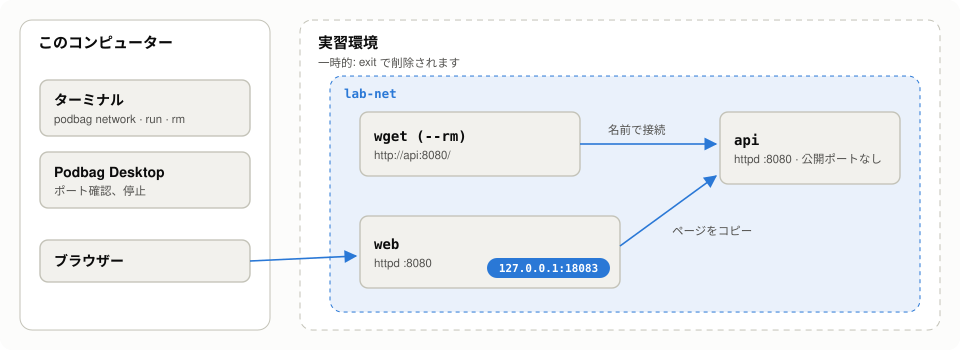

同じネットワーク上のコンテナは、名前で互いに接続できます。このモジュールでは、ポートを公開しないサーバーを実行します。別のコンテナがそのサーバーを名前で呼び出し、Web サーバーがそのページをブラウザーに表示します。

**所要時間** 10〜15 分。このモジュールは [ログを使って Web サーバーを復旧する](../web-service-recovery/)の続きです。



## モジュールをインストールして開始する

このモジュールには、`container-network` に対応した Podbag Desktop と CLI のビルドが必要です。このモジュールは v0.3.2 より後に追加されました。

[container-network.podbag をダウンロード](container-network.podbag)します。Desktop で **Training → モジュールをインストール**を開き、ファイルを指定して確認します。ダウンロード先のフォルダーからインストールすることもできます。

```sh
podbag lab install container-network.podbag
```

**Training** で **2 つのコンテナを名前でつなぐ**を選びます。使っているターミナルで開始コマンドを実行します。`training $` プロンプトが表示されたら続けます。

```sh
podbag lab start container-network
```


Podbag Desktop の代わりに TUI で手順を進めるには、`--tui` を付けます。

```sh
podbag lab start container-network --tui
```

TUI では、コマンドの手順で `:` を押すと Training シェルが開きます。`exit` と入力すると TUI に戻ります。`q` を押すと実習を終了します。

## ネットワークを作成して api サーバーを実行する

各コマンドを Training からコピーします。まず、`lab-net` という名前のネットワークを作成します。

```sh
podbag network create lab-net
```

次に、そのネットワーク上で `api` という小さなサーバーを実行します。このサーバーは、ポート `8080` でテキスト `Hello from api` を配信します。後で使う `web` と違い、このコマンドは `-p 127.0.0.1:…` でポートを公開しません。このコンピューターからは、このサーバーを直接開けません。

```sh
podbag run -d --name api --network lab-net docker.io/library/busybox:1.37.0 sh -c 'mkdir -p /www && printf "%s\n" "Hello from api" > /www/index.html && exec httpd -f -p 8080 -h /www'
```

## 名前でサーバーを呼び出す

同じネットワーク上で、1 回だけ動くコンテナを実行します。このコンテナは `http://api:8080/` にリクエストを送ります。Podbag は、`lab-net` 上の各コンテナの名前をほかのコンテナに登録します。そのため、`api` という名前でサーバーに届きます。`--rm` オプションは、コマンドが終わるとこのコンテナを削除します。

```sh
podbag run --rm --network lab-net docker.io/library/busybox:1.37.0 wget -qO- http://api:8080/
```


ターミナルに `api` のページが表示されます。Podbag はこの出力を確認します。


## api を使う Web サーバーを公開する

`lab-net` 上で、2 つ目のサーバー `web` を実行します。`web` は起動時に `api` からページを取得し、そのコピーを配信します。ポートを公開するのは `web` だけです。既定の `18083` がすでに使われている場合は、Training に表示されるポートを使います。

```sh
podbag run -d --name web --network lab-net -p 127.0.0.1:18083:8080 docker.io/library/busybox:1.37.0 sh -c 'mkdir -p /www && wget -qO /www/index.html http://api:8080/ && exec httpd -f -p 8080 -h /www'
```

**実習コンテナ → web → ポートを表示**に移動します。**ブラウザーで開く**を選びます。ページに **Hello from api** と表示されます。Podbag は、HTTP 200 の応答とこのテキストを確認します。

- **Podbag Desktop で:** **実習コンテナ → web → ポートを表示**を選びます。
- **TUI で:** **コンテナ**で `web` を選び、`Enter` を押します。
- **Podbag Desktop で:** **ブラウザーで開く**を選びます。
- **TUI で:** ブラウザーで `http://127.0.0.1:18083/` を開きます。ページが表示されたら `o` を押します。


## 片付けて終了する

Desktop で**実習コンテナ → web → 停止**を選びます。次に、同じターミナルで 2 つのコンテナとネットワークを削除します。`api` はまだ実行中なので、`-f` で停止してから削除します。ネットワークは、どのコンテナも使っていなければ削除できます。

- **Podbag Desktop で:** **実習コンテナ → web → 停止**を選びます。
- **TUI で:** **コンテナ**で `web` を選び、`x` を押します。
- **Podbag Desktop で:** **実習コンテナ → web → 削除**を選び、確認します。
- **TUI で:** **コンテナ**で `web` を選び、`d` を押してから `y` を押します。
- **Podbag Desktop で:** **実習コンテナ → api → 削除**を選び、確認します。
- **TUI で:** **コンテナ**で `api` を選び、`d` を押してから `y` を押します。
- **Podbag Desktop で:** **実習コンテナ → ネットワーク lab-net を削除**を選び、確認します。
- **TUI で:** **ネットワーク**で `lab-net` を選び、`d` を押してから `y` を押します。

```sh
podbag rm web
podbag rm -f api
podbag network rm lab-net
exit
```

一時的な実習用のリソースが削除されます。Training にモジュールの完了が表示されます。


