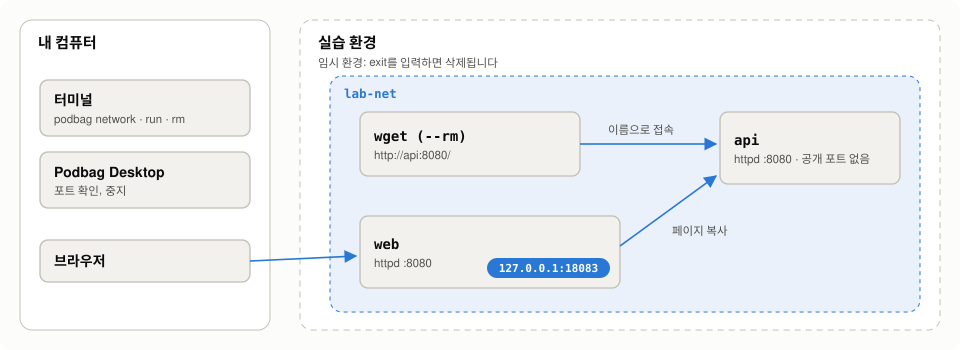
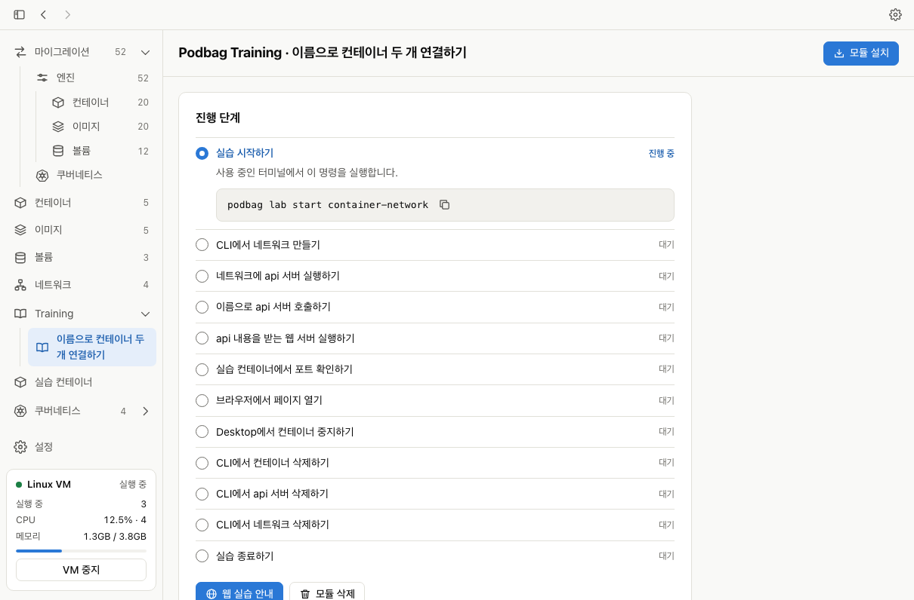
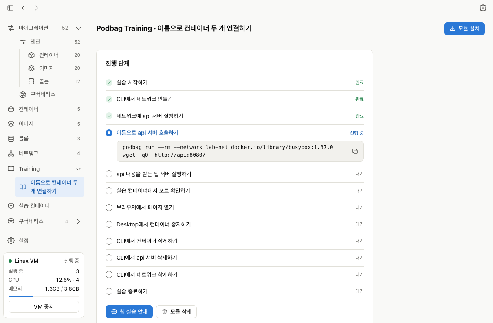
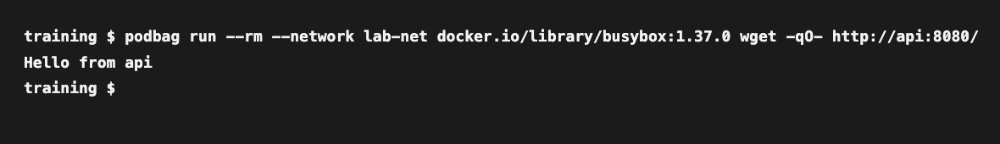
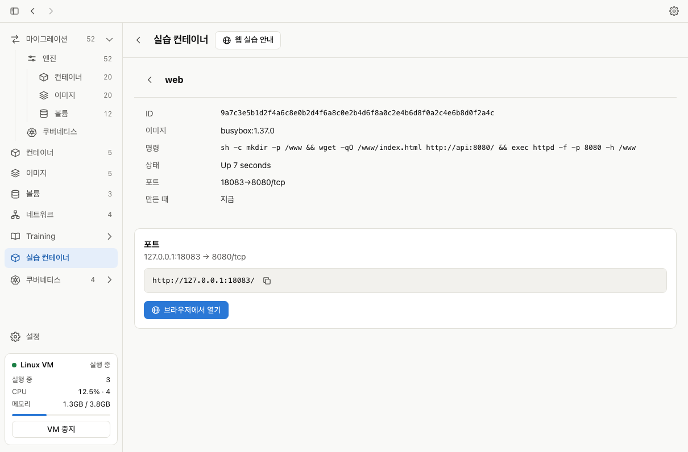
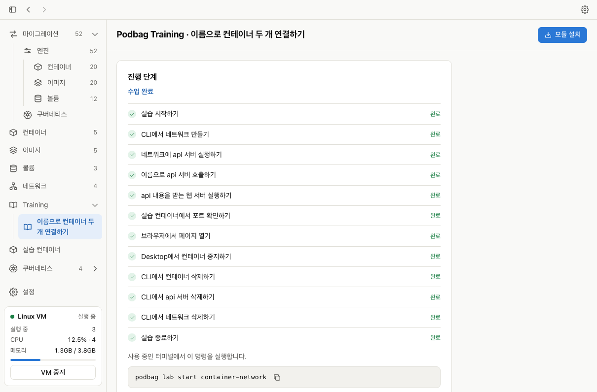

같은 네트워크에 있는 컨테이너는 이름으로 서로 접속할 수 있습니다. 이번 트레이닝에서는 포트를 공개하지 않은 서버를 실행합니다. 다른 컨테이너가 이름으로 이 서버를 호출합니다. 웹 서버는 이 서버의 페이지를 브라우저에 보여 줍니다.

**예상 시간** 10~15분. [로그로 웹 서버 장애 해결하기](/ko/blog/web-service-recovery/)를 마친 뒤 진행합니다.



## 모듈 설치 및 실습 시작

`container-network`를 지원하는 Podbag Desktop과 CLI가 필요합니다. 이 모듈은 v0.3.2 이후에 추가됐습니다.

[container-network.podbag 다운로드](container-network.podbag). Desktop에서 **Training → 모듈 설치**를 누릅니다. 내려받은 파일을 선택한 뒤 확인합니다. 다운로드 폴더에서 다음 명령으로 설치할 수도 있습니다.

```sh
podbag lab install container-network.podbag
```

**Training**에서 **이름으로 컨테이너 두 개 연결하기**를 선택합니다. 사용 중인 터미널에서 시작 명령을 실행합니다. `training $` 프롬프트가 나오면 다음 단계로 진행합니다.

```sh
podbag lab start container-network
```



## 네트워크 만들고 api 서버 실행

각 명령은 Training에서 복사합니다. 먼저 `lab-net`이라는 네트워크를 만듭니다.

```sh
podbag network create lab-net
```

이 네트워크에 `api`라는 작은 서버를 실행합니다. 이 서버는 `8080` 포트에서 `Hello from api`라는 글자를 보여 줍니다. 나중에 실행할 `web`과 달리, 이 명령은 `-p 127.0.0.1:…` 옵션으로 포트를 공개하지 않습니다. 그래서 내 컴퓨터에서는 이 서버에 바로 접속할 수 없습니다.

```sh
podbag run -d --name api --network lab-net docker.io/library/busybox:1.37.0 sh -c 'mkdir -p /www && printf "%s\n" "Hello from api" > /www/index.html && exec httpd -f -p 8080 -h /www'
```

## 이름으로 서버 호출

같은 네트워크에 한 번만 쓰는 컨테이너를 실행합니다. 이 컨테이너는 `http://api:8080/`에 접속합니다. Podbag은 `lab-net`에 있는 컨테이너의 이름을 서로에게 알려 줍니다. 그래서 `api`라는 이름으로 서버를 찾을 수 있습니다. `--rm` 옵션은 명령이 끝나면 이 컨테이너를 삭제합니다.

```sh
podbag run --rm --network lab-net docker.io/library/busybox:1.37.0 wget -qO- http://api:8080/
```



터미널에 `api`의 페이지 내용이 나옵니다. Podbag이 이 출력을 확인합니다.



## api를 쓰는 웹 서버 공개

`lab-net`에 두 번째 서버 `web`을 실행합니다. 이 서버는 시작할 때 `api`의 페이지를 받아 복사본을 보여 줍니다. 포트는 `web`만 공개합니다. 기본 포트 `18083`이 이미 사용 중이면 Training에 표시된 포트를 사용합니다.

```sh
podbag run -d --name web --network lab-net -p 127.0.0.1:18083:8080 docker.io/library/busybox:1.37.0 sh -c 'mkdir -p /www && wget -qO /www/index.html http://api:8080/ && exec httpd -f -p 8080 -h /www'
```

**실습 컨테이너 → web → 포트 보기**를 누릅니다. **브라우저에서 열기**를 누릅니다. 페이지에 **Hello from api**가 표시됩니다. Podbag은 HTTP 200 응답과 이 글자를 확인합니다.




## 실습 리소스 정리

Desktop에서 **실습 컨테이너 → web → 중지**를 누릅니다. 같은 터미널에서 컨테이너 두 개와 네트워크를 삭제합니다. `api`는 아직 실행 중이므로 `-f` 옵션으로 중지한 뒤 삭제합니다. 네트워크는 사용하는 컨테이너가 없을 때 삭제할 수 있습니다.

```sh
podbag rm web
podbag rm -f api
podbag network rm lab-net
exit
```

임시 실습 환경이 정리되면 Training에서 **수업 완료**를 확인합니다.


