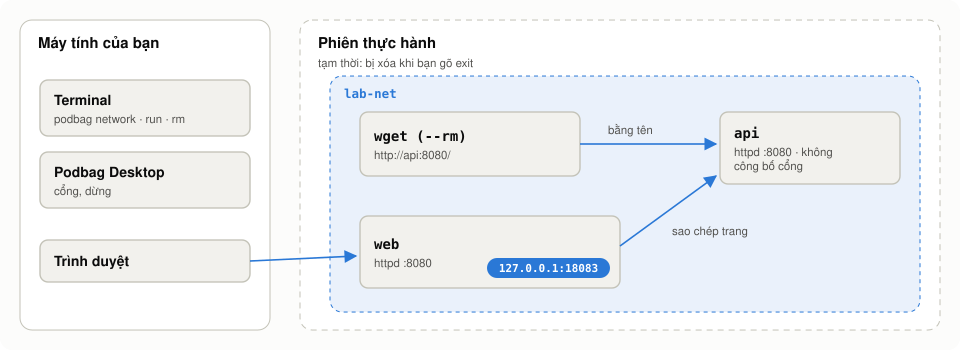
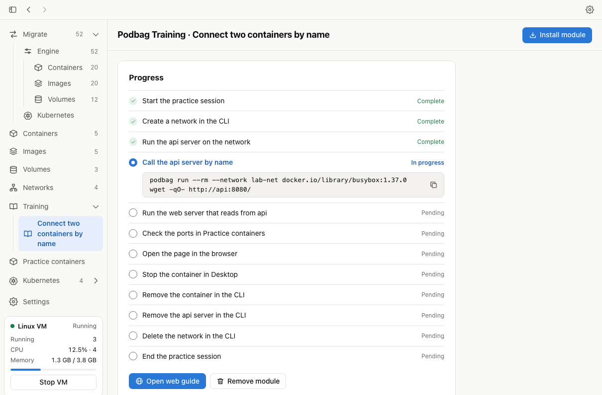
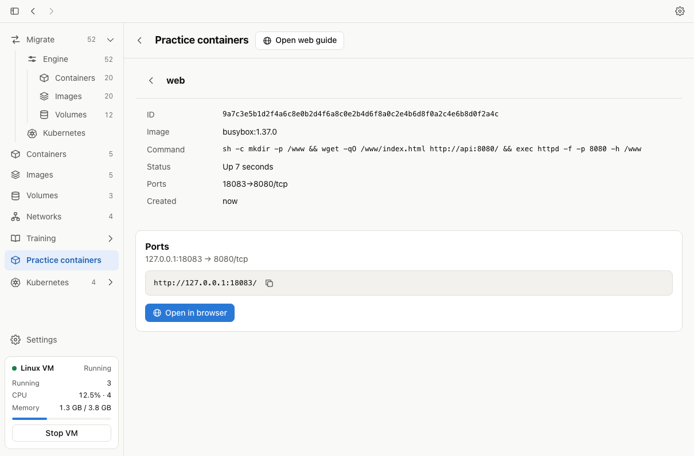
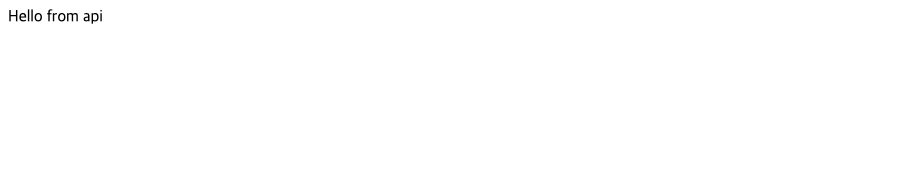

Các container trong cùng một mạng có thể gọi nhau bằng tên. Trong mô-đun này, bạn chạy một máy chủ không công bố cổng. Một container khác gọi nó bằng tên, và một máy chủ web hiển thị trang của nó trong trình duyệt.

**Thời gian** 10–15 phút. Mô-đun này nối tiếp [Khôi phục máy chủ web bằng nhật ký](../web-service-recovery/).



## Cài và bắt đầu mô-đun

Mô-đun này cần bản Podbag Desktop và CLI có hỗ trợ `container-network`. Mô-đun được thêm sau v0.3.2.

[Tải container-network.podbag](container-network.podbag). Trong Desktop, mở **Training → Cài mô-đun**, chọn tệp và xác nhận. Bạn cũng có thể cài từ thư mục tải xuống.

```sh
podbag lab install container-network.podbag
```

Chọn **Kết nối hai container bằng tên** trong **Training**. Chạy lệnh bắt đầu trong terminal bạn đang dùng. Tiếp tục tại dấu nhắc `training $`.

```sh
podbag lab start container-network
```


Để làm các bước trong TUI thay cho Podbag Desktop, hãy thêm `--tui`.

```sh
podbag lab start container-network --tui
```

Trong TUI, nhấn `:` để mở shell Training cho bước chạy lệnh, gõ `exit` để quay lại TUI và nhấn `q` để kết thúc phiên.

## Tạo mạng và chạy máy chủ api

Sao chép từng lệnh từ Training. Đầu tiên, tạo một mạng tên `lab-net`.

```sh
podbag network create lab-net
```

Sau đó chạy một máy chủ nhỏ tên `api` trong mạng đó. Nó phục vụ dòng chữ `Hello from api` ở cổng `8080`. Khác với `web` ở bước sau, lệnh này không công bố cổng bằng `-p 127.0.0.1:…`. Máy tính của bạn không thể mở trực tiếp máy chủ này.

```sh
podbag run -d --name api --network lab-net docker.io/library/busybox:1.37.0 sh -c 'mkdir -p /www && printf "%s\n" "Hello from api" > /www/index.html && exec httpd -f -p 8080 -h /www'
```

## Gọi máy chủ bằng tên

Chạy một container dùng một lần trong cùng mạng. Nó yêu cầu `http://api:8080/`. Podbag cho mỗi container trong `lab-net` biết tên của các container khác. Vì vậy, `api` dẫn tới máy chủ. Tùy chọn `--rm` xóa container này khi lệnh kết thúc.

```sh
podbag run --rm --network lab-net docker.io/library/busybox:1.37.0 wget -qO- http://api:8080/
```



Terminal in trang của `api`. Podbag kiểm tra kết quả này.


## Công bố máy chủ web dùng api

Chạy máy chủ thứ hai tên `web` trong `lab-net`. Khi khởi động, nó lấy trang từ `api` và phục vụ một bản sao. Chỉ `web` công bố cổng. Nếu cổng mặc định `18083` đang được dùng, hãy dùng cổng hiển thị trong Training.

```sh
podbag run -d --name web --network lab-net -p 127.0.0.1:18083:8080 docker.io/library/busybox:1.37.0 sh -c 'mkdir -p /www && wget -qO /www/index.html http://api:8080/ && exec httpd -f -p 8080 -h /www'
```

Đi tới **Container thực hành → web → Xem cổng**. Chọn **Mở trong trình duyệt**. Trang hiển thị **Hello from api**. Podbag kiểm tra phản hồi HTTP 200 và dòng chữ này.

- **Trong Podbag Desktop:** Chọn **Container thực hành → web → Xem cổng**.
- **Trong TUI:** Chọn `web` trong **Container** rồi nhấn `Enter`.
- **Trong Podbag Desktop:** Chọn **Mở trong trình duyệt**.
- **Trong TUI:** Mở `http://127.0.0.1:18083/` trong trình duyệt. Khi trang hiện ra, nhấn `o`.





## Dọn dẹp và kết thúc

Trong Desktop, chọn **Container thực hành → web → Dừng**. Sau đó xóa cả hai container và mạng trong cùng terminal. `api` vẫn đang chạy, nên `-f` dừng nó trước khi xóa. Chỉ xóa được mạng khi không còn container nào dùng nó.

- **Trong Podbag Desktop:** Chọn **Container thực hành → web → Dừng**.
- **Trong TUI:** Chọn `web` trong **Container** rồi nhấn `x`.
- **Trong Podbag Desktop:** Chọn **Container thực hành → web → Xóa** và xác nhận.
- **Trong TUI:** Chọn `web` trong **Container**, nhấn `d`, rồi nhấn `y`.
- **Trong Podbag Desktop:** Chọn **Container thực hành → api → Xóa** và xác nhận.
- **Trong TUI:** Chọn `api` trong **Container**, nhấn `d`, rồi nhấn `y`.
- **Trong Podbag Desktop:** Chọn **Container thực hành → Xóa mạng lab-net** và xác nhận.
- **Trong TUI:** Chọn `lab-net` trong **Mạng**, nhấn `d`, rồi nhấn `y`.

```sh
podbag rm web
podbag rm -f api
podbag network rm lab-net
exit
```

Các tài nguyên thực hành tạm thời đã được xóa. Training hiển thị mô-đun đã hoàn thành.


