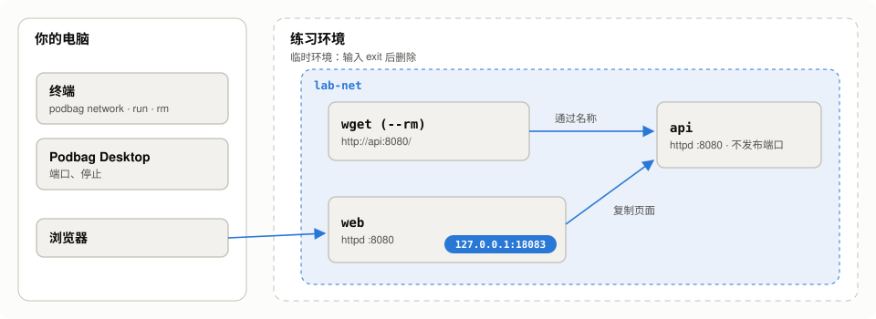

同一个网络中的容器可以通过名称互相访问。在本模块中，你将运行一个不发布端口的服务器。另一个容器通过名称调用它，Web 服务器则在浏览器中显示它的页面。

**预计用时** 10–15 分钟。请在完成[用日志恢复 Web 服务器](../web-service-recovery/)后学习本模块。



## 安装并开始模块

本模块需要支持 `container-network` 的 Podbag Desktop 和 CLI 版本。该模块在 v0.3.2 之后加入。

[下载 container-network.podbag](container-network.podbag)。在 Desktop 中打开 **Training → 安装模块**，选择文件并确认。也可以在下载目录中运行以下命令安装。

```sh
podbag lab install container-network.podbag
```

在 **Training** 下选择**通过名称连接两个容器**。在你当前的终端中运行启动命令。出现 `training $` 提示符后继续。

```sh
podbag lab start container-network
```


## 创建网络并运行 api 服务器

从 Training 复制每条命令。首先，创建名为 `lab-net` 的网络。

```sh
podbag network create lab-net
```

然后在这个网络中运行一个名为 `api` 的小型服务器。它在 `8080` 端口上提供文字 `Hello from api`。与后面的 `web` 不同，这条命令没有用 `-p 127.0.0.1:…` 发布端口。你的电脑不能直接打开这个服务器。

```sh
podbag run -d --name api --network lab-net docker.io/library/busybox:1.37.0 sh -c 'mkdir -p /www && printf "%s\n" "Hello from api" > /www/index.html && exec httpd -f -p 8080 -h /www'
```

## 通过名称调用服务器

在同一个网络中运行一个一次性容器。它请求 `http://api:8080/`。Podbag 会把 `lab-net` 中每个容器的名称告诉其他容器，所以 `api` 会指向该服务器。`--rm` 选项会在命令结束时删除这个容器。

```sh
podbag run --rm --network lab-net docker.io/library/busybox:1.37.0 wget -qO- http://api:8080/
```


终端打印出 `api` 的页面。Podbag 会检查这个输出。


## 发布使用 api 的 Web 服务器

在 `lab-net` 中运行第二个服务器，名为 `web`。它启动时会从 `api` 获取页面，并提供一份副本。只有 `web` 发布端口。如果默认端口 `18083` 已被占用，请使用 Training 中显示的端口。

```sh
podbag run -d --name web --network lab-net -p 127.0.0.1:18083:8080 docker.io/library/busybox:1.37.0 sh -c 'mkdir -p /www && wget -qO /www/index.html http://api:8080/ && exec httpd -f -p 8080 -h /www'
```

前往**实验容器 → web → 查看端口**。点击**在浏览器中打开**。页面显示 **Hello from api**。Podbag 会检查 HTTP 200 响应和这段文字。


## 清理并结束

在 Desktop 中选择**实验容器 → web → 停止**。然后在同一个终端中删除两个容器和网络。`api` 仍在运行，所以 `-f` 会先停止它再删除。没有容器使用网络时，才能删除网络。

```sh
podbag rm web
podbag rm -f api
podbag network rm lab-net
exit
```

临时实验资源会被删除。Training 会显示该模块已完成。


