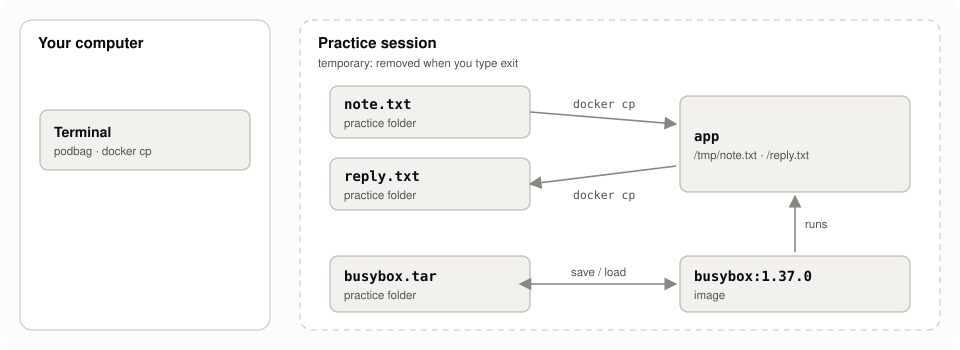

Sometimes you need a file inside a container, or a file out of it. Sometimes you need an image as one file, to move it to another computer. In this module, you copy files with `docker cp`, and save and load an image with `podbag save` and `podbag load`.

**Time** 10–15 minutes.



## Start the module

You need a build of Podbag Desktop and the CLI with the Training catalog. It was added after v0.3.2. You also need the Docker CLI: podbag has no `cp` command of its own, so the copy steps use `docker cp`. The session points `docker` at its own engine, not at your Docker setup. The Docker CLI steps work on Linux and macOS. On Windows, Podbag Desktop leaves this module out.

Open **Training** in Podbag Desktop and select **Copy files and move an image as an archive**. New modules appear after **Refresh**. Or run this command in a terminal:

```sh
podbag lab start copy-and-archive
```

Continue at the `training $` prompt. The session puts a file named `note.txt` in the practice directory. It has one line: `Hello from note.txt`.

## Run a container in the background

Run a container named `app`. It writes `/reply.txt` and then waits.

```sh
podbag run -d --name app docker.io/library/busybox:1.37.0 sh -c 'echo "Hello from app" > /reply.txt && exec sleep 3600'
```

Podbag checks that `app` runs.

## Copy the note into the container

`docker cp` copies from your folder to `CONTAINER:PATH`. A path that ends with `/` is a folder, so the file keeps its name.

```sh
docker cp note.txt app:/tmp/
```

The container keeps running. Podbag checks that the command worked and `app` still runs.

## Read the note in the container

```sh
podbag exec app cat /tmp/note.txt
```

The terminal prints `Hello from note.txt`. Podbag checks this output.

## Copy a file out of the container

Turn the order around to copy a file out: `CONTAINER:PATH` first, then the place in your folder.

```sh
docker cp app:/reply.txt reply.txt
```

Podbag checks that `reply.txt` is in the practice directory.

## Save the image to an archive

`save` writes an image, with its name and settings, as one tar file. `-o` names the file.

```sh
podbag save -o busybox.tar docker.io/library/busybox:1.37.0
```

Podbag checks that `busybox.tar` is in the practice directory.

## Remove the container and the image

`app` still runs, so `-f` stops it before removing it. Then remove the image.

```sh
podbag rm -f app
podbag rmi docker.io/library/busybox:1.37.0
```

Podbag checks that the container is gone, then that the image is gone.

## Load the image from the archive

`load` reads the archive and stores the image again, with its name.

```sh
podbag load -i busybox.tar
```

podbag prints `Loaded image: docker.io/library/busybox:1.37.0`. Podbag checks that the image is back. On another computer, `podbag load` (or `docker load`) reads the same file.

## Clean up and finish

The loaded image can stay. End the session in the same terminal.

```sh
exit
```

The temporary practice session is removed, with its files and the loaded image. Training shows the module as complete.
