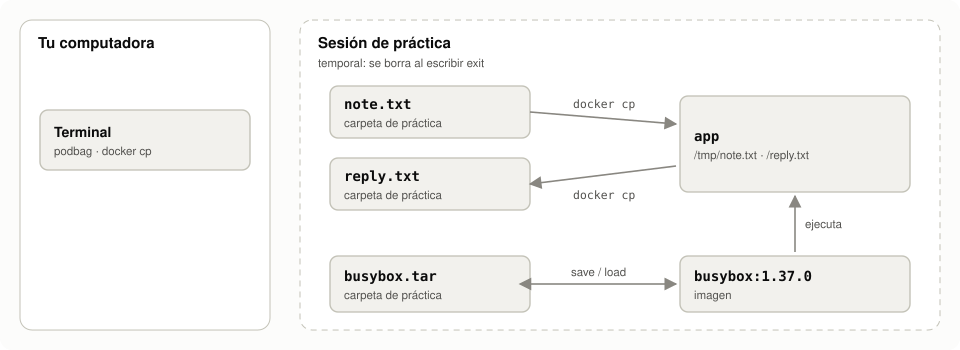

A veces necesitas un archivo dentro de un contenedor, o sacar un archivo de él. A veces necesitas una imagen como un solo archivo para llevarla a otra computadora. En este módulo, copias archivos con `docker cp`, y guardas y cargas una imagen con `podbag save` y `podbag load`.

**Tiempo** 10–15 minutos.



## Inicia el módulo

Necesitas una versión de Podbag Desktop y de la CLI con el catálogo de Training. Se añadió después de v0.3.2. También necesitas la CLI de Docker. podbag no tiene un comando `cp` propio, así que los pasos de copia usan `docker cp`. La sesión dirige `docker` a su propio motor, no a tu instalación de Docker. Los pasos con la CLI de Docker funcionan en Linux y macOS. En Windows, Podbag Desktop no muestra este módulo.

Abre **Training** en Podbag Desktop y selecciona **Copia archivos y mueve una imagen en un archivo tar**. Los módulos nuevos aparecen después de **Actualizar**. O ejecuta este comando en una terminal:

```sh
podbag lab start copy-and-archive
```

Continúa en el prompt `training $`. La sesión pone un archivo llamado `note.txt` en el directorio de práctica. Tiene una línea: `Hello from note.txt`.

Para hacer los pasos en la TUI en lugar de Podbag Desktop, añade `--tui`.

```sh
podbag lab start copy-and-archive --tui
```

En la TUI, pulsa `:` para abrir la shell de Training cuando un paso pida un comando, escribe `exit` para volver a la TUI y pulsa `q` para terminar la sesión.

## Ejecuta un contenedor en segundo plano

Ejecuta un contenedor llamado `app`. Escribe `/reply.txt` y luego espera.

```sh
podbag run -d --name app docker.io/library/busybox:1.37.0 sh -c 'echo "Hello from app" > /reply.txt && exec sleep 3600'
```

Podbag comprueba que `app` está en ejecución.

## Copia la nota al contenedor

`docker cp` copia desde tu carpeta a `CONTAINER:PATH`. Una ruta que termina en `/` es una carpeta, así que el archivo conserva su nombre.

```sh
docker cp note.txt app:/tmp/
```

El contenedor sigue en ejecución. Podbag comprueba que el comando funcionó y que `app` sigue en ejecución.

## Lee la nota en el contenedor

```sh
podbag exec app cat /tmp/note.txt
```

La terminal muestra `Hello from note.txt`. Podbag comprueba esta salida.

## Copia un archivo desde el contenedor

Invierte el orden para sacar un archivo: primero `CONTAINER:PATH` y después el destino en tu carpeta.

```sh
docker cp app:/reply.txt reply.txt
```

Podbag comprueba que `reply.txt` está en el directorio de práctica.

## Guarda la imagen en un archivo

`save` escribe una imagen, con su nombre y su configuración, en un solo archivo tar. `-o` indica el nombre del archivo.

```sh
podbag save -o busybox.tar docker.io/library/busybox:1.37.0
```

Podbag comprueba que `busybox.tar` está en el directorio de práctica.

## Elimina el contenedor y la imagen

`app` sigue en ejecución, así que `-f` lo detiene antes de eliminarlo. Luego elimina la imagen.

```sh
podbag rm -f app
podbag rmi docker.io/library/busybox:1.37.0
```

- **En Podbag Desktop:** Selecciona **Contenedores de práctica → app → Eliminar** y confirma.
- **En la TUI:** Selecciona `app` en **Contenedores**, pulsa `d` y luego `y`.
- **En Podbag Desktop:** Selecciona **Contenedores de práctica → Eliminar la imagen docker.io/library/busybox:1.37.0** y confirma.
- **En la TUI:** Selecciona `docker.io/library/busybox:1.37.0` en **Imágenes**, pulsa `d` y luego `y`.

Podbag comprueba que el contenedor ya no existe y después que la imagen ya no existe.

## Carga la imagen desde el archivo

`load` lee el archivo y vuelve a guardar la imagen, con su nombre.

```sh
podbag load -i busybox.tar
```

podbag muestra `Loaded image: docker.io/library/busybox:1.37.0`. Podbag comprueba que la imagen ha vuelto. En otra computadora, `podbag load` (o `docker load`) lee el mismo archivo.

## Limpia y termina

La imagen cargada puede quedarse. Termina la sesión en la misma terminal.

```sh
exit
```

Se elimina la sesión de práctica temporal, con sus archivos y la imagen cargada. Training muestra el módulo como completado.
