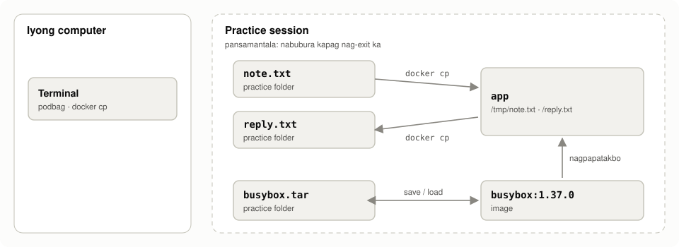

Minsan kailangan mo ng file sa loob ng container, o ng file mula rito. Minsan kailangan mo ang image bilang iisang file para mailipat ito sa ibang computer. Sa module na ito, kokopya ka ng mga file gamit ang `docker cp`. Ise-save at ilo-load mo rin ang image gamit ang `podbag save` at `podbag load`.

**Oras** 10–15 minuto.



## Simulan ang module

Kailangan mo ng build ng Podbag Desktop at ng CLI na may Training catalog. Idinagdag ito pagkatapos ng v0.3.2. Kailangan mo rin ang Docker CLI. Walang sariling `cp` command ang podbag, kaya `docker cp` ang gamit sa mga hakbang sa pagkopya. Itinuturo ng session ang `docker` sa sarili nitong engine, hindi sa Docker setup mo. Gumagana ang mga hakbang ng Docker CLI sa Linux at macOS. Sa Windows, hindi isinasama ng Podbag Desktop ang module na ito.

Buksan ang **Training** sa Podbag Desktop at piliin ang **Kumopya ng mga file at ilipat ang image bilang archive**. Lalabas ang mga bagong module pagkatapos ng **I-refresh**. O patakbuhin ang command na ito sa terminal:

```sh
podbag lab start copy-and-archive
```

Magpatuloy sa prompt na `training $`. Naglalagay ang session ng file na `note.txt` sa practice directory. May isang linya ito: `Hello from note.txt`.

Para gawin ang mga hakbang sa TUI sa halip na sa Podbag Desktop, idagdag ang `--tui`.

```sh
podbag lab start copy-and-archive --tui
```

Sa TUI, pindutin ang `:` para buksan ang training shell sa isang hakbang na command. I-type ang `exit` para bumalik sa TUI. Pindutin ang `q` para tapusin ang practice session.

## Magpatakbo ng container sa background

Magpatakbo ng container na `app`. Isinusulat nito ang `/reply.txt` at saka naghihintay.

```sh
podbag run -d --name app docker.io/library/busybox:1.37.0 sh -c 'echo "Hello from app" > /reply.txt && exec sleep 3600'
```

Sinusuri ng Podbag na tumatakbo ang `app`.

## Kopyahin ang note papasok sa container

Kinokopya ng `docker cp` ang file mula sa folder mo papunta sa `CONTAINER:PATH`. Folder ang path na nagtatapos sa `/`, kaya nananatili ang pangalan ng file.

```sh
docker cp note.txt app:/tmp/
```

Patuloy na tumatakbo ang container. Sinusuri ng Podbag na gumana ang command at tumatakbo pa rin ang `app`.

## Basahin ang note sa container

```sh
podbag exec app cat /tmp/note.txt
```

Ipinapakita ng terminal ang `Hello from note.txt`. Sinusuri ng Podbag ang output na ito.

## Kumopya ng file palabas ng container

Baligtarin ang pagkakasunod para kumopya ng file palabas: una ang `CONTAINER:PATH`, saka ang lugar sa folder mo.

```sh
docker cp app:/reply.txt reply.txt
```

Sinusuri ng Podbag na nasa practice directory ang `reply.txt`.

## I-save ang image sa archive

Isinusulat ng `save` ang image, kasama ang pangalan at mga setting nito, bilang iisang tar file. Pinapangalanan ng `-o` ang file.

```sh
podbag save -o busybox.tar docker.io/library/busybox:1.37.0
```

Sinusuri ng Podbag na nasa practice directory ang `busybox.tar`.

## Alisin ang container at ang image

Tumatakbo pa ang `app`, kaya inihihinto muna ito ng `-f` bago alisin. Pagkatapos, alisin ang image.

```sh
podbag rm -f app
podbag rmi docker.io/library/busybox:1.37.0
```

- **Sa Podbag Desktop:** Piliin ang **Mga practice container → app → Alisin** at kumpirmahin.
- **Sa TUI:** Piliin ang `app` sa **Mga container**, pindutin ang `d`, saka ang `y`.
- **Sa Podbag Desktop:** Piliin ang **Mga practice container → Alisin ang image na docker.io/library/busybox:1.37.0** at kumpirmahin.
- **Sa TUI:** Piliin ang `docker.io/library/busybox:1.37.0` sa **Mga image**, pindutin ang `d`, saka ang `y`.

Sinusuri ng Podbag na wala na ang container, at saka na wala na ang image.

## I-load ang image mula sa archive

Binabasa ng `load` ang archive at iniimbak ulit ang image, kasama ang pangalan nito.

```sh
podbag load -i busybox.tar
```

Ipinapakita ng podbag ang `Loaded image: docker.io/library/busybox:1.37.0`. Sinusuri ng Podbag na bumalik na ang image. Sa ibang computer, binabasa ng `podbag load` (o ng `docker load`) ang parehong file.

## Maglinis at tapusin

Maaaring manatili ang na-load na image. Tapusin ang session sa parehong terminal.

```sh
exit
```

Naaalis ang pansamantalang practice session, kasama ang mga file nito at ang na-load na image. Ipinapakita ng Training na tapos na ang module.
