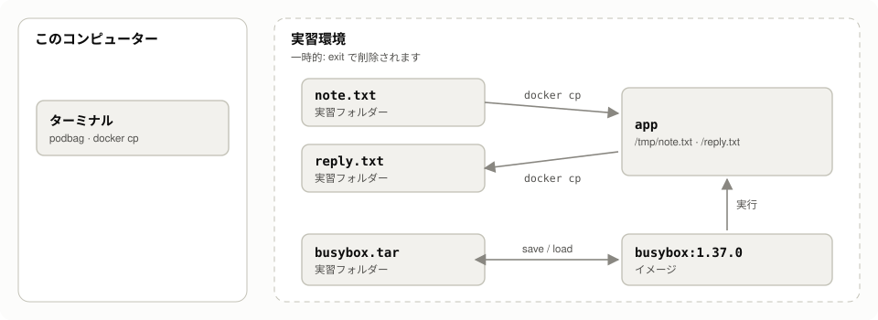

コンテナの中にファイルを入れたいときや、中からファイルを取り出したいときがあります。イメージを別のコンピューターに移すために、1 つのファイルにしたいときもあります。このモジュールでは、`docker cp` でファイルをコピーします。また、`podbag save` と `podbag load` でイメージを保存して読み込みます。

**所要時間** 10〜15 分。



## モジュールを開始する

Training カタログがある Podbag Desktop と CLI のビルドが必要です。カタログは v0.3.2 より後に追加されました。Docker CLI も必要です。podbag には専用の `cp` コマンドがないので、コピーの手順では `docker cp` を使います。実習環境は、`docker` をお使いの Docker の環境ではなく、実習環境のエンジンに向けます。Docker CLI の手順は Linux と macOS で動きます。Windows の Podbag Desktop には、このモジュールは表示されません。

Podbag Desktop で **Training** を開き、**ファイルをコピーし、イメージをアーカイブで移す**を選びます。新しいモジュールは**更新**の後に表示されます。ターミナルで次のコマンドを実行しても開始できます。

```sh
podbag lab start copy-and-archive
```

`training $` プロンプトが表示されたら続けます。実習環境は、実習用のディレクトリに `note.txt` というファイルを置きます。このファイルには `Hello from note.txt` の 1 行があります。

## コンテナをバックグラウンドで実行する

`app` という名前のコンテナを実行します。このコンテナは `/reply.txt` を書いてから待機します。

```sh
podbag run -d --name app docker.io/library/busybox:1.37.0 sh -c 'echo "Hello from app" > /reply.txt && exec sleep 3600'
```

Podbag は `app` が実行中であることを確認します。

## メモをコンテナにコピーする

`docker cp` は、このフォルダーから `CONTAINER:PATH` にコピーします。`/` で終わるパスはフォルダーなので、ファイルの名前は変わりません。

```sh
docker cp note.txt app:/tmp/
```

コンテナは動き続けます。Podbag は、コマンドが成功し、`app` がまだ実行中であることを確認します。

## コンテナの中でメモを読む

```sh
podbag exec app cat /tmp/note.txt
```

ターミナルに `Hello from note.txt` と表示されます。Podbag はこの出力を確認します。

## コンテナからファイルを取り出す

ファイルを取り出すには、順番を逆にします。先に `CONTAINER:PATH`、次にこのフォルダー内の保存先を書きます。

```sh
docker cp app:/reply.txt reply.txt
```

Podbag は、実習用のディレクトリに `reply.txt` があることを確認します。

## イメージをアーカイブに保存する

`save` は、イメージを名前と設定と一緒に 1 つの tar ファイルに書き出します。`-o` はファイル名を指定します。

```sh
podbag save -o busybox.tar docker.io/library/busybox:1.37.0
```

Podbag は、実習用のディレクトリに `busybox.tar` があることを確認します。

## コンテナとイメージを削除する

`app` はまだ実行中なので、`-f` で停止してから削除します。次に、イメージを削除します。

```sh
podbag rm -f app
podbag rmi docker.io/library/busybox:1.37.0
```

Podbag は、コンテナが消えたことを確認し、次にイメージが消えたことを確認します。

## アーカイブからイメージを読み込む

`load` はアーカイブを読み、イメージを名前と一緒にもう一度保存します。

```sh
podbag load -i busybox.tar
```

podbag は `Loaded image: docker.io/library/busybox:1.37.0` と表示します。Podbag はイメージが戻ったことを確認します。別のコンピューターでも、`podbag load`（または `docker load`）で同じファイルを読み込めます。

## 片付けて終了する

読み込んだイメージは残したままでかまいません。同じターミナルで実習を終了します。

```sh
exit
```

一時的な実習環境が、そのファイルと読み込んだイメージと一緒に削除されます。Training にモジュールの完了が表示されます。
