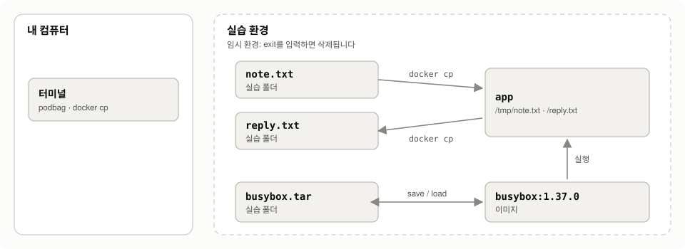

컨테이너 안에 파일을 넣거나 꺼내야 할 때가 있습니다. 이미지를 다른 컴퓨터로 옮기려고 파일 하나로 만들어야 할 때도 있습니다. 이번 트레이닝에서는 `docker cp`로 파일을 복사합니다. 그리고 `podbag save`와 `podbag load`로 이미지를 저장하고 불러옵니다.

**예상 시간** 10~15분.



## 실습 시작

Training 카탈로그가 들어 있는 Podbag Desktop과 CLI가 필요합니다. 이 기능은 v0.3.2 이후에 추가됐습니다. Docker CLI도 필요합니다. podbag에는 자체 `cp` 명령이 없으므로 복사 단계는 `docker cp`를 씁니다. 실습 환경은 `docker`를 내 Docker 설정이 아니라 실습 엔진에 연결합니다. Docker CLI 단계는 Linux와 macOS에서 할 수 있습니다. Windows의 Podbag Desktop은 이 모듈을 목록에 보여 주지 않습니다.

Podbag Desktop에서 **Training**을 열고 **파일 복사하고 이미지를 아카이브로 옮기기**를 선택합니다. 새 모듈은 **새로 고침**을 누르면 나타납니다. 터미널에서 다음 명령을 실행해도 됩니다.

```sh
podbag lab start copy-and-archive
```

`training $` 프롬프트에서 계속 진행합니다. 실습 디렉터리에는 `note.txt` 파일이 있습니다. 내용은 `Hello from note.txt` 한 줄입니다.

Podbag Desktop 대신 TUI에서 실습하려면 `--tui`를 붙입니다.

```sh
podbag lab start copy-and-archive --tui
```

TUI에서는 `:` 키로 명령 단계용 Training 셸을 열고, `exit`를 입력해 TUI로 돌아오며, `q` 키로 실습을 끝냅니다.

## 백그라운드에서 컨테이너 실행하기

`app` 컨테이너를 실행합니다. 이 컨테이너는 `/reply.txt`를 쓰고 기다립니다.

```sh
podbag run -d --name app docker.io/library/busybox:1.37.0 sh -c 'echo "Hello from app" > /reply.txt && exec sleep 3600'
```

Podbag은 `app`이 실행 중인지 확인합니다.

## 메모를 컨테이너에 복사하기

`docker cp`는 내 폴더의 파일을 `컨테이너:경로`로 복사합니다. `/`로 끝나는 경로는 폴더이므로 파일 이름이 그대로 유지됩니다.

```sh
docker cp note.txt app:/tmp/
```

컨테이너는 계속 실행됩니다. Podbag은 명령이 성공했는지, `app`이 아직 실행 중인지 확인합니다.

## 컨테이너에서 메모 읽기

```sh
podbag exec app cat /tmp/note.txt
```

터미널에 `Hello from note.txt`가 출력됩니다. Podbag은 이 출력을 확인합니다.

## 컨테이너에서 파일 꺼내기

파일을 꺼낼 때는 순서를 바꿉니다. `컨테이너:경로`를 먼저 쓰고 내 폴더의 위치를 뒤에 씁니다.

```sh
docker cp app:/reply.txt reply.txt
```

Podbag은 실습 디렉터리에 `reply.txt`가 있는지 확인합니다.

## 이미지를 아카이브로 저장하기

`save`는 이미지를 이름과 설정까지 tar 파일 하나로 씁니다. `-o`는 파일 이름을 정합니다.

```sh
podbag save -o busybox.tar docker.io/library/busybox:1.37.0
```

Podbag은 실습 디렉터리에 `busybox.tar`가 있는지 확인합니다.

## 컨테이너와 이미지 삭제하기

`app`은 아직 실행 중이므로 `-f` 옵션으로 중지한 뒤 삭제합니다. 그다음 이미지를 삭제합니다.

```sh
podbag rm -f app
podbag rmi docker.io/library/busybox:1.37.0
```

- **Podbag Desktop에서:** **실습 컨테이너 → app → 삭제**를 누르고 확인합니다.
- **TUI에서:** **컨테이너**에서 `app` 선택 후 `d` 키, `y` 키를 차례로 누릅니다.
- **Podbag Desktop에서:** **실습 컨테이너 → 이미지 docker.io/library/busybox:1.37.0 삭제**를 누르고 확인합니다.
- **TUI에서:** **이미지**에서 `docker.io/library/busybox:1.37.0` 선택 후 `d` 키, `y` 키를 차례로 누릅니다.

Podbag은 컨테이너가 사라졌는지 확인하고, 이어서 이미지가 사라졌는지 확인합니다.

## 아카이브에서 이미지 불러오기

`load`는 아카이브를 읽고 이미지를 이름과 함께 다시 저장합니다.

```sh
podbag load -i busybox.tar
```

podbag은 `Loaded image: docker.io/library/busybox:1.37.0`을 출력합니다. Podbag은 이미지가 돌아왔는지 확인합니다. 다른 컴퓨터에서도 `podbag load`나 `docker load`로 같은 파일을 읽을 수 있습니다.

## 정리 및 실습 종료

불러온 이미지는 남겨 두어도 됩니다. 같은 터미널에서 실습을 종료합니다.

```sh
exit
```

임시 실습 환경이 파일, 불러온 이미지와 함께 삭제됩니다. Training에 모듈이 완료됨으로 표시됩니다.
