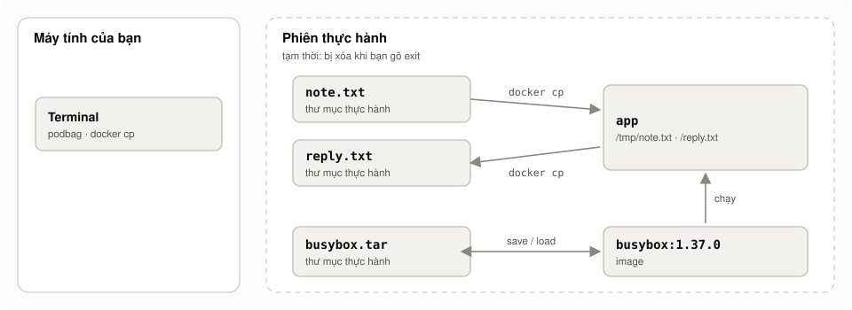

Đôi khi bạn cần đưa một tệp vào container, hoặc lấy một tệp ra. Đôi khi bạn cần image ở dạng một tệp để chuyển sang máy tính khác. Trong mô-đun này, bạn sao chép tệp bằng `docker cp`, rồi lưu và nạp image bằng `podbag save` và `podbag load`.

**Thời gian** 10–15 phút.



## Bắt đầu mô-đun

Bạn cần bản Podbag Desktop và CLI có danh mục Training. Danh mục này được thêm sau v0.3.2. Bạn cũng cần Docker CLI. podbag không có lệnh `cp` riêng, nên các bước sao chép dùng `docker cp`. Phiên thực hành trỏ `docker` tới engine của chính phiên, không phải tới Docker bạn đã cài. Các bước dùng Docker CLI chạy được trên Linux và macOS. Trên Windows, Podbag Desktop không hiển thị mô-đun này.

Mở **Training** trong Podbag Desktop và chọn **Sao chép tệp và chuyển image bằng tệp lưu trữ**. Mô-đun mới xuất hiện sau khi chọn **Làm mới**. Hoặc chạy lệnh này trong terminal:

```sh
podbag lab start copy-and-archive
```

Tiếp tục tại dấu nhắc `training $`. Phiên thực hành đặt một tệp tên `note.txt` vào thư mục thực hành. Tệp có một dòng: `Hello from note.txt`.

Để làm các bước trong TUI thay cho Podbag Desktop, hãy thêm `--tui`.

```sh
podbag lab start copy-and-archive --tui
```

Trong TUI, nhấn `:` để mở shell Training cho bước chạy lệnh, gõ `exit` để quay lại TUI và nhấn `q` để kết thúc phiên.

## Chạy container ở chế độ nền

Chạy một container tên `app`. Nó ghi `/reply.txt` rồi chờ.

```sh
podbag run -d --name app docker.io/library/busybox:1.37.0 sh -c 'echo "Hello from app" > /reply.txt && exec sleep 3600'
```

Podbag kiểm tra rằng `app` đang chạy.

## Sao chép tệp ghi chú vào container

`docker cp` sao chép từ thư mục của bạn tới `CONTAINER:PATH`. Đường dẫn kết thúc bằng `/` là thư mục, nên tệp giữ nguyên tên.

```sh
docker cp note.txt app:/tmp/
```

Container vẫn tiếp tục chạy. Podbag kiểm tra rằng lệnh đã thành công và `app` vẫn đang chạy.

## Đọc tệp ghi chú trong container

```sh
podbag exec app cat /tmp/note.txt
```

Terminal in `Hello from note.txt`. Podbag kiểm tra kết quả này.

## Sao chép tệp ra khỏi container

Đảo thứ tự để sao chép tệp ra ngoài: `CONTAINER:PATH` trước, rồi đến vị trí trong thư mục của bạn.

```sh
docker cp app:/reply.txt reply.txt
```

Podbag kiểm tra rằng `reply.txt` có trong thư mục thực hành.

## Lưu image thành tệp lưu trữ

`save` ghi một image, cùng tên và cài đặt của nó, thành một tệp tar. `-o` đặt tên cho tệp.

```sh
podbag save -o busybox.tar docker.io/library/busybox:1.37.0
```

Podbag kiểm tra rằng `busybox.tar` có trong thư mục thực hành.

## Xóa container và image

`app` vẫn đang chạy, nên `-f` dừng nó trước khi xóa. Sau đó xóa image.

```sh
podbag rm -f app
podbag rmi docker.io/library/busybox:1.37.0
```

- **Trong Podbag Desktop:** Chọn **Container thực hành → app → Xóa** và xác nhận.
- **Trong TUI:** Chọn `app` trong **Container**, nhấn `d`, rồi nhấn `y`.
- **Trong Podbag Desktop:** Chọn **Container thực hành → Xóa image docker.io/library/busybox:1.37.0** và xác nhận.
- **Trong TUI:** Chọn `docker.io/library/busybox:1.37.0` trong **Image**, nhấn `d`, rồi nhấn `y`.

Podbag kiểm tra rằng container không còn, rồi kiểm tra rằng image không còn.

## Nạp image từ tệp lưu trữ

`load` đọc tệp lưu trữ và lưu lại image, cùng với tên của nó.

```sh
podbag load -i busybox.tar
```

podbag in `Loaded image: docker.io/library/busybox:1.37.0`. Podbag kiểm tra rằng image đã trở lại. Trên máy tính khác, `podbag load` (hoặc `docker load`) đọc được cùng tệp này.

## Dọn dẹp và kết thúc

Image đã nạp có thể giữ lại. Kết thúc phiên trong cùng terminal.

```sh
exit
```

Phiên thực hành tạm thời đã được xóa, cùng với các tệp và image đã nạp. Training hiển thị mô-đun đã hoàn thành.
