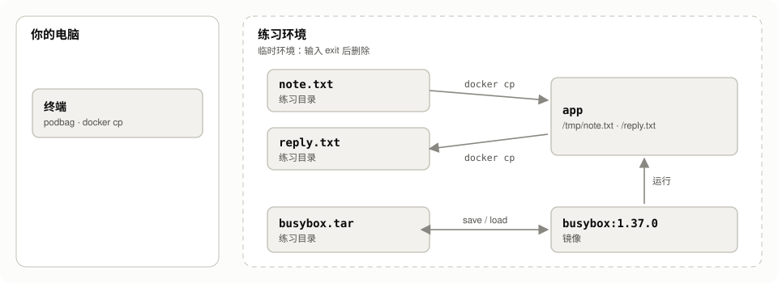

有时你需要把文件放进容器，或从容器中取出文件。有时你需要把镜像变成一个文件，以便移到另一台电脑上。在本模块中，你将用 `docker cp` 复制文件，并用 `podbag save` 和 `podbag load` 保存和加载镜像。

**预计用时** 10–15 分钟。



## 开始模块

需要带有 Training 目录的 Podbag Desktop 和 CLI 版本。该目录在 v0.3.2 之后加入。还需要 Docker CLI：podbag 没有自己的 `cp` 命令，所以复制步骤使用 `docker cp`。实验会让 `docker` 连接实验自己的引擎，而不是你的 Docker 环境。Docker CLI 步骤可在 Linux 和 macOS 上运行。在 Windows 上，Podbag Desktop 不显示此模块。

在 Podbag Desktop 中打开 **Training**，选择**复制文件并用归档迁移镜像**。点击**刷新**后会出现新模块。也可以在终端中运行以下命令：

```sh
podbag lab start copy-and-archive
```

出现 `training $` 提示符后继续。实验会在练习目录中放入一个名为 `note.txt` 的文件。文件中只有一行：`Hello from note.txt`。

要在 TUI 而不是 Podbag Desktop 中完成这些步骤，请加上 `--tui`。

```sh
podbag lab start copy-and-archive --tui
```

在 TUI 中，按 `:` 打开 Training 终端来执行命令步骤，输入 `exit` 返回 TUI，按 `q` 结束实验。

## 在后台运行容器

运行一个名为 `app` 的容器。它写入 `/reply.txt`，然后等待。

```sh
podbag run -d --name app docker.io/library/busybox:1.37.0 sh -c 'echo "Hello from app" > /reply.txt && exec sleep 3600'
```

Podbag 会检查 `app` 是否正在运行。

## 将 note 复制到容器中

`docker cp` 从你的文件夹复制到 `CONTAINER:PATH`。以 `/` 结尾的路径表示文件夹，所以文件会保留原名。

```sh
docker cp note.txt app:/tmp/
```

容器会继续运行。Podbag 会检查命令是否成功，以及 `app` 是否仍在运行。

## 在容器中读取 note

```sh
podbag exec app cat /tmp/note.txt
```

终端打印 `Hello from note.txt`。Podbag 会检查这个输出。

## 从容器中复制出文件

要把文件复制出来，就把顺序反过来：先写 `CONTAINER:PATH`，再写你文件夹中的位置。

```sh
docker cp app:/reply.txt reply.txt
```

Podbag 会检查 `reply.txt` 是否在练习目录中。

## 将镜像保存为归档

`save` 把镜像连同名称和设置写入一个 tar 文件。`-o` 指定文件名。

```sh
podbag save -o busybox.tar docker.io/library/busybox:1.37.0
```

Podbag 会检查 `busybox.tar` 是否在练习目录中。

## 删除容器和镜像

`app` 仍在运行，所以 `-f` 会先停止它再删除。然后删除镜像。

```sh
podbag rm -f app
podbag rmi docker.io/library/busybox:1.37.0
```

- **在 Podbag Desktop 中：** 选择**实验容器 → app → 删除**并确认。
- **在 TUI 中：** 在**容器**中选择 `app`，按 `d`，再按 `y`。
- **在 Podbag Desktop 中：** 选择**实验容器 → 删除镜像 docker.io/library/busybox:1.37.0**并确认。
- **在 TUI 中：** 在**镜像**中选择 `docker.io/library/busybox:1.37.0`，按 `d`，再按 `y`。

Podbag 会先检查容器是否已删除，再检查镜像是否已删除。

## 从归档加载镜像

`load` 读取归档，并重新存储镜像及其名称。

```sh
podbag load -i busybox.tar
```

podbag 打印 `Loaded image: docker.io/library/busybox:1.37.0`。Podbag 会检查镜像是否已恢复。在另一台电脑上，`podbag load`（或 `docker load`）也可以读取同一个文件。

## 清理并结束

加载的镜像可以保留。在同一个终端中结束实验。

```sh
exit
```

临时练习环境会被删除，其中的文件和加载的镜像也会一起删除。Training 会显示该模块已完成。
