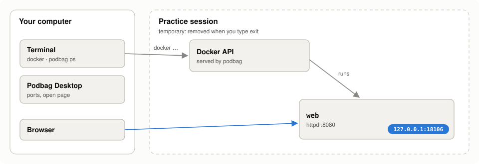

podbag can serve the Docker Engine API. The `docker` command talks to this API, so it works with podbag as it does with Docker. In this module, you run a web server with `docker` and see it in podbag and in Desktop.

**Time** 10 minutes.



## Start the module

You need a build of Podbag Desktop and the CLI with the Training catalog. It was added after v0.3.2. You also need the Docker CLI (the `docker` command). You do not need Docker Engine. The Docker CLI steps work on Linux and macOS. On Windows, Podbag Desktop leaves this module out.

Open **Training** in Podbag Desktop and select **Use the Docker CLI with Podbag**. New modules appear after **Refresh**. Or run this command in a terminal:

```sh
podbag lab start docker-cli
```

Continue at the `training $` prompt. In this shell, `docker` goes to the practice session. The session serves the Docker API on its own socket and sets `DOCKER_HOST` to it. Your other docker settings do not change.

To do the steps in the TUI instead of Podbag Desktop, add `--tui`.

```sh
podbag lab start docker-cli --tui
```

In the TUI, press `:` to open the training shell for a command step, type `exit` to return to the TUI, and press `q` to end the session.

## Ask the engine for its version

```sh
docker version
```

The output has two parts. `Client` is the docker command. `Server` is the engine it talks to. Here the server is `podbag`. Podbag checks the output for `Server: podbag`.

## Pull an image with docker

```sh
docker pull docker.io/library/busybox:1.37.0
```

- **In Podbag Desktop:** Select **Practice containers → Pull docker.io/library/busybox:1.37.0**.
- **In the TUI:** Open **Images**, press `p`, type `docker.io/library/busybox:1.37.0` and press `Enter`.

The docker command asks podbag to pull the image. podbag downloads it and keeps it in its own store. Podbag checks that the image `busybox:1.37.0` exists.

## Run a web server with docker

Use the port shown in Training if the default `18106` is already in use.

```sh
docker run -d --name web -p 127.0.0.1:18106:8080 docker.io/library/busybox:1.37.0 sh -c 'mkdir -p /www && echo "Hello from the Docker CLI" > /www/index.html && exec httpd -f -p 8080 -h /www'
```

The options are the same as for `podbag run`. Podbag checks that `web` runs, publishes the port and shows **Hello from the Docker CLI**.

## List containers with docker

```sh
docker ps
```

The list shows `web` and its port, `127.0.0.1:18106->8080/tcp`. Podbag checks the output for `web`.

## List the same containers with podbag

```sh
podbag ps
```

podbag shows the same container. There is one engine, and `docker` and `podbag` are two ways to use it. Podbag checks the output for `web`.

## Open the page in Desktop

Go to **Practice containers → web → View ports**. Select **Open in browser**. The page displays **Hello from the Docker CLI**. Podbag checks for an HTTP 200 response and this text.

- **In Podbag Desktop:** Select **Practice containers → web → View ports**.
- **In the TUI:** Select `web` in **Containers** and press `Enter`.
- **In Podbag Desktop:** Select **Open in browser**.
- **In the TUI:** Open `http://127.0.0.1:18106/` in a browser. When the page shows, press `o`.

## Clean up and finish

Stop and remove the container with `docker`. Podbag checks that `web` stops, and then that it is gone.

- **In Podbag Desktop:** Select **Practice containers → web → Stop**.
- **In the TUI:** Select `web` in **Containers** and press `x`.
- **In Podbag Desktop:** Select **Practice containers → web → Remove** and confirm.
- **In the TUI:** Select `web` in **Containers**, press `d`, then `y`.

```sh
docker stop web
docker rm web
exit
```

The temporary practice session is removed. Training shows the module as complete.

Outside Training, `podbag system docker use` points the docker command at podbag, and `podbag system docker restore` points it back. See "Docker API" in the podbag usage guide.
