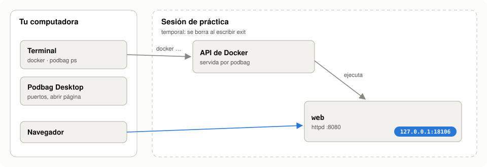

podbag puede servir la API de Docker Engine. El comando `docker` habla con esta API, así que funciona con podbag igual que con Docker. En este módulo, ejecutas un servidor web con `docker` y lo ves en podbag y en Desktop.

**Tiempo** 10 minutos.



## Inicia el módulo

Necesitas una versión de Podbag Desktop y de la CLI con el catálogo de Training. Se añadió después de v0.3.2. También necesitas la CLI de Docker (el comando `docker`). No necesitas Docker Engine. Los pasos con la CLI de Docker funcionan en Linux y macOS. En Windows, Podbag Desktop no muestra este módulo.

Abre **Training** en Podbag Desktop y selecciona **Usa la CLI de Docker con Podbag**. Los módulos nuevos aparecen después de **Actualizar**. O ejecuta este comando en una terminal:

```sh
podbag lab start docker-cli
```

Continúa en el prompt `training $`. En esta shell, `docker` va a la sesión de práctica. La sesión sirve la API de Docker en su propio socket y apunta `DOCKER_HOST` a él. Tu otra configuración de docker no cambia.

## Pide su versión al motor

```sh
docker version
```

La salida tiene dos partes. `Client` es el comando docker. `Server` es el motor con el que habla. Aquí el servidor es `podbag`. Podbag busca `Server: podbag` en la salida.

## Descarga una imagen con docker

```sh
docker pull docker.io/library/busybox:1.37.0
```

El comando docker pide a podbag que descargue la imagen. podbag la descarga y la guarda en su propio almacén. Podbag comprueba que existe la imagen `busybox:1.37.0`.

## Ejecuta un servidor web con docker

Si el puerto predeterminado `18106` ya está en uso, usa el puerto que indica Training.

```sh
docker run -d --name web -p 127.0.0.1:18106:8080 docker.io/library/busybox:1.37.0 sh -c 'mkdir -p /www && echo "Hello from the Docker CLI" > /www/index.html && exec httpd -f -p 8080 -h /www'
```

Las opciones son las mismas que las de `podbag run`. Podbag comprueba que `web` está en ejecución, publica el puerto y muestra **Hello from the Docker CLI**.

## Lista los contenedores con docker

```sh
docker ps
```

La lista muestra `web` y su puerto, `127.0.0.1:18106->8080/tcp`. Podbag busca `web` en la salida.

## Lista los mismos contenedores con podbag

```sh
podbag ps
```

podbag muestra el mismo contenedor. Hay un solo motor, y `docker` y `podbag` son dos formas de usarlo. Podbag busca `web` en la salida.

## Abre la página en Desktop

Ve a **Contenedores de práctica → web → Ver puertos**. Selecciona **Abrir en el navegador**. La página muestra **Hello from the Docker CLI**. Podbag comprueba que hay una respuesta HTTP 200 y este texto.

## Limpia y termina

Detén y elimina el contenedor con `docker`. Podbag comprueba que `web` se detiene y después que ya no existe.

```sh
docker stop web
docker rm web
exit
```

Se elimina la sesión de práctica temporal. Training muestra el módulo como completado.

Fuera de Training, `podbag system docker use` dirige el comando docker a podbag, y `podbag system docker restore` lo devuelve a su destino anterior. Consulta «Docker API» en la guía de uso de podbag.
