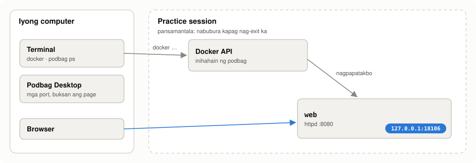

Kayang ihain ng podbag ang Docker Engine API. Nakikipag-usap ang `docker` command sa API na ito. Kaya gumagana ito sa podbag gaya ng sa Docker. Sa module na ito, magpapatakbo ka ng web server gamit ang `docker` at titingnan mo ito sa podbag at sa Desktop.

**Oras** 10 minuto.



## Simulan ang module

Kailangan mo ng build ng Podbag Desktop at ng CLI na may Training catalog. Idinagdag ito pagkatapos ng v0.3.2. Kailangan mo rin ang Docker CLI (ang `docker` command). Hindi mo kailangan ang Docker Engine. Gumagana ang mga hakbang ng Docker CLI sa Linux at macOS. Sa Windows, hindi isinasama ng Podbag Desktop ang module na ito.

Buksan ang **Training** sa Podbag Desktop at piliin ang **Gamitin ang Docker CLI kasama ang Podbag**. Lalabas ang mga bagong module pagkatapos ng **I-refresh**. O patakbuhin ang command na ito sa terminal:

```sh
podbag lab start docker-cli
```

Magpatuloy sa prompt na `training $`. Sa shell na ito, papunta sa practice session ang `docker`. Inihahain ng session ang Docker API sa sarili nitong socket at itinatakda ang `DOCKER_HOST` dito. Hindi nagbabago ang iba mong setting ng docker.

Para gawin ang mga hakbang sa TUI sa halip na sa Podbag Desktop, idagdag ang `--tui`.

```sh
podbag lab start docker-cli --tui
```

Sa TUI, pindutin ang `:` para buksan ang training shell sa isang hakbang na command. I-type ang `exit` para bumalik sa TUI. Pindutin ang `q` para tapusin ang practice session.

## Itanong sa engine ang bersiyon nito

```sh
docker version
```

May dalawang bahagi ang output. Ang `Client` ay ang docker command. Ang `Server` ay ang engine na kausap nito. Dito, `podbag` ang server. Hinahanap ng Podbag ang `Server: podbag` sa output.

## Mag-pull ng image gamit ang docker

```sh
docker pull docker.io/library/busybox:1.37.0
```

- **Sa Podbag Desktop:** Piliin ang **Mga practice container → I-pull ang docker.io/library/busybox:1.37.0**.
- **Sa TUI:** Buksan ang **Mga image**, pindutin ang `p`, i-type ang `docker.io/library/busybox:1.37.0` at pindutin ang `Enter`.

Hinihiling ng docker command sa podbag na kunin ang image. Dina-download ito ng podbag at iniimbak sa sarili nitong imbakan. Sinusuri ng Podbag na may image na `busybox:1.37.0`.

## Magpatakbo ng web server gamit ang docker

Gamitin ang port na nasa Training kung gamit na ang default na `18106`.

```sh
docker run -d --name web -p 127.0.0.1:18106:8080 docker.io/library/busybox:1.37.0 sh -c 'mkdir -p /www && echo "Hello from the Docker CLI" > /www/index.html && exec httpd -f -p 8080 -h /www'
```

Pareho ang mga option sa `podbag run`. Sinusuri ng Podbag na tumatakbo ang `web`, nagpa-publish ito ng port at ipinapakita nito ang **Hello from the Docker CLI**.

## Ilista ang mga container gamit ang docker

```sh
docker ps
```

Ipinapakita ng listahan ang `web` at ang port nito, `127.0.0.1:18106->8080/tcp`. Hinahanap ng Podbag ang `web` sa output.

## Ilista ang parehong mga container gamit ang podbag

```sh
podbag ps
```

Ipinapakita ng podbag ang parehong container. Iisa ang engine, at dalawang paraan ng paggamit nito ang `docker` at `podbag`. Hinahanap ng Podbag ang `web` sa output.

## Buksan ang page sa Desktop

Pumunta sa **Mga practice container → web → Tingnan ang mga port**. Piliin ang **Buksan sa browser**. Ipinapakita ng page ang **Hello from the Docker CLI**. Sinusuri ng Podbag kung may tugon na HTTP 200 at ang text na ito.

- **Sa Podbag Desktop:** Piliin ang **Mga practice container → web → Tingnan ang mga port**.
- **Sa TUI:** Piliin ang `web` sa **Mga container** at pindutin ang `Enter`.
- **Sa Podbag Desktop:** Piliin ang **Buksan sa browser**.
- **Sa TUI:** Buksan ang `http://127.0.0.1:18106/` sa browser. Kapag lumabas ang page, pindutin ang `o`.

## Maglinis at tapusin

Ihinto at alisin ang container gamit ang `docker`. Sinusuri ng Podbag na humihinto ang `web`, at saka na wala na ito.

- **Sa Podbag Desktop:** Piliin ang **Mga practice container → web → Ihinto**.
- **Sa TUI:** Piliin ang `web` sa **Mga container** at pindutin ang `x`.
- **Sa Podbag Desktop:** Piliin ang **Mga practice container → web → Alisin** at kumpirmahin.
- **Sa TUI:** Piliin ang `web` sa **Mga container**, pindutin ang `d`, saka ang `y`.

```sh
docker stop web
docker rm web
exit
```

Naaalis ang pansamantalang practice session. Ipinapakita ng Training na tapos na ang module.

Sa labas ng Training, itinuturo ng `podbag system docker use` ang docker command sa podbag, at ibinabalik ito ng `podbag system docker restore`. Tingnan ang "Docker API" sa gabay sa paggamit ng podbag.
