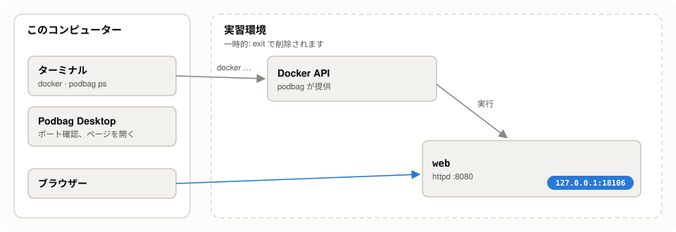

podbag は Docker Engine API を提供できます。`docker` コマンドはこの API と通信します。そのため、Docker と同じように podbag でも動きます。このモジュールでは、`docker` で Web サーバーを実行し、podbag と Desktop で確認します。

**所要時間** 10 分。



## モジュールを開始する

Training カタログがある Podbag Desktop と CLI のビルドが必要です。カタログは v0.3.2 より後に追加されました。Docker CLI（`docker` コマンド）も必要です。Docker Engine は必要ありません。Docker CLI の手順は Linux と macOS で動きます。Windows の Podbag Desktop には、このモジュールは表示されません。

Podbag Desktop で **Training** を開き、**Podbag で Docker CLI を使う**を選びます。新しいモジュールは**更新**の後に表示されます。ターミナルで次のコマンドを実行しても開始できます。

```sh
podbag lab start docker-cli
```

`training $` プロンプトが表示されたら続けます。このシェルでは、`docker` は実習環境に接続します。実習環境は専用のソケットで Docker API を提供し、`DOCKER_HOST` をそのソケットに設定します。ほかの docker の設定は変わりません。

Podbag Desktop の代わりに TUI で手順を進めるには、`--tui` を付けます。

```sh
podbag lab start docker-cli --tui
```

TUI では、コマンドの手順で `:` を押すと Training シェルが開きます。`exit` と入力すると TUI に戻ります。`q` を押すと実習を終了します。

## エンジンにバージョンを問い合わせる

```sh
docker version
```

出力は 2 つの部分に分かれます。`Client` は docker コマンドです。`Server` は docker コマンドが通信するエンジンです。ここでは、サーバーは `podbag` です。Podbag は出力に `Server: podbag` があることを確認します。

## docker でイメージを取得する

```sh
docker pull docker.io/library/busybox:1.37.0
```

- **Podbag Desktop で:** **実習コンテナ → docker.io/library/busybox:1.37.0 を取得**を選びます。
- **TUI で:** **イメージ**を開き、`p` を押して `docker.io/library/busybox:1.37.0` と入力し、`Enter` を押します。

docker コマンドは podbag にイメージの取得を依頼します。podbag はイメージをダウンロードし、自分のストアに保存します。Podbag はイメージ `busybox:1.37.0` があることを確認します。

## docker で Web サーバーを実行する

既定の `18106` がすでに使われている場合は、Training に表示されるポートを使います。

```sh
docker run -d --name web -p 127.0.0.1:18106:8080 docker.io/library/busybox:1.37.0 sh -c 'mkdir -p /www && echo "Hello from the Docker CLI" > /www/index.html && exec httpd -f -p 8080 -h /www'
```

オプションは `podbag run` と同じです。Podbag は、`web` が実行中で、ポートを公開し、**Hello from the Docker CLI** と表示することを確認します。

## docker でコンテナを一覧表示する

```sh
docker ps
```

一覧に `web` とそのポート `127.0.0.1:18106->8080/tcp` が表示されます。Podbag は出力に `web` があることを確認します。

## podbag で同じコンテナを一覧表示する

```sh
podbag ps
```

podbag にも同じコンテナが表示されます。エンジンは 1 つで、`docker` と `podbag` はその 2 つの使い方です。Podbag は出力に `web` があることを確認します。

## Desktop でページを開く

**実習コンテナ → web → ポートを表示**に移動します。**ブラウザーで開く**を選びます。ページに **Hello from the Docker CLI** と表示されます。Podbag は、HTTP 200 の応答とこのテキストを確認します。

- **Podbag Desktop で:** **実習コンテナ → web → ポートを表示**を選びます。
- **TUI で:** **コンテナ**で `web` を選び、`Enter` を押します。
- **Podbag Desktop で:** **ブラウザーで開く**を選びます。
- **TUI で:** ブラウザーで `http://127.0.0.1:18106/` を開きます。ページが表示されたら `o` を押します。

## 片付けて終了する

`docker` でコンテナを停止して削除します。Podbag は、`web` が停止したこと、次に消えたことを確認します。

- **Podbag Desktop で:** **実習コンテナ → web → 停止**を選びます。
- **TUI で:** **コンテナ**で `web` を選び、`x` を押します。
- **Podbag Desktop で:** **実習コンテナ → web → 削除**を選び、確認します。
- **TUI で:** **コンテナ**で `web` を選び、`d` を押してから `y` を押します。

```sh
docker stop web
docker rm web
exit
```

一時的な実習環境が削除されます。Training にモジュールの完了が表示されます。

Training の外では、`podbag system docker use` で docker コマンドを podbag に向けます。`podbag system docker restore` で元に戻します。詳しくは、podbag の使い方ガイドの「Docker API」を参照してください。
