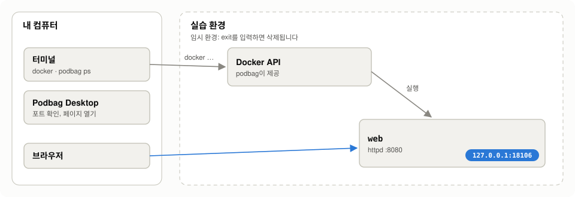

podbag은 Docker Engine API를 제공할 수 있습니다. `docker` 명령은 이 API로 엔진과 통신하므로 Docker와 똑같이 podbag에서도 동작합니다. 이번 트레이닝에서는 `docker`로 웹 서버를 실행하고 podbag과 Desktop에서 확인합니다.

**예상 시간** 10분.



## 실습 시작

Training 카탈로그가 들어 있는 Podbag Desktop과 CLI가 필요합니다. 이 기능은 v0.3.2 이후에 추가됐습니다. Docker CLI(`docker` 명령)도 필요합니다. Docker Engine은 필요 없습니다. Docker CLI 단계는 Linux와 macOS에서 할 수 있습니다. Windows의 Podbag Desktop은 이 모듈을 목록에 보여 주지 않습니다.

Podbag Desktop에서 **Training**을 열고 **Podbag에서 Docker CLI 사용하기**를 선택합니다. 새 모듈은 **새로 고침**을 누르면 나타납니다. 터미널에서 다음 명령을 실행해도 됩니다.

```sh
podbag lab start docker-cli
```

`training $` 프롬프트에서 계속 진행합니다. 이 셸에서 `docker`는 실습 환경으로 연결됩니다. 실습 환경은 자체 소켓으로 Docker API를 제공하고 `DOCKER_HOST`를 그 소켓으로 정합니다. 다른 docker 설정은 바뀌지 않습니다.

Podbag Desktop 대신 TUI에서 실습하려면 `--tui`를 붙입니다.

```sh
podbag lab start docker-cli --tui
```

TUI에서는 `:` 키로 명령 단계용 Training 셸을 열고, `exit`를 입력해 TUI로 돌아오며, `q` 키로 실습을 끝냅니다.

## 엔진 버전 확인하기

```sh
docker version
```

출력은 두 부분으로 나뉩니다. `Client`는 docker 명령입니다. `Server`는 docker 명령이 연결한 엔진입니다. 여기서는 서버가 `podbag`입니다. Podbag은 출력에 `Server: podbag`이 있는지 확인합니다.

## docker로 이미지 받기

```sh
docker pull docker.io/library/busybox:1.37.0
```

- **Podbag Desktop에서:** **실습 컨테이너 → docker.io/library/busybox:1.37.0 받기**를 누릅니다.
- **TUI에서:** **이미지** 탭을 열고 `p` 키를 누른 뒤 `docker.io/library/busybox:1.37.0` 입력 후 `Enter` 키를 누릅니다.

docker 명령이 podbag에 이미지를 받으라고 요청합니다. podbag은 이미지를 내려받아 자체 저장소에 보관합니다. Podbag은 `busybox:1.37.0` 이미지가 있는지 확인합니다.

## docker로 웹 서버 실행하기

기본 포트 `18106`을 이미 사용 중이면 Training에 표시된 포트를 사용합니다.

```sh
docker run -d --name web -p 127.0.0.1:18106:8080 docker.io/library/busybox:1.37.0 sh -c 'mkdir -p /www && echo "Hello from the Docker CLI" > /www/index.html && exec httpd -f -p 8080 -h /www'
```

옵션은 `podbag run`과 같습니다. Podbag은 `web`이 실행 중인지, 포트를 공개했는지, **Hello from the Docker CLI**를 보여 주는지 확인합니다.

## docker로 컨테이너 목록 보기

```sh
docker ps
```

목록에 `web`과 포트 `127.0.0.1:18106->8080/tcp`가 표시됩니다. Podbag은 출력에 `web`이 있는지 확인합니다.

## podbag으로 같은 컨테이너 보기

```sh
podbag ps
```

podbag도 같은 컨테이너를 보여 줍니다. 엔진은 하나이고, `docker`와 `podbag`은 그 엔진을 쓰는 두 가지 방법입니다. Podbag은 출력에 `web`이 있는지 확인합니다.

## Desktop에서 페이지 열기

**실습 컨테이너 → web → 포트 보기**로 이동합니다. **브라우저에서 열기**를 선택합니다. 페이지에 **Hello from the Docker CLI**가 표시됩니다. Podbag은 HTTP 200 응답과 이 문구를 확인합니다.

- **Podbag Desktop에서:** **실습 컨테이너 → web → 포트 보기**를 누릅니다.
- **TUI에서:** **컨테이너**에서 `web` 선택 후 `Enter` 키를 누릅니다.
- **Podbag Desktop에서:** **브라우저에서 열기**를 누릅니다.
- **TUI에서:** 브라우저에서 `http://127.0.0.1:18106/` 주소를 엽니다. 페이지가 보이면 `o` 키를 누릅니다.

## 정리 및 실습 종료

`docker`로 컨테이너를 중지하고 삭제합니다. Podbag은 `web`이 중지됐는지 확인하고, 그다음 삭제됐는지 확인합니다.

- **Podbag Desktop에서:** **실습 컨테이너 → web → 중지**를 누릅니다.
- **TUI에서:** **컨테이너**에서 `web` 선택 후 `x` 키를 누릅니다.
- **Podbag Desktop에서:** **실습 컨테이너 → web → 삭제**를 누르고 확인합니다.
- **TUI에서:** **컨테이너**에서 `web` 선택 후 `d` 키, `y` 키를 차례로 누릅니다.

```sh
docker stop web
docker rm web
exit
```

임시 실습 환경이 삭제됩니다. Training에 모듈이 완료됨으로 표시됩니다.

Training 밖에서는 `podbag system docker use`로 docker 명령을 podbag에 연결하고, `podbag system docker restore`로 원래대로 되돌립니다. podbag 사용 설명서의 "Docker API"를 참고합니다.
