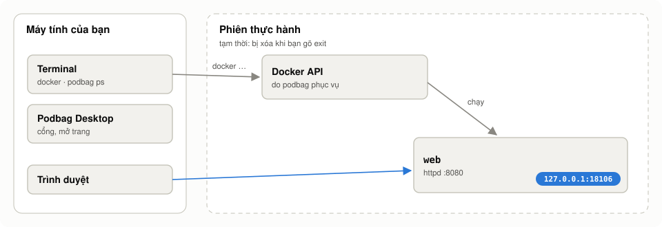

podbag có thể phục vụ Docker Engine API. Lệnh `docker` giao tiếp với API này, nên nó hoạt động với podbag giống như với Docker. Trong mô-đun này, bạn chạy một máy chủ web bằng `docker` và thấy nó trong podbag và trong Desktop.

**Thời gian** 10 phút.



## Bắt đầu mô-đun

Bạn cần bản Podbag Desktop và CLI có danh mục Training. Danh mục này được thêm sau v0.3.2. Bạn cũng cần Docker CLI (lệnh `docker`). Bạn không cần Docker Engine. Các bước dùng Docker CLI chạy được trên Linux và macOS. Trên Windows, Podbag Desktop không hiển thị mô-đun này.

Mở **Training** trong Podbag Desktop và chọn **Dùng Docker CLI với Podbag**. Mô-đun mới xuất hiện sau khi chọn **Làm mới**. Hoặc chạy lệnh này trong terminal:

```sh
podbag lab start docker-cli
```

Tiếp tục tại dấu nhắc `training $`. Trong shell này, `docker` đi tới phiên thực hành. Phiên phục vụ Docker API trên socket riêng và đặt `DOCKER_HOST` trỏ tới socket đó. Các cài đặt docker khác của bạn không thay đổi.

## Hỏi engine về phiên bản

```sh
docker version
```

Kết quả có hai phần. `Client` là lệnh docker. `Server` là engine mà nó giao tiếp. Ở đây, server là `podbag`. Podbag tìm `Server: podbag` trong kết quả.

## Kéo image bằng docker

```sh
docker pull docker.io/library/busybox:1.37.0
```

Lệnh docker yêu cầu podbag kéo image. podbag tải image và giữ nó trong kho riêng. Podbag kiểm tra rằng image `busybox:1.37.0` đã có.

## Chạy máy chủ web bằng docker

Nếu cổng mặc định `18106` đang được dùng, hãy dùng cổng hiển thị trong Training.

```sh
docker run -d --name web -p 127.0.0.1:18106:8080 docker.io/library/busybox:1.37.0 sh -c 'mkdir -p /www && echo "Hello from the Docker CLI" > /www/index.html && exec httpd -f -p 8080 -h /www'
```

Các tùy chọn giống như với `podbag run`. Podbag kiểm tra rằng `web` đang chạy, công bố cổng và hiển thị **Hello from the Docker CLI**.

## Liệt kê container bằng docker

```sh
docker ps
```

Danh sách hiển thị `web` và cổng của nó, `127.0.0.1:18106->8080/tcp`. Podbag tìm `web` trong kết quả.

## Liệt kê cùng các container bằng podbag

```sh
podbag ps
```

podbag hiển thị cùng container đó. Chỉ có một engine, còn `docker` và `podbag` là hai cách để dùng nó. Podbag tìm `web` trong kết quả.

## Mở trang trong Desktop

Đi tới **Container thực hành → web → Xem cổng**. Chọn **Mở trong trình duyệt**. Trang hiển thị **Hello from the Docker CLI**. Podbag kiểm tra phản hồi HTTP 200 và dòng chữ này.

## Dọn dẹp và kết thúc

Dừng và xóa container bằng `docker`. Podbag kiểm tra rằng `web` dừng, rồi kiểm tra rằng nó không còn.

```sh
docker stop web
docker rm web
exit
```

Phiên thực hành tạm thời đã được xóa. Training hiển thị mô-đun đã hoàn thành.

Ngoài Training, `podbag system docker use` trỏ lệnh docker tới podbag, còn `podbag system docker restore` trỏ nó về lại như cũ. Xem phần "Docker API" trong hướng dẫn sử dụng podbag.
