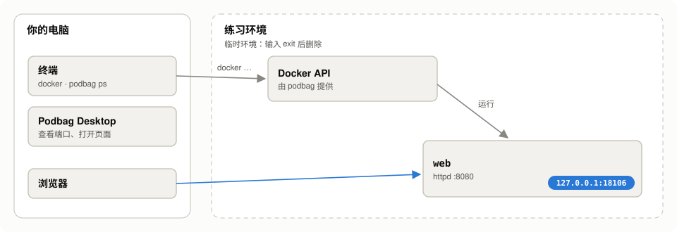

podbag 可以提供 Docker Engine API。`docker` 命令通过这个 API 通信，所以它在 podbag 上的用法与在 Docker 上相同。在本模块中，你将用 `docker` 运行一个 Web 服务器，并在 podbag 和 Desktop 中查看它。

**预计用时** 10 分钟。



## 开始模块

需要带有 Training 目录的 Podbag Desktop 和 CLI 版本。该目录在 v0.3.2 之后加入。还需要 Docker CLI（`docker` 命令）。不需要 Docker Engine。Docker CLI 步骤可在 Linux 和 macOS 上运行。在 Windows 上，Podbag Desktop 不显示此模块。

在 Podbag Desktop 中打开 **Training**，选择**在 Podbag 中使用 Docker CLI**。点击**刷新**后会出现新模块。也可以在终端中运行以下命令：

```sh
podbag lab start docker-cli
```

出现 `training $` 提示符后继续。在这个 shell 中，`docker` 会连接到练习环境。练习环境在自己的套接字上提供 Docker API，并把 `DOCKER_HOST` 设为该套接字。你的其他 docker 设置不会改变。

要在 TUI 而不是 Podbag Desktop 中完成这些步骤，请加上 `--tui`。

```sh
podbag lab start docker-cli --tui
```

在 TUI 中，按 `:` 打开 Training 终端来执行命令步骤，输入 `exit` 返回 TUI，按 `q` 结束实验。

## 查询引擎版本

```sh
docker version
```

输出分为两部分。`Client` 是 docker 命令。`Server` 是它连接的引擎。这里的服务器是 `podbag`。Podbag 会检查输出中是否有 `Server: podbag`。

## 用 docker 拉取镜像

```sh
docker pull docker.io/library/busybox:1.37.0
```

- **在 Podbag Desktop 中：** 选择**实验容器 → 拉取 docker.io/library/busybox:1.37.0**。
- **在 TUI 中：** 打开**镜像**，按 `p`，输入 `docker.io/library/busybox:1.37.0` 并按 `Enter`。

docker 命令请求 podbag 拉取镜像。podbag 下载镜像，并保存在自己的存储中。Podbag 会检查镜像 `busybox:1.37.0` 是否存在。

## 用 docker 运行 Web 服务器

如果默认端口 `18106` 已被占用，请使用 Training 中显示的端口。

```sh
docker run -d --name web -p 127.0.0.1:18106:8080 docker.io/library/busybox:1.37.0 sh -c 'mkdir -p /www && echo "Hello from the Docker CLI" > /www/index.html && exec httpd -f -p 8080 -h /www'
```

选项与 `podbag run` 相同。Podbag 会检查 `web` 是否正在运行、是否发布了端口，以及是否显示 **Hello from the Docker CLI**。

## 用 docker 列出容器

```sh
docker ps
```

列表中显示 `web` 及其端口 `127.0.0.1:18106->8080/tcp`。Podbag 会检查输出中是否有 `web`。

## 用 podbag 列出同样的容器

```sh
podbag ps
```

podbag 显示同一个容器。引擎只有一个，`docker` 和 `podbag` 是使用它的两种方式。Podbag 会检查输出中是否有 `web`。

## 在 Desktop 中打开页面

前往**实验容器 → web → 查看端口**。点击**在浏览器中打开**。页面显示 **Hello from the Docker CLI**。Podbag 会检查 HTTP 200 响应和这段文字。

- **在 Podbag Desktop 中：** 选择**实验容器 → web → 查看端口**。
- **在 TUI 中：** 在**容器**中选择 `web`，然后按 `Enter`。
- **在 Podbag Desktop 中：** 选择**在浏览器中打开**。
- **在 TUI 中：** 在浏览器中打开 `http://127.0.0.1:18106/`。页面显示后按 `o`。

## 清理并结束

用 `docker` 停止并删除容器。Podbag 会先检查 `web` 是否已停止，再检查它是否已删除。

- **在 Podbag Desktop 中：** 选择**实验容器 → web → 停止**。
- **在 TUI 中：** 在**容器**中选择 `web`，然后按 `x`。
- **在 Podbag Desktop 中：** 选择**实验容器 → web → 删除**并确认。
- **在 TUI 中：** 在**容器**中选择 `web`，按 `d`，再按 `y`。

```sh
docker stop web
docker rm web
exit
```

临时练习环境会被删除。Training 会显示该模块已完成。

在 Training 之外，`podbag system docker use` 让 docker 命令连接 podbag，`podbag system docker restore` 则恢复原来的连接。请参阅 podbag 使用指南中的“Docker API”。
