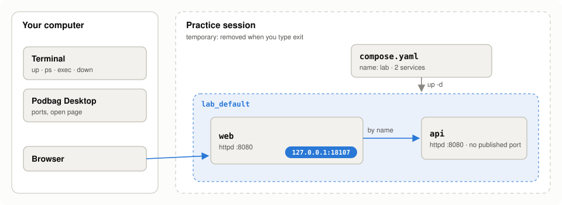

Docker Compose starts several containers from one file, `compose.yaml`. The file says which images to run, which ports to publish and how the containers find each other. In this module, Compose starts a server named `api` and a web server named `web` on podbag.

**Time** 10–15 minutes.



## Start the module

You need a build of Podbag Desktop and the CLI with the Training catalog. It was added after v0.3.2. You also need the Docker CLI and the Docker Compose plugin (`docker compose`). You do not need Docker Engine. The Docker CLI steps work on Linux and macOS. On Windows, Podbag Desktop leaves this module out.

Open **Training** in Podbag Desktop and select **Run two services with Docker Compose**. New modules appear after **Refresh**. Or run this command in a terminal:

```sh
podbag lab start docker-compose
```

Continue at the `training $` prompt.

To do the steps in the TUI instead of Podbag Desktop, add `--tui`.

```sh
podbag lab start docker-compose --tui
```

In the TUI, press `:` to open the training shell for a command step, type `exit` to return to the TUI, and press `q` to end the session.

In this shell, `docker` goes to the practice session's engine. The session puts `compose.yaml` in the practice directory:

```yaml
name: lab
services:
  api:
    image: docker.io/library/busybox:1.37.0
    container_name: api
    command: ["sh", "-c", "mkdir -p /www && echo 'Hello from api' > /www/index.html && exec httpd -f -p 8080 -h /www"]
  web:
    image: docker.io/library/busybox:1.37.0
    container_name: web
    depends_on: [api]
    ports:
      - "127.0.0.1:18107:8080"
    command: ["sh", "-c", "mkdir -p /www && until wget -qO /www/index.html http://api:8080/; do sleep 1; done && exec httpd -f -p 8080 -h /www"]
```

- `name: lab` is the project name. Compose puts it in the names of what it makes, such as the network `lab_default`.
- `container_name` keeps the container names short: `api` and `web`.
- `api` serves `Hello from api` and publishes no port.
- `web` gets the page from `api` and serves a copy on `127.0.0.1:18107`. It tries again each second until `api` answers.

If `18107` is in use when the session starts, Training writes another port into the file and shows it in its commands.

## List the services

```sh
docker compose config --services
```

Compose reads `compose.yaml` and prints the name of each service. Nothing runs yet. Podbag checks for a line `web`.

## Start the services

```sh
docker compose up -d
```

Compose makes the network `lab_default`, then starts `api` and `web` on it. `depends_on` starts `api` first. `-d` returns to the prompt and leaves the containers running. Podbag checks that `web` runs, publishes the port and shows **Hello from api**.

## List the services that run

```sh
docker compose ps
```

The list shows the containers of this project only, with their state and ports. Podbag checks the output for `127.0.0.1:18107->8080/tcp`.

## Call api by name

Run a command in the running `web` container.

```sh
docker compose exec web wget -qO- http://api:8080/
```

Compose put both containers on `lab_default`. podbag adds the name of each container on the network to the others, so `api` leads to the server. Podbag checks that the output is `Hello from api`.

## Open the page in Desktop

Go to **Practice containers → web → View ports**. Select **Open in browser**. The page displays **Hello from api**. Podbag checks for an HTTP 200 response and this text.

- **In Podbag Desktop:** Select **Practice containers → web → View ports**.
- **In the TUI:** Select `web` in **Containers** and press `Enter`.
- **In Podbag Desktop:** Select **Open in browser**.
- **In the TUI:** Open `http://127.0.0.1:18107/` in a browser. When the page shows, press `o`.

## Clean up and finish

```sh
docker compose down
exit
```

`down` stops and removes both containers and the network `lab_default`. Podbag checks that no container is left. Then `exit` removes the temporary practice session. Training shows the module as complete.
