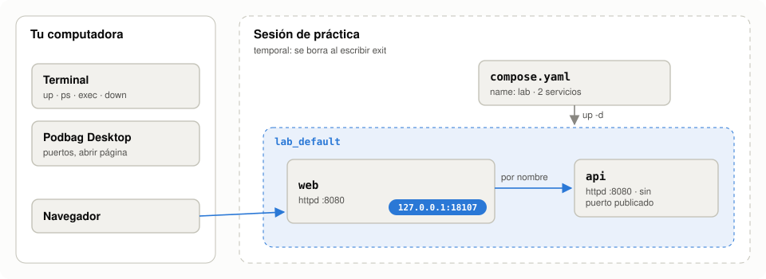

Docker Compose inicia varios contenedores a partir de un archivo, `compose.yaml`. El archivo dice qué imágenes ejecutar, qué puertos publicar y cómo se encuentran los contenedores entre sí. En este módulo, Compose inicia en podbag un servidor llamado `api` y un servidor web llamado `web`.

**Tiempo** 10–15 minutos.



## Inicia el módulo

Necesitas una versión de Podbag Desktop y de la CLI con el catálogo de Training. Se añadió después de v0.3.2. También necesitas la CLI de Docker y el plugin Docker Compose (`docker compose`). No necesitas Docker Engine. Los pasos con la CLI de Docker funcionan en Linux y macOS. En Windows, Podbag Desktop no muestra este módulo.

Abre **Training** en Podbag Desktop y selecciona **Ejecuta dos servicios con Docker Compose**. Los módulos nuevos aparecen después de **Actualizar**. O ejecuta este comando en una terminal:

```sh
podbag lab start docker-compose
```

Continúa en el prompt `training $`.

Para hacer los pasos en la TUI en lugar de Podbag Desktop, añade `--tui`.

```sh
podbag lab start docker-compose --tui
```

En la TUI, pulsa `:` para abrir la shell de Training cuando un paso pida un comando, escribe `exit` para volver a la TUI y pulsa `q` para terminar la sesión.

En esta shell, `docker` va al motor de la sesión de práctica. La sesión pone `compose.yaml` en el directorio de práctica:

```yaml
name: lab
services:
  api:
    image: docker.io/library/busybox:1.37.0
    container_name: api
    command: ["sh", "-c", "mkdir -p /www && echo 'Hello from api' > /www/index.html && exec httpd -f -p 8080 -h /www"]
  web:
    image: docker.io/library/busybox:1.37.0
    container_name: web
    depends_on: [api]
    ports:
      - "127.0.0.1:18107:8080"
    command: ["sh", "-c", "mkdir -p /www && until wget -qO /www/index.html http://api:8080/; do sleep 1; done && exec httpd -f -p 8080 -h /www"]
```

- `name: lab` es el nombre del proyecto. Compose lo pone en los nombres de lo que crea, como la red `lab_default`.
- `container_name` mantiene cortos los nombres de los contenedores: `api` y `web`.
- `api` sirve `Hello from api` y no publica ningún puerto.
- `web` obtiene la página de `api` y sirve una copia en `127.0.0.1:18107`. Lo intenta de nuevo cada segundo hasta que `api` responde.

Si `18107` está en uso cuando se inicia la sesión, Training escribe otro puerto en el archivo y lo muestra en sus comandos.

## Lista los servicios

```sh
docker compose config --services
```

Compose lee `compose.yaml` y muestra el nombre de cada servicio. Todavía no se ejecuta nada. Podbag busca una línea `web`.

## Inicia los servicios

```sh
docker compose up -d
```

Compose crea la red `lab_default` y luego inicia `api` y `web` en ella. `depends_on` inicia `api` primero. `-d` vuelve al prompt y deja los contenedores en ejecución. Podbag comprueba que `web` está en ejecución, publica el puerto y muestra **Hello from api**.

## Lista los servicios en ejecución

```sh
docker compose ps
```

La lista muestra solo los contenedores de este proyecto, con su estado y sus puertos. Podbag busca `127.0.0.1:18107->8080/tcp` en la salida.

## Llama a api por su nombre

Ejecuta un comando en el contenedor `web`, que está en ejecución.

```sh
docker compose exec web wget -qO- http://api:8080/
```

Compose puso los dos contenedores en `lab_default`. podbag da a cada contenedor de la red el nombre de los demás. Así, `api` lleva al servidor. Podbag comprueba que la salida es `Hello from api`.

## Abre la página en Desktop

Ve a **Contenedores de práctica → web → Ver puertos**. Selecciona **Abrir en el navegador**. La página muestra **Hello from api**. Podbag comprueba que hay una respuesta HTTP 200 y este texto.

- **En Podbag Desktop:** Selecciona **Contenedores de práctica → web → Ver puertos**.
- **En la TUI:** Selecciona `web` en **Contenedores** y pulsa `Enter`.
- **En Podbag Desktop:** Selecciona **Abrir en el navegador**.
- **En la TUI:** Abre `http://127.0.0.1:18107/` en un navegador. Cuando se vea la página, pulsa `o`.

## Limpia y termina

```sh
docker compose down
exit
```

`down` detiene y elimina los dos contenedores y la red `lab_default`. Podbag comprueba que no queda ningún contenedor. Luego `exit` elimina la sesión de práctica temporal. Training muestra el módulo como completado.
