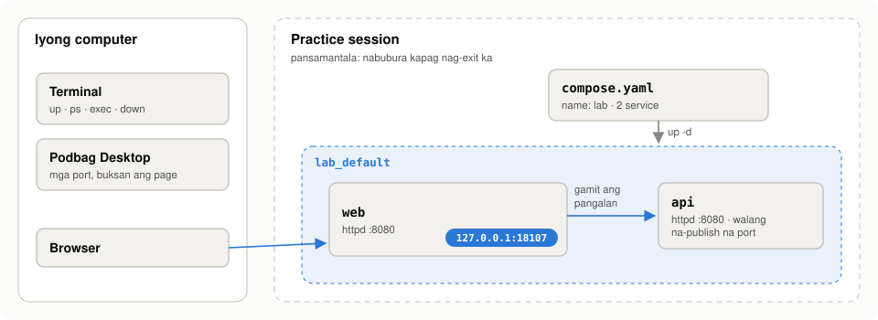

Nagsisimula ang Docker Compose ng ilang container mula sa iisang file, ang `compose.yaml`. Sinasabi ng file kung aling mga image ang patatakbuhin, aling mga port ang ipa-publish, at kung paano mahahanap ng mga container ang isa't isa. Sa module na ito, nagsisimula ang Compose ng server na `api` at ng web server na `web` sa podbag.

**Oras** 10–15 minuto.



## Simulan ang module

Kailangan mo ng build ng Podbag Desktop at ng CLI na may Training catalog. Idinagdag ito pagkatapos ng v0.3.2. Kailangan mo rin ang Docker CLI at ang Docker Compose plugin (`docker compose`). Hindi mo kailangan ang Docker Engine. Gumagana ang mga hakbang ng Docker CLI sa Linux at macOS. Sa Windows, hindi isinasama ng Podbag Desktop ang module na ito.

Buksan ang **Training** sa Podbag Desktop at piliin ang **Magpatakbo ng dalawang service gamit ang Docker Compose**. Lalabas ang mga bagong module pagkatapos ng **I-refresh**. O patakbuhin ang command na ito sa terminal:

```sh
podbag lab start docker-compose
```

Magpatuloy sa prompt na `training $`.

Para gawin ang mga hakbang sa TUI sa halip na sa Podbag Desktop, idagdag ang `--tui`.

```sh
podbag lab start docker-compose --tui
```

Sa TUI, pindutin ang `:` para buksan ang training shell sa isang hakbang na command. I-type ang `exit` para bumalik sa TUI. Pindutin ang `q` para tapusin ang practice session.

Sa shell na ito, papunta sa engine ng practice session ang `docker`. Naglalagay ang session ng `compose.yaml` sa practice directory:

```yaml
name: lab
services:
  api:
    image: docker.io/library/busybox:1.37.0
    container_name: api
    command: ["sh", "-c", "mkdir -p /www && echo 'Hello from api' > /www/index.html && exec httpd -f -p 8080 -h /www"]
  web:
    image: docker.io/library/busybox:1.37.0
    container_name: web
    depends_on: [api]
    ports:
      - "127.0.0.1:18107:8080"
    command: ["sh", "-c", "mkdir -p /www && until wget -qO /www/index.html http://api:8080/; do sleep 1; done && exec httpd -f -p 8080 -h /www"]
```

- Ang `name: lab` ang pangalan ng project. Inilalagay ito ng Compose sa mga pangalan ng ginagawa nito, gaya ng network na `lab_default`.
- Pinapanatiling maikli ng `container_name` ang mga pangalan ng container: `api` at `web`.
- Inihahain ng `api` ang `Hello from api` at wala itong ipina-publish na port.
- Kinukuha ng `web` ang page mula sa `api` at naghahain ito ng kopya sa `127.0.0.1:18107`. Sumusubok ulit ito bawat segundo hanggang sumagot ang `api`.

Kung gamit na ang `18107` pagsisimula ng session, isusulat ng Training ang ibang port sa file at ipapakita ito sa mga command nito.

## Ilista ang mga service

```sh
docker compose config --services
```

Binabasa ng Compose ang `compose.yaml` at ipinapakita ang pangalan ng bawat service. Wala pang tumatakbo. Hinahanap ng Podbag ang linyang `web`.

## Simulan ang mga service

```sh
docker compose up -d
```

Ginagawa ng Compose ang network na `lab_default`, at saka sinisimulan ang `api` at `web` dito. Sinisimulan muna ng `depends_on` ang `api`. Bumabalik sa prompt ang `-d` at iniiwang tumatakbo ang mga container. Sinusuri ng Podbag na tumatakbo ang `web`, nagpa-publish ito ng port at ipinapakita nito ang **Hello from api**.

## Ilista ang mga tumatakbong service

```sh
docker compose ps
```

Ipinapakita lang ng listahan ang mga container ng project na ito, kasama ang state at mga port nila. Hinahanap ng Podbag ang `127.0.0.1:18107->8080/tcp` sa output.

## Tawagin ang api gamit ang pangalan

Magpatakbo ng command sa tumatakbong container na `web`.

```sh
docker compose exec web wget -qO- http://api:8080/
```

Inilagay ng Compose ang dalawang container sa `lab_default`. Idinaragdag ng podbag ang pangalan ng bawat container sa network sa iba pang container. Kaya papunta sa server ang `api`. Sinusuri ng Podbag na `Hello from api` ang output.

## Buksan ang page sa Desktop

Pumunta sa **Mga practice container → web → Tingnan ang mga port**. Piliin ang **Buksan sa browser**. Ipinapakita ng page ang **Hello from api**. Sinusuri ng Podbag kung may tugon na HTTP 200 at ang text na ito.

- **Sa Podbag Desktop:** Piliin ang **Mga practice container → web → Tingnan ang mga port**.
- **Sa TUI:** Piliin ang `web` sa **Mga container** at pindutin ang `Enter`.
- **Sa Podbag Desktop:** Piliin ang **Buksan sa browser**.
- **Sa TUI:** Buksan ang `http://127.0.0.1:18107/` sa browser. Kapag lumabas ang page, pindutin ang `o`.

## Maglinis at tapusin

```sh
docker compose down
exit
```

Inihihinto at inaalis ng `down` ang dalawang container at ang network na `lab_default`. Sinusuri ng Podbag na walang natitirang container. Pagkatapos, inaalis ng `exit` ang pansamantalang practice session. Ipinapakita ng Training na tapos na ang module.
