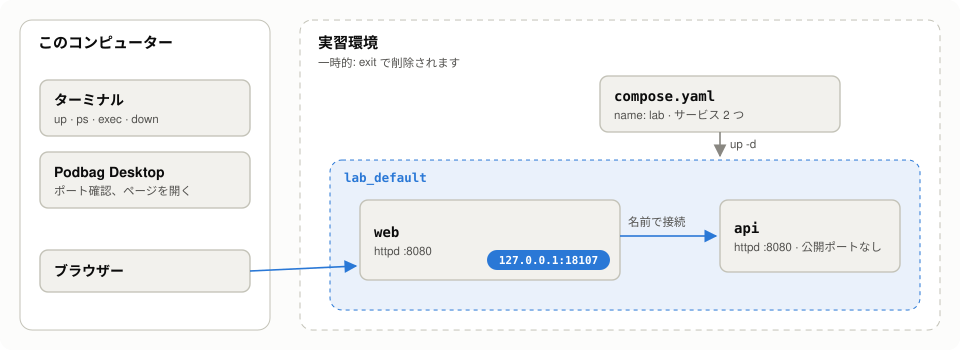

Docker Compose は、1 つのファイル `compose.yaml` から複数のコンテナを起動します。このファイルには、実行するイメージ、公開するポート、コンテナどうしが相手を見つける方法を書きます。このモジュールでは、Compose が podbag 上で `api` というサーバーと `web` という Web サーバーを起動します。

**所要時間** 10〜15 分。



## モジュールを開始する

Training カタログがある Podbag Desktop と CLI のビルドが必要です。カタログは v0.3.2 より後に追加されました。Docker CLI と Docker Compose プラグイン（`docker compose`）も必要です。Docker Engine は必要ありません。Docker CLI の手順は Linux と macOS で動きます。Windows の Podbag Desktop には、このモジュールは表示されません。

Podbag Desktop で **Training** を開き、**Docker Compose で 2 つのサービスを実行する**を選びます。新しいモジュールは**更新**の後に表示されます。ターミナルで次のコマンドを実行しても開始できます。

```sh
podbag lab start docker-compose
```

`training $` プロンプトが表示されたら続けます。このシェルでは、`docker` は実習環境のエンジンに接続します。実習環境は、実習用のディレクトリに `compose.yaml` を置きます。

```yaml
name: lab
services:
  api:
    image: docker.io/library/busybox:1.37.0
    container_name: api
    command: ["sh", "-c", "mkdir -p /www && echo 'Hello from api' > /www/index.html && exec httpd -f -p 8080 -h /www"]
  web:
    image: docker.io/library/busybox:1.37.0
    container_name: web
    depends_on: [api]
    ports:
      - "127.0.0.1:18107:8080"
    command: ["sh", "-c", "mkdir -p /www && until wget -qO /www/index.html http://api:8080/; do sleep 1; done && exec httpd -f -p 8080 -h /www"]
```

- `name: lab` はプロジェクト名です。Compose は、作るものの名前にこれを入れます。たとえば、ネットワーク `lab_default` です。
- `container_name` は、コンテナの名前を `api` と `web` の短い形にします。
- `api` は `Hello from api` を配信し、ポートは公開しません。
- `web` は `api` からページを取得し、そのコピーを `127.0.0.1:18107` で配信します。`api` が応答するまで、1 秒ごとに再試行します。

実習の開始時に `18107` が使われている場合、Training はファイルに別のポートを書き、そのポートをコマンドに表示します。

## サービスを一覧表示する

```sh
docker compose config --services
```

Compose は `compose.yaml` を読み、各サービスの名前を表示します。まだ何も動いていません。Podbag は `web` の行を確認します。

## サービスを起動する

```sh
docker compose up -d
```

Compose はネットワーク `lab_default` を作り、その上で `api` と `web` を起動します。`depends_on` によって `api` が先に起動します。`-d` を付けると、コンテナを動かしたままプロンプトに戻ります。Podbag は、`web` が実行中で、ポートを公開し、**Hello from api** と表示することを確認します。

## 実行中のサービスを一覧表示する

```sh
docker compose ps
```

一覧には、このプロジェクトのコンテナだけが、状態とポートと一緒に表示されます。Podbag は出力に `127.0.0.1:18107->8080/tcp` があることを確認します。

## 名前で api を呼び出す

実行中の `web` コンテナでコマンドを実行します。

```sh
docker compose exec web wget -qO- http://api:8080/
```

Compose は両方のコンテナを `lab_default` に置きました。podbag は、ネットワーク上の各コンテナの名前をほかのコンテナに登録します。そのため、`api` という名前でサーバーに届きます。Podbag は出力が `Hello from api` であることを確認します。

## Desktop でページを開く

**実習コンテナ → web → ポートを表示**に移動します。**ブラウザーで開く**を選びます。ページに **Hello from api** と表示されます。Podbag は、HTTP 200 の応答とこのテキストを確認します。

## 片付けて終了する

```sh
docker compose down
exit
```

`down` は、両方のコンテナとネットワーク `lab_default` を停止して削除します。Podbag は、コンテナが残っていないことを確認します。次に、`exit` が一時的な実習環境を削除します。Training にモジュールの完了が表示されます。
