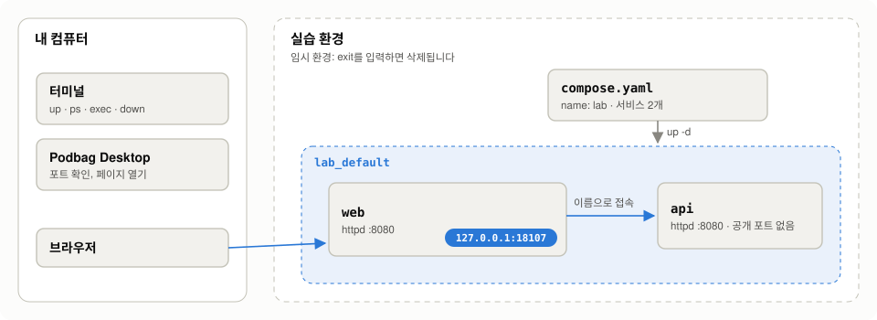

Docker Compose는 파일 하나(`compose.yaml`)로 컨테이너 여러 개를 시작합니다. 이 파일에는 실행할 이미지, 공개할 포트, 컨테이너끼리 찾는 방법을 적습니다. 이번 트레이닝에서는 Compose로 podbag에서 `api` 서버와 `web` 웹 서버를 시작합니다.

**예상 시간** 10~15분.



## 실습 시작

Training 카탈로그가 들어 있는 Podbag Desktop과 CLI가 필요합니다. 이 기능은 v0.3.2 이후에 추가됐습니다. Docker CLI와 Docker Compose 플러그인(`docker compose`)도 필요합니다. Docker Engine은 필요 없습니다. Docker CLI 단계는 Linux와 macOS에서 할 수 있습니다. Windows의 Podbag Desktop은 이 모듈을 목록에 보여 주지 않습니다.

Podbag Desktop에서 **Training**을 열고 **Docker Compose로 서비스 두 개 실행하기**를 선택합니다. 새 모듈은 **새로 고침**을 누르면 나타납니다. 터미널에서 다음 명령을 실행해도 됩니다.

```sh
podbag lab start docker-compose
```

`training $` 프롬프트에서 계속 진행합니다.

Podbag Desktop 대신 TUI에서 실습하려면 `--tui`를 붙입니다.

```sh
podbag lab start docker-compose --tui
```

TUI에서는 `:` 키로 명령 단계용 Training 셸을 열고, `exit`를 입력해 TUI로 돌아오며, `q` 키로 실습을 끝냅니다.

이 셸에서 `docker`는 실습 환경의 엔진으로 연결됩니다. 실습 디렉터리에는 `compose.yaml`이 있습니다.

```yaml
name: lab
services:
  api:
    image: docker.io/library/busybox:1.37.0
    container_name: api
    command: ["sh", "-c", "mkdir -p /www && echo 'Hello from api' > /www/index.html && exec httpd -f -p 8080 -h /www"]
  web:
    image: docker.io/library/busybox:1.37.0
    container_name: web
    depends_on: [api]
    ports:
      - "127.0.0.1:18107:8080"
    command: ["sh", "-c", "mkdir -p /www && until wget -qO /www/index.html http://api:8080/; do sleep 1; done && exec httpd -f -p 8080 -h /www"]
```

- `name: lab`은 프로젝트 이름입니다. Compose는 만드는 것의 이름에 이 이름을 붙입니다. 예를 들어 네트워크 이름은 `lab_default`입니다.
- `container_name`은 컨테이너 이름을 `api`와 `web`으로 짧게 정합니다.
- `api`는 `Hello from api`를 제공하고 포트를 공개하지 않습니다.
- `web`은 `api`에서 페이지를 받아 `127.0.0.1:18107`로 제공합니다. `api`가 응답할 때까지 1초마다 다시 시도합니다.

실습을 시작할 때 `18107`이 사용 중이면 Training이 다른 포트를 파일에 적고, 명령에도 그 포트를 보여 줍니다.

## 서비스 목록 보기

```sh
docker compose config --services
```

Compose는 `compose.yaml`을 읽고 서비스 이름을 하나씩 출력합니다. 아직 아무것도 실행하지 않습니다. Podbag은 `web` 줄이 있는지 확인합니다.

## 서비스 시작하기

```sh
docker compose up -d
```

Compose는 `lab_default` 네트워크를 만들고 그 위에 `api`와 `web`을 시작합니다. `depends_on` 때문에 `api`가 먼저 시작합니다. `-d`는 컨테이너를 실행한 채로 프롬프트로 돌아옵니다. Podbag은 `web`이 실행 중인지, 포트를 공개했는지, **Hello from api**를 보여 주는지 확인합니다.

## 실행 중인 서비스 보기

```sh
docker compose ps
```

이 프로젝트의 컨테이너만 상태, 포트와 함께 표시됩니다. Podbag은 출력에 `127.0.0.1:18107->8080/tcp`가 있는지 확인합니다.

## 이름으로 api 호출하기

실행 중인 `web` 컨테이너 안에서 명령을 실행합니다.

```sh
docker compose exec web wget -qO- http://api:8080/
```

Compose는 두 컨테이너를 `lab_default`에 연결했습니다. podbag은 네트워크에 있는 각 컨테이너의 이름을 다른 컨테이너에 알려 주므로 `api`로 서버에 접속할 수 있습니다. Podbag은 출력이 `Hello from api`인지 확인합니다.

## Desktop에서 페이지 열기

**실습 컨테이너 → web → 포트 보기**로 이동합니다. **브라우저에서 열기**를 선택합니다. 페이지에 **Hello from api**가 표시됩니다. Podbag은 HTTP 200 응답과 이 문구를 확인합니다.

- **Podbag Desktop에서:** **실습 컨테이너 → web → 포트 보기**를 누릅니다.
- **TUI에서:** **컨테이너**에서 `web` 선택 후 `Enter` 키를 누릅니다.
- **Podbag Desktop에서:** **브라우저에서 열기**를 누릅니다.
- **TUI에서:** 브라우저에서 `http://127.0.0.1:18107/` 주소를 엽니다. 페이지가 보이면 `o` 키를 누릅니다.

## 정리 및 실습 종료

```sh
docker compose down
exit
```

`down`은 두 컨테이너를 중지하고 삭제합니다. `lab_default` 네트워크도 삭제합니다. Podbag은 남은 컨테이너가 없는지 확인합니다. 그다음 `exit`로 임시 실습 환경을 삭제합니다. Training에 모듈이 완료됨으로 표시됩니다.
