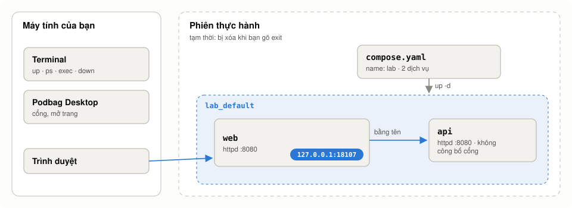

Docker Compose chạy nhiều container từ một tệp, `compose.yaml`. Tệp này cho biết cần chạy image nào, công bố cổng nào và các container tìm thấy nhau bằng cách nào. Trong mô-đun này, Compose chạy một máy chủ tên `api` và một máy chủ web tên `web` trên podbag.

**Thời gian** 10–15 phút.



## Bắt đầu mô-đun

Bạn cần bản Podbag Desktop và CLI có danh mục Training. Danh mục này được thêm sau v0.3.2. Bạn cũng cần Docker CLI và plugin Docker Compose (`docker compose`). Bạn không cần Docker Engine. Các bước dùng Docker CLI chạy được trên Linux và macOS. Trên Windows, Podbag Desktop không hiển thị mô-đun này.

Mở **Training** trong Podbag Desktop và chọn **Chạy hai dịch vụ bằng Docker Compose**. Mô-đun mới xuất hiện sau khi chọn **Làm mới**. Hoặc chạy lệnh này trong terminal:

```sh
podbag lab start docker-compose
```

Tiếp tục tại dấu nhắc `training $`. Trong shell này, `docker` đi tới engine của phiên thực hành. Phiên đặt `compose.yaml` vào thư mục thực hành:

```yaml
name: lab
services:
  api:
    image: docker.io/library/busybox:1.37.0
    container_name: api
    command: ["sh", "-c", "mkdir -p /www && echo 'Hello from api' > /www/index.html && exec httpd -f -p 8080 -h /www"]
  web:
    image: docker.io/library/busybox:1.37.0
    container_name: web
    depends_on: [api]
    ports:
      - "127.0.0.1:18107:8080"
    command: ["sh", "-c", "mkdir -p /www && until wget -qO /www/index.html http://api:8080/; do sleep 1; done && exec httpd -f -p 8080 -h /www"]
```

- `name: lab` là tên dự án. Compose đặt tên này vào tên của những gì nó tạo ra, ví dụ mạng `lab_default`.
- `container_name` giữ tên container ngắn gọn: `api` và `web`.
- `api` phục vụ `Hello from api` và không công bố cổng nào.
- `web` lấy trang từ `api` và phục vụ một bản sao tại `127.0.0.1:18107`. Nó thử lại mỗi giây cho đến khi `api` trả lời.

Nếu `18107` đang được dùng khi phiên bắt đầu, Training ghi một cổng khác vào tệp và hiển thị cổng đó trong các lệnh.

## Liệt kê các dịch vụ

```sh
docker compose config --services
```

Compose đọc `compose.yaml` và in tên của từng dịch vụ. Chưa có gì chạy. Podbag tìm một dòng `web`.

## Chạy các dịch vụ

```sh
docker compose up -d
```

Compose tạo mạng `lab_default`, rồi chạy `api` và `web` trong mạng đó. `depends_on` cho `api` chạy trước. `-d` trả về dấu nhắc và để các container tiếp tục chạy. Podbag kiểm tra rằng `web` đang chạy, công bố cổng và hiển thị **Hello from api**.

## Liệt kê các dịch vụ đang chạy

```sh
docker compose ps
```

Danh sách chỉ hiển thị các container của dự án này, kèm trạng thái và cổng. Podbag tìm `127.0.0.1:18107->8080/tcp` trong kết quả.

## Gọi api bằng tên

Chạy một lệnh trong container `web` đang chạy.

```sh
docker compose exec web wget -qO- http://api:8080/
```

Compose đặt cả hai container vào `lab_default`. podbag cho mỗi container trong mạng biết tên của các container khác. Vì vậy, `api` dẫn tới máy chủ. Podbag kiểm tra rằng kết quả là `Hello from api`.

## Mở trang trong Desktop

Đi tới **Container thực hành → web → Xem cổng**. Chọn **Mở trong trình duyệt**. Trang hiển thị **Hello from api**. Podbag kiểm tra phản hồi HTTP 200 và dòng chữ này.

## Dọn dẹp và kết thúc

```sh
docker compose down
exit
```

`down` dừng và xóa cả hai container và mạng `lab_default`. Podbag kiểm tra rằng không còn container nào. Sau đó `exit` xóa phiên thực hành tạm thời. Training hiển thị mô-đun đã hoàn thành.
