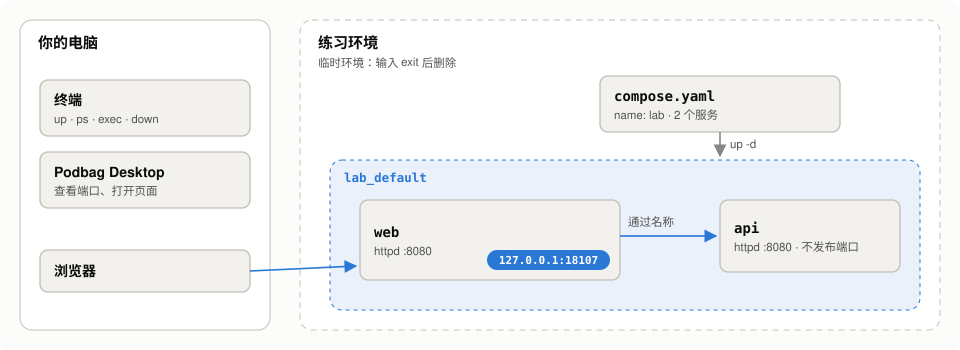

Docker Compose 用一个文件 `compose.yaml` 启动多个容器。这个文件说明要运行哪些镜像、发布哪些端口，以及容器如何找到彼此。在本模块中，Compose 在 podbag 上启动一个名为 `api` 的服务器和一个名为 `web` 的 Web 服务器。

**预计用时** 10–15 分钟。



## 开始模块

需要带有 Training 目录的 Podbag Desktop 和 CLI 版本。该目录在 v0.3.2 之后加入。还需要 Docker CLI 和 Docker Compose 插件（`docker compose`）。不需要 Docker Engine。Docker CLI 步骤可在 Linux 和 macOS 上运行。在 Windows 上，Podbag Desktop 不显示此模块。

在 Podbag Desktop 中打开 **Training**，选择**用 Docker Compose 运行两个服务**。点击**刷新**后会出现新模块。也可以在终端中运行以下命令：

```sh
podbag lab start docker-compose
```

出现 `training $` 提示符后继续。在这个 shell 中，`docker` 会连接到练习环境的引擎。实验会在练习目录中放入 `compose.yaml`：

```yaml
name: lab
services:
  api:
    image: docker.io/library/busybox:1.37.0
    container_name: api
    command: ["sh", "-c", "mkdir -p /www && echo 'Hello from api' > /www/index.html && exec httpd -f -p 8080 -h /www"]
  web:
    image: docker.io/library/busybox:1.37.0
    container_name: web
    depends_on: [api]
    ports:
      - "127.0.0.1:18107:8080"
    command: ["sh", "-c", "mkdir -p /www && until wget -qO /www/index.html http://api:8080/; do sleep 1; done && exec httpd -f -p 8080 -h /www"]
```

- `name: lab` 是项目名称。Compose 会把它放进所创建资源的名称中，例如网络 `lab_default`。
- `container_name` 让容器名称保持简短：`api` 和 `web`。
- `api` 提供 `Hello from api`，不发布端口。
- `web` 从 `api` 获取页面，并在 `127.0.0.1:18107` 上提供一份副本。在 `api` 响应之前，它每秒重试一次。

如果实验开始时 `18107` 已被占用，Training 会把另一个端口写入文件，并在命令中显示该端口。

## 列出服务

```sh
docker compose config --services
```

Compose 读取 `compose.yaml`，打印每个服务的名称。此时还没有运行任何内容。Podbag 会检查是否有 `web` 这一行。

## 启动服务

```sh
docker compose up -d
```

Compose 创建网络 `lab_default`，然后在其中启动 `api` 和 `web`。`depends_on` 让 `api` 先启动。`-d` 让命令返回提示符，容器继续运行。Podbag 会检查 `web` 是否正在运行、是否发布了端口，以及是否显示 **Hello from api**。

## 列出正在运行的服务

```sh
docker compose ps
```

列表只显示这个项目的容器，包括状态和端口。Podbag 会检查输出中是否有 `127.0.0.1:18107->8080/tcp`。

## 通过名称调用 api

在正在运行的 `web` 容器中运行一条命令。

```sh
docker compose exec web wget -qO- http://api:8080/
```

Compose 把两个容器都放在 `lab_default` 中。podbag 会把网络中每个容器的名称告诉其他容器，所以 `api` 会指向该服务器。Podbag 会检查输出是否为 `Hello from api`。

## 在 Desktop 中打开页面

前往**实验容器 → web → 查看端口**。点击**在浏览器中打开**。页面显示 **Hello from api**。Podbag 会检查 HTTP 200 响应和这段文字。

## 清理并结束

```sh
docker compose down
exit
```

`down` 会停止并删除两个容器和网络 `lab_default`。Podbag 会检查是否已没有容器。然后 `exit` 删除临时练习环境。Training 会显示该模块已完成。
