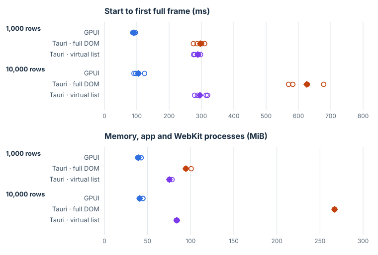

Podbag Desktop is a Tauri 2 app. Its interface is HTML, CSS and JavaScript in the system WebView. [GPUI](https://github.com/zed-industries/zed/tree/main/crates/gpui) is the Rust UI framework of the Zed editor. It draws the interface on the GPU without a WebView. We built the same screen with both and measured them.

## What we built

Each prototype shows a sidebar, a search box and a Containers table with name, image, state, ports and age. The rows are generated, so both apps show the same data. Typing in the search box filters all columns.

- **GPUI**: `uniform_list` draws only the visible rows.
- **Tauri · full DOM**: JavaScript creates a table row for every container. Podbag Desktop renders its lists this way today.
- **Tauri · virtual list**: JavaScript keeps only the visible rows in the page.

Both apps use the same window size and Podbag Desktop's release profile. Each app prints one line when the first frame with the full table is on screen. A script starts the app, waits for that line, waits 3 seconds, reads memory, and measures CPU for 10 seconds. It then types `web-0004` into the search box through standard input.

Apple M5 · 24 GB · macOS 27.2.1 · Rust 1.96.0 · gpui 0.2.2 (`runtime_shaders`) · Tauri 2.12.7 · five warm runs per case, medians

## Results

| 1,000 rows | GPUI | Tauri · full DOM | Tauri · virtual list |
|---|---:|---:|---:|
| Start to first full frame | {{n:91}} ms | {{n:296}} ms | {{n:289}} ms |
| Memory, app and WebKit processes | {{n:39.4}} MiB | {{n:94.5}} MiB | {{n:75.4}} MiB |
| Render the rows | {{n:19}} ms | {{n:49}} ms | {{n:44}} ms |
| Filter to 2 rows | {{n:11}} ms | {{n:19}} ms | {{n:12}} ms |

| 10,000 rows | GPUI | Tauri · full DOM | Tauri · virtual list |
|---|---:|---:|---:|
| Start to first full frame | {{n:105}} ms | {{n:626}} ms | {{n:295}} ms |
| Memory, app and WebKit processes | {{n:40.9}} MiB | {{n:266.9}} MiB | {{n:83.9}} MiB |
| Render the rows | {{n:20}} ms | {{n:344}} ms | {{n:41}} ms |
| Filter to 2 rows | {{n:13}} ms | {{n:38}} ms | {{n:16}} ms |

GPUI started about three times faster and used about half the memory of the Tauri virtual list. Its numbers barely changed between 1,000 and 10,000 rows. The full-DOM Tauri page slowed down and grew with the row count. A virtual list kept Tauri's startup and memory almost flat. The WebKit processes still added about 45 MiB. Memory is the physical footprint of the app process and the `com.apple.WebKit.*` services that start with it.

At 1,000 and 10,000 rows, Tauri used less CPU at rest: at most {{n:0.2}}%, against {{n:0.5}}–{{n:0.6}}% for GPUI. A blinking caret changes this. With the search box focused, WebKit's caret raised Tauri's idle CPU to about {{n:3}}% and its GPU process from about {{n:15}} MiB to {{n:57}} MiB. The caret in our GPUI search box does not blink, so the tables compare both apps without focus.

## Size and build

| Release build | GPUI | Tauri |
|---|---:|---:|
| Binary | {{n:2.7}} MB | {{n:3.4}} MB |
| Clean build | {{n:53}} s | {{n:43}} s |
| Crates in the dependency tree | {{n:452}} | {{n:220}} |
| Prototype source | {{n:1121}} lines | {{n:392}} lines |

The GPUI binary carries its own renderer. Tauri relies on the WebView that macOS ships. More than half of the GPUI source is the search box. GPUI 0.2.2 has no ready text field, so we adapted the input example from the GPUI repository. It handles IME composition through GPUI's input handler.

## What it means for Podbag Desktop

- GPUI started faster, drew faster and used less memory. Tauri used less CPU at rest.
- Moving would mean rewriting about {{n:4600}} lines of interface code (JavaScript, HTML and CSS), the string files in seven languages ({{n:422}} lines each) and about {{n:1000}} lines of browser-based UI tests.
- GPUI 0.2.2 has platform code for macOS, Linux and Windows. We tested macOS only.
- The GPUI API is still pre-1.0, and its documentation is mostly the Zed source and examples.

The cheapest gain is inside the current app. A virtual list cut the 10,000-row startup from {{n:626}} ms to {{n:295}} ms and memory from {{n:266.9}} MiB to {{n:83.9}} MiB. We will keep watching GPUI, especially for a stable API.

## Limits

These are two small prototypes on one Mac, not two finished apps. Render and filter times come from inside each app, from the moment the rows reach the interface layer until the next frame. In Tauri this excludes moving the rows from Rust to JavaScript. The start-to-frame time is measured from outside and includes everything. We did not measure Linux, Windows, scrolling smoothness, or long sessions.

## Reproduce the run

[Benchmark script](run.py) · [Summary script](summary.py) · [Per-run data](results.json) · [Versions and commands](reproduce.txt) · [Prototype source](prototypes.tar.gz)

[GPUI](https://github.com/zed-industries/zed/tree/main/crates/gpui) · [Tauri](https://tauri.app/)
