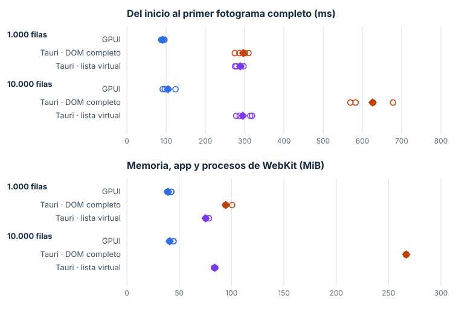

Podbag Desktop es una app de Tauri 2. Su interfaz es HTML, CSS y JavaScript dentro del WebView del sistema. [GPUI](https://github.com/zed-industries/zed/tree/main/crates/gpui) es el framework de interfaz en Rust del editor Zed. Dibuja la interfaz con la GPU, sin WebView. Creamos la misma pantalla con los dos y la medimos.

## Qué construimos

Cada prototipo muestra una barra lateral, un cuadro de búsqueda y una tabla de contenedores con nombre, imagen, estado, puertos y antigüedad. Las filas son generadas, así que las dos apps muestran los mismos datos. Al escribir en el cuadro de búsqueda se filtran todas las columnas.

- **GPUI**: `uniform_list` dibuja solo las filas visibles.
- **Tauri · DOM completo**: JavaScript crea una fila por contenedor. Así dibuja hoy sus listas Podbag Desktop.
- **Tauri · lista virtual**: JavaScript mantiene en la página solo las filas visibles.

Las dos apps usan el mismo tamaño de ventana y el perfil release de Podbag Desktop. Cada app imprime una línea cuando el primer fotograma con la tabla completa está en pantalla. Un script inicia la app, espera esa línea, espera 3 segundos, lee la memoria y mide la CPU durante 10 segundos. Después escribe `web-0004` en el cuadro de búsqueda por la entrada estándar.

Apple M5 · 24 GB · macOS 27.2.1 · Rust 1.96.0 · gpui 0.2.2 (`runtime_shaders`) · Tauri 2.12.7 · cinco ejecuciones en caliente por caso, medianas

## Resultados

| 1.000 filas | GPUI | Tauri · DOM completo | Tauri · lista virtual |
|---|---:|---:|---:|
| Del inicio al primer fotograma completo | {{n:91}} ms | {{n:296}} ms | {{n:289}} ms |
| Memoria, app y procesos de WebKit | {{n:39.4}} MiB | {{n:94.5}} MiB | {{n:75.4}} MiB |
| Dibujar las filas | {{n:19}} ms | {{n:49}} ms | {{n:44}} ms |
| Filtrar a 2 filas | {{n:11}} ms | {{n:19}} ms | {{n:12}} ms |

| 10.000 filas | GPUI | Tauri · DOM completo | Tauri · lista virtual |
|---|---:|---:|---:|
| Del inicio al primer fotograma completo | {{n:105}} ms | {{n:626}} ms | {{n:295}} ms |
| Memoria, app y procesos de WebKit | {{n:40.9}} MiB | {{n:266.9}} MiB | {{n:83.9}} MiB |
| Dibujar las filas | {{n:20}} ms | {{n:344}} ms | {{n:41}} ms |
| Filtrar a 2 filas | {{n:13}} ms | {{n:38}} ms | {{n:16}} ms |

GPUI arrancó unas tres veces más rápido y usó cerca de la mitad de la memoria que la lista virtual de Tauri. Sus cifras casi no cambiaron entre 1.000 y 10.000 filas. La página de Tauri con DOM completo se volvió más lenta y más grande con más filas. Una lista virtual en la misma app de Tauri mantuvo el inicio y la memoria casi constantes. Los procesos de WebKit siguen sumando unos 45 MiB. La memoria es la huella física del proceso de la app y de los servicios `com.apple.WebKit.*` que se inician con ella.

Con 1.000 y 10.000 filas, Tauri usó menos CPU en reposo: como máximo {{n:0.2}} %, frente a {{n:0.5}}–{{n:0.6}} % de GPUI. Un cursor que parpadea cambia esto. Con el foco en el cuadro de búsqueda, el cursor de WebKit subió la CPU en reposo de Tauri a cerca del {{n:3}} % y su proceso de GPU de unos {{n:15}} MiB a {{n:57}} MiB. El cursor de nuestro cuadro de búsqueda en GPUI no parpadea, así que las tablas comparan las dos apps sin foco.

## Tamaño y compilación

| Compilación release | GPUI | Tauri |
|---|---:|---:|
| Binario | {{n:2.7}} MB | {{n:3.4}} MB |
| Compilación limpia | {{n:53}} s | {{n:43}} s |
| Crates en el árbol de dependencias | {{n:452}} | {{n:220}} |
| Código del prototipo | {{n:1121}} líneas | {{n:392}} líneas |

El binario de GPUI lleva su propio renderizador. Tauri usa el WebView que incluye macOS. Más de la mitad del código de GPUI es el cuadro de búsqueda. gpui 0.2.2 no trae un campo de texto listo, así que adaptamos el ejemplo de entrada del repositorio de GPUI. La composición de IME pasa por el manejador de entrada de GPUI.

## Qué significa para Podbag Desktop

- GPUI arrancó y dibujó más rápido y usó menos memoria. Tauri usó menos CPU en reposo.
- Cambiar supondría reescribir unas 10.000 líneas de interfaz, los archivos de textos en siete idiomas y las pruebas de interfaz basadas en navegador.
- gpui 0.2.2 tiene código de plataforma para macOS, Linux y Windows. Solo probamos macOS.
- No encontramos soporte para lectores de pantalla en gpui 0.2.2. Hoy Podbag Desktop obtiene su accesibilidad de WebKit.
- La API de GPUI sigue antes de la 1.0, y su documentación es sobre todo el código y los ejemplos de Zed.

La mejora más barata está en la app actual. Una lista virtual bajó el inicio con 10.000 filas de {{n:626}} ms a {{n:295}} ms, y la memoria de {{n:266.9}} MiB a {{n:83.9}} MiB. Seguiremos de cerca GPUI, sobre todo su accesibilidad y una API estable.

## Límites

Son dos prototipos pequeños en un solo Mac, no dos apps terminadas. Los tiempos de dibujo y filtrado se miden dentro de cada app, desde que las filas llegan a la capa de interfaz hasta el siguiente fotograma. En Tauri no incluyen el paso de las filas de Rust a JavaScript. El tiempo hasta el primer fotograma se mide desde fuera e incluye todo. No medimos Linux, Windows, la suavidad del desplazamiento ni sesiones largas.

## Reproducir la prueba

[Script de la prueba](run.py) · [Script de resumen](summary.py) · [Datos por ejecución](results.json) · [Versiones y comandos](reproduce.txt) · [Código de los prototipos](prototypes.tar.gz)

[GPUI](https://github.com/zed-industries/zed/tree/main/crates/gpui) · [Tauri](https://tauri.app/)
