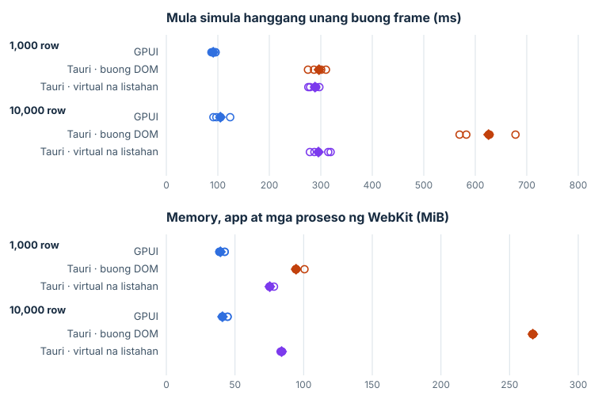

Ang Podbag Desktop ay isang Tauri 2 app. Ang interface nito ay HTML, CSS at JavaScript sa loob ng WebView ng system. Ang [GPUI](https://github.com/zed-industries/zed/tree/main/crates/gpui) ay ang Rust UI framework ng Zed editor. Iginuguhit nito ang interface gamit ang GPU, nang walang WebView. Ginawa namin ang parehong screen sa dalawa at sinukat ang mga ito.

## Ang ginawa namin

Bawat prototype ay may sidebar, search box at Containers table na may pangalan, image, estado, port at edad. Gawa-gawa ang mga row, kaya pareho ang datos na ipinapakita ng dalawang app. Kapag nag-type sa search box, sinasala ang lahat ng column.

- **GPUI**: ang `uniform_list` ay gumuguhit lamang ng mga row na nakikita.
- **Tauri · buong DOM**: gumagawa ang JavaScript ng isang row para sa bawat container. Ganito iginuguhit ng Podbag Desktop ang mga listahan nito ngayon.
- **Tauri · virtual na listahan**: ang mga row na nakikita lamang ang iniiwan ng JavaScript sa page.

Pareho ang laki ng window at ang release profile ng Podbag Desktop sa dalawang app. Bawat app ay nagpi-print ng isang linya kapag nasa screen na ang unang frame na may buong table. Pinapatakbo ng isang script ang app, hinihintay ang linyang iyon, naghihintay ng 3 segundo, binabasa ang memory, at sinusukat ang CPU sa loob ng 10 segundo. Pagkatapos, tina-type nito ang `web-0004` sa search box sa pamamagitan ng standard input.

Apple M5 · 24 GB · macOS 27.2.1 · Rust 1.96.0 · gpui 0.2.2 (`runtime_shaders`) · Tauri 2.12.7 · limang warm run bawat kaso, median

## Mga resulta

| 1,000 row | GPUI | Tauri · buong DOM | Tauri · virtual na listahan |
|---|---:|---:|---:|
| Mula simula hanggang unang buong frame | {{n:91}} ms | {{n:296}} ms | {{n:289}} ms |
| Memory, app at mga proseso ng WebKit | {{n:39.4}} MiB | {{n:94.5}} MiB | {{n:75.4}} MiB |
| Pagguhit ng mga row | {{n:19}} ms | {{n:49}} ms | {{n:44}} ms |
| Pagsala hanggang 2 row | {{n:11}} ms | {{n:19}} ms | {{n:12}} ms |

| 10,000 row | GPUI | Tauri · buong DOM | Tauri · virtual na listahan |
|---|---:|---:|---:|
| Mula simula hanggang unang buong frame | {{n:105}} ms | {{n:626}} ms | {{n:295}} ms |
| Memory, app at mga proseso ng WebKit | {{n:40.9}} MiB | {{n:266.9}} MiB | {{n:83.9}} MiB |
| Pagguhit ng mga row | {{n:20}} ms | {{n:344}} ms | {{n:41}} ms |
| Pagsala hanggang 2 row | {{n:13}} ms | {{n:38}} ms | {{n:16}} ms |

Halos tatlong beses na mas mabilis nagsimula ang GPUI, at halos kalahati lamang ng memory ng virtual na listahan ng Tauri ang ginamit nito. Halos hindi nagbago ang mga numero nito mula 1,000 hanggang 10,000 row. Ang Tauri page na may buong DOM ay bumagal at lumaki habang dumarami ang row. Sa parehong Tauri app, halos hindi nagbago ang pagsisimula at memory nang gumamit ng virtual na listahan. Nagdadagdag pa rin ng mga 45 MiB ang mga proseso ng WebKit. Ang memory ay ang physical footprint ng proseso ng app at ng mga serbisyong `com.apple.WebKit.*` na nagsisimula kasama nito.

Sa 1,000 at 10,000 row, mas kaunting CPU ang ginamit ng Tauri habang idle: hanggang {{n:0.2}}% lamang, kumpara sa {{n:0.5}}–{{n:0.6}}% ng GPUI. Nagbabago ito kapag kumikislap ang cursor. Kapag naka-focus ang search box, itinaas ng kumikislap na cursor ng WebKit ang idle CPU ng Tauri sa mga {{n:3}}% at ang GPU process nito mula mga {{n:15}} MiB hanggang {{n:57}} MiB. Hindi kumikislap ang cursor sa aming GPUI search box, kaya inihahambing ng mga table ang dalawang app nang walang focus.

## Laki at build

| Release build | GPUI | Tauri |
|---|---:|---:|
| Binary | {{n:2.7}} MB | {{n:3.4}} MB |
| Malinis na build | {{n:53}} s | {{n:43}} s |
| Mga crate sa dependency tree | {{n:452}} | {{n:220}} |
| Code ng prototype | {{n:1121}} linya | {{n:392}} linya |

May sariling renderer ang GPUI binary. Ginagamit ng Tauri ang WebView na kasama ng macOS. Mahigit kalahati ng GPUI code ay ang search box. Walang handang text field ang gpui 0.2.2, kaya inangkop namin ang input example mula sa GPUI repository. Dumadaan ang IME composition sa input handler ng GPUI.

## Ano ang ibig sabihin nito para sa Podbag Desktop

- Mas mabilis nagsimula at gumuhit ang GPUI at mas kaunti ang memory nito. Mas kaunting CPU ang ginamit ng Tauri habang idle.
- Kapag lumipat, kailangang isulat muli ang mga 10,000 linya ng interface code, ang mga string file sa pitong wika, at ang mga UI test na tumatakbo sa browser.
- May platform code ang gpui 0.2.2 para sa macOS, Linux at Windows. macOS lamang ang sinubukan namin.
- Wala kaming nakitang suporta para sa screen reader sa gpui 0.2.2. Sa ngayon, nakukuha ng Podbag Desktop ang accessibility nito mula sa WebKit.
- Bago pa sa 1.0 ang GPUI API, at ang dokumentasyon ay karamihan ang source at mga example ng Zed.

Nasa kasalukuyang app ang pinakamurang pagbuti. Ibinaba ng virtual na listahan ang pagsisimula sa 10,000 row mula {{n:626}} ms hanggang {{n:295}} ms, at ang memory mula {{n:266.9}} MiB hanggang {{n:83.9}} MiB. Patuloy naming babantayan ang GPUI, lalo na ang accessibility at isang matatag na API.

## Mga limitasyon

Dalawang maliit na prototype ito sa iisang Mac, hindi dalawang tapos na app. Sinusukat sa loob ng bawat app ang oras ng pagguhit at pagsala, mula nang dumating ang mga row sa interface layer hanggang sa susunod na frame. Sa Tauri, hindi kasama rito ang paglipat ng mga row mula Rust papuntang JavaScript. Sinusukat mula sa labas ang oras hanggang sa unang frame at kasama na ang lahat. Hindi namin sinukat ang Linux, Windows, kinis ng pag-scroll, o mahahabang session.

## Ulitin ang sukat

[Benchmark script](run.py) · [Summary script](summary.py) · [Datos ng bawat run](results.json) · [Mga bersyon at command](reproduce.txt) · [Source ng mga prototype](prototypes.tar.gz)

[GPUI](https://github.com/zed-industries/zed/tree/main/crates/gpui) · [Tauri](https://tauri.app/)
