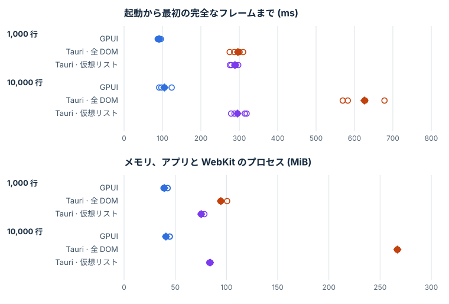

Podbag Desktop は Tauri 2 のアプリです。画面はシステムの WebView 上の HTML、CSS、JavaScript です。[GPUI](https://github.com/zed-industries/zed/tree/main/crates/gpui) は Zed エディターの Rust UI フレームワークです。WebView を使わず GPU で画面を描きます。同じ画面を両方で作り、測定しました。

## 作ったもの

どちらのプロトタイプも、サイドバー、検索ボックス、コンテナの表を表示します。表には名前、イメージ、状態、ポート、作成時刻があります。行は生成したデータなので、両方のアプリが同じ内容を表示します。検索ボックスに入力すると、すべての列を対象に絞り込みます。

- **GPUI**: `uniform_list` が見えている行だけを描きます。
- **Tauri · 全 DOM**: JavaScript がコンテナごとに表の行を作ります。今の Podbag Desktop はこの方法でリストを描いています。
- **Tauri · 仮想リスト**: JavaScript が見えている行だけをページに置きます。

両方のアプリは同じウィンドウサイズと Podbag Desktop の release 設定を使います。各アプリは、表全体を含む最初のフレームが画面に出ると 1 行を出力します。スクリプトはアプリを起動し、その行を待ちます。3 秒後にメモリを読み、10 秒間 CPU を測ります。そのあと標準入力から検索ボックスに `web-0004` を入力します。

Apple M5 · 24 GB · macOS 27.2.1 · Rust 1.96.0 · gpui 0.2.2 (`runtime_shaders`) · Tauri 2.12.7 · 条件ごとにウォームアップ後 5 回、中央値

## 結果

| 1,000 行 | GPUI | Tauri · 全 DOM | Tauri · 仮想リスト |
|---|---:|---:|---:|
| 起動から最初の完全なフレームまで | {{n:91}} ms | {{n:296}} ms | {{n:289}} ms |
| メモリ (アプリと WebKit のプロセス) | {{n:39.4}} MiB | {{n:94.5}} MiB | {{n:75.4}} MiB |
| 行の描画 | {{n:19}} ms | {{n:49}} ms | {{n:44}} ms |
| 2 行への絞り込み | {{n:11}} ms | {{n:19}} ms | {{n:12}} ms |

| 10,000 行 | GPUI | Tauri · 全 DOM | Tauri · 仮想リスト |
|---|---:|---:|---:|
| 起動から最初の完全なフレームまで | {{n:105}} ms | {{n:626}} ms | {{n:295}} ms |
| メモリ (アプリと WebKit のプロセス) | {{n:40.9}} MiB | {{n:266.9}} MiB | {{n:83.9}} MiB |
| 行の描画 | {{n:20}} ms | {{n:344}} ms | {{n:41}} ms |
| 2 行への絞り込み | {{n:13}} ms | {{n:38}} ms | {{n:16}} ms |

GPUI は約 3 倍速く起動し、メモリは Tauri の仮想リストの約半分でした。1,000 行から 10,000 行に増えても、数値はほとんど変わりませんでした。全 DOM の Tauri は、行が増えるほど遅く、大きくなりました。同じ Tauri アプリでも仮想リストにすると、起動時間とメモリはほぼ一定でした。それでも WebKit のプロセスが約 45 MiB を追加で使います。メモリは、アプリのプロセスと、一緒に起動した `com.apple.WebKit.*` サービスの物理フットプリントです。

1,000 行と 10,000 行では、待機中の CPU は Tauri のほうが少なく、最大 {{n:0.2}}% でした。GPUI は {{n:0.5}}〜{{n:0.6}}% でした。ただし、カーソルが点滅すると変わります。検索ボックスにフォーカスがあると、WebKit のカーソル点滅により Tauri の待機時 CPU は約 {{n:3}}% に上がり、GPU プロセスは約 {{n:15}} MiB から {{n:57}} MiB に増えました。GPUI の検索ボックスのカーソルは点滅しません。そのため表では、両方のアプリをフォーカスのない状態で比べています。

## サイズとビルド

| Release ビルド | GPUI | Tauri |
|---|---:|---:|
| 実行ファイル | {{n:2.7}} MB | {{n:3.4}} MB |
| クリーンビルド | {{n:53}} 秒 | {{n:43}} 秒 |
| 依存ツリーの crate 数 | {{n:452}} | {{n:220}} |
| プロトタイプのコード | {{n:1121}} 行 | {{n:392}} 行 |

GPUI の実行ファイルは自前のレンダラーを含みます。Tauri は macOS に入っている WebView を使います。GPUI のコードの半分以上は検索ボックスです。gpui 0.2.2 にはすぐ使える入力欄がないため、GPUI リポジトリの入力サンプルを手直しして使いました。IME の変換入力は GPUI の入力ハンドラーで扱います。

## Podbag Desktop にとっての意味

- GPUI は起動と描画が速く、メモリも少なく済みました。待機中の CPU は Tauri のほうが少なく済みました。
- 移行するには、約 10,000 行の画面コード、7 言語の文字列ファイル、ブラウザーを使う UI テストを作り直す必要があります。
- gpui 0.2.2 には macOS、Linux、Windows 向けのプラットフォームコードがあります。今回は macOS だけで試しました。
- gpui 0.2.2 ではスクリーンリーダーへの対応を見つけられませんでした。今の Podbag Desktop はアクセシビリティを WebKit から得ています。
- GPUI の API はまだ 1.0 前です。ドキュメントは主に Zed のソースとサンプルです。

最も少ないコストで得られる改善は、今のアプリの中にあります。仮想リストにすると、10,000 行の起動時間は {{n:626}} ms から {{n:295}} ms に、メモリは {{n:266.9}} MiB から {{n:83.9}} MiB に減りました。GPUI は、アクセシビリティと安定した API を中心に引き続き見守ります。

## 制約

完成した 2 つのアプリではなく、Mac 1 台で作った小さなプロトタイプ 2 つです。行の描画と絞り込みの時間は各アプリの中で測った値です。行が画面の層に届いてから次のフレームまでです。Tauri では、Rust から JavaScript へ行を渡す時間は含みません。起動から最初のフレームまでの時間は外から測り、すべての処理を含みます。Linux、Windows、スクロールの滑らかさ、長時間の使用は測っていません。

## 再現する

[ベンチマークスクリプト](run.py) · [集計スクリプト](summary.py) · [実行ごとのデータ](results.json) · [バージョンとコマンド](reproduce.txt) · [プロトタイプのソース](prototypes.tar.gz)

[GPUI](https://github.com/zed-industries/zed/tree/main/crates/gpui) · [Tauri](https://tauri.app/)
