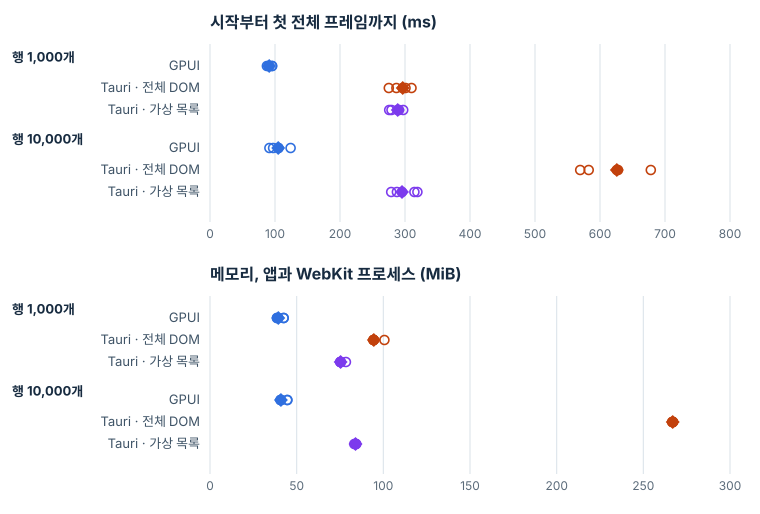

Podbag Desktop은 Tauri 2 앱입니다. 화면은 시스템 WebView 안의 HTML, CSS, JavaScript입니다. [GPUI](https://github.com/zed-industries/zed/tree/main/crates/gpui)는 Zed 편집기의 Rust UI 프레임워크입니다. WebView 없이 GPU로 화면을 그립니다. 같은 화면을 두 방식으로 만들고 측정했습니다.

## 만든 것

두 프로토타입은 사이드바, 검색창, 컨테이너 표를 보여 줍니다. 표에는 이름, 이미지, 상태, 포트, 생성 시간이 있습니다. 행은 생성한 데이터라서 두 앱이 같은 내용을 보여 줍니다. 검색창에 입력하면 모든 열에서 찾습니다.

- **GPUI**: `uniform_list`가 화면에 보이는 행만 그립니다.
- **Tauri · 전체 DOM**: JavaScript가 컨테이너마다 표 행을 만듭니다. 지금 Podbag Desktop이 목록을 그리는 방식입니다.
- **Tauri · 가상 목록**: JavaScript가 보이는 행만 페이지에 둡니다.

두 앱은 같은 창 크기와 Podbag Desktop의 release 설정을 씁니다. 각 앱은 표 전체가 담긴 첫 프레임이 화면에 나오면 한 줄을 출력합니다. 스크립트는 앱을 실행하고 그 줄을 기다립니다. 3초 뒤 메모리를 읽고, 10초 동안 CPU를 잽니다. 그다음 표준 입력으로 검색창에 `web-0004`를 입력합니다.

Apple M5 · 24 GB · macOS 27.2.1 · Rust 1.96.0 · gpui 0.2.2 (`runtime_shaders`) · Tauri 2.12.7 · 경우마다 예열 후 5회, 중앙값

## 결과

| 행 1,000개 | GPUI | Tauri · 전체 DOM | Tauri · 가상 목록 |
|---|---:|---:|---:|
| 시작부터 첫 전체 프레임까지 | {{n:91}} ms | {{n:296}} ms | {{n:289}} ms |
| 메모리 (앱과 WebKit 프로세스) | {{n:39.4}} MiB | {{n:94.5}} MiB | {{n:75.4}} MiB |
| 행 그리기 | {{n:19}} ms | {{n:49}} ms | {{n:44}} ms |
| 2행으로 검색 | {{n:11}} ms | {{n:19}} ms | {{n:12}} ms |

| 행 10,000개 | GPUI | Tauri · 전체 DOM | Tauri · 가상 목록 |
|---|---:|---:|---:|
| 시작부터 첫 전체 프레임까지 | {{n:105}} ms | {{n:626}} ms | {{n:295}} ms |
| 메모리 (앱과 WebKit 프로세스) | {{n:40.9}} MiB | {{n:266.9}} MiB | {{n:83.9}} MiB |
| 행 그리기 | {{n:20}} ms | {{n:344}} ms | {{n:41}} ms |
| 2행으로 검색 | {{n:13}} ms | {{n:38}} ms | {{n:16}} ms |

GPUI는 약 3배 빨리 시작했고, 메모리는 Tauri 가상 목록의 약 절반을 썼습니다. 행이 1,000개에서 10,000개로 늘어도 숫자가 거의 그대로였습니다. 전체 DOM 방식의 Tauri는 행이 늘수록 느려지고 커졌습니다. 같은 Tauri 앱에서 가상 목록을 쓰면 시작 시간과 메모리가 거의 일정했습니다. 그래도 WebKit 프로세스가 약 45 MiB를 더 씁니다. 메모리는 앱 프로세스와, 앱과 함께 시작한 `com.apple.WebKit.*` 서비스의 물리 사용량(physical footprint)입니다.

행 1,000개와 10,000개에서 대기 중 CPU는 Tauri가 더 적게 썼습니다. Tauri는 최대 {{n:0.2}}%, GPUI는 {{n:0.5}}~{{n:0.6}}%였습니다. 단, 커서가 깜박이면 달라집니다. 검색창에 포커스가 있으면 WebKit의 커서 깜박임 때문에 Tauri의 대기 CPU가 약 {{n:3}}%로 오르고, GPU 프로세스가 약 {{n:15}} MiB에서 {{n:57}} MiB로 커졌습니다. GPUI 검색창의 커서는 깜박이지 않습니다. 그래서 표는 두 앱 모두 포커스가 없는 상태에서 비교합니다.

## 크기와 빌드

| Release 빌드 | GPUI | Tauri |
|---|---:|---:|
| 실행 파일 | {{n:2.7}} MB | {{n:3.4}} MB |
| 처음부터 빌드 | {{n:53}} 초 | {{n:43}} 초 |
| 의존성 트리의 crate 수 | {{n:452}} | {{n:220}} |
| 프로토타입 코드 | {{n:1121}}줄 | {{n:392}}줄 |

GPUI 실행 파일에는 자체 렌더러가 들어 있습니다. Tauri는 macOS에 포함된 WebView를 씁니다. GPUI 코드의 절반 이상은 검색창입니다. gpui 0.2.2에는 바로 쓸 수 있는 입력창이 없어서 GPUI 저장소의 입력 예제를 고쳐 썼습니다. IME 조합 입력은 GPUI의 입력 처리기로 다룹니다.

## Podbag Desktop에 주는 의미

- GPUI는 더 빨리 시작하고, 더 빨리 그리고, 메모리를 덜 썼습니다. 대기 중 CPU는 Tauri가 더 적게 썼습니다.
- 옮기려면 약 10,000줄의 화면 코드, 7개 언어 문자열 파일, 브라우저 기반 UI 테스트를 다시 만들어야 합니다.
- gpui 0.2.2에는 macOS, Linux, Windows용 플랫폼 코드가 있습니다. 이번에는 macOS만 시험했습니다.
- gpui 0.2.2에서 스크린 리더 지원을 찾지 못했습니다. 지금 Podbag Desktop은 WebKit에서 접근성 기능을 얻습니다.
- GPUI API는 아직 1.0 이전입니다. 문서는 주로 Zed 소스와 예제입니다.

가장 적은 비용으로 얻을 수 있는 개선은 지금 앱 안에 있습니다. 가상 목록으로 행 10,000개의 시작 시간이 {{n:626}} ms에서 {{n:295}} ms로, 메모리가 {{n:266.9}} MiB에서 {{n:83.9}} MiB로 줄었습니다. GPUI는 접근성과 안정된 API를 중심으로 계속 지켜보겠습니다.

## 한계

완성된 두 앱이 아니라, Mac 한 대에서 만든 작은 프로토타입 두 개입니다. 행 그리기와 검색 시간은 각 앱 안에서 잰 값입니다. 행이 화면 계층에 도착한 때부터 다음 프레임까지입니다. Tauri에서는 Rust에서 JavaScript로 행을 옮기는 시간이 빠집니다. 시작부터 첫 프레임까지의 시간은 밖에서 재며 모든 과정을 포함합니다. Linux, Windows, 스크롤의 부드러움, 오래 쓰는 경우는 측정하지 않았습니다.

## 직접 실행하기

[벤치마크 스크립트](run.py) · [요약 스크립트](summary.py) · [실행별 데이터](results.json) · [버전과 명령](reproduce.txt) · [프로토타입 소스](prototypes.tar.gz)

[GPUI](https://github.com/zed-industries/zed/tree/main/crates/gpui) · [Tauri](https://tauri.app/)
