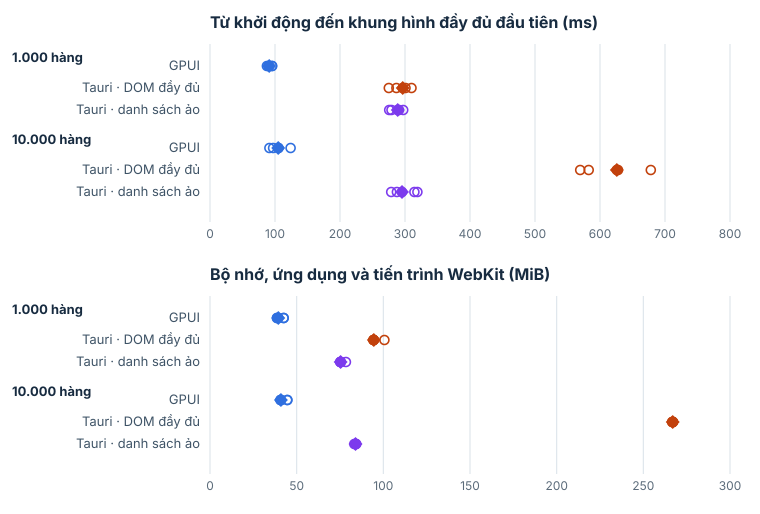

Podbag Desktop là một ứng dụng Tauri 2. Giao diện là HTML, CSS và JavaScript trong WebView của hệ thống. [GPUI](https://github.com/zed-industries/zed/tree/main/crates/gpui) là framework giao diện bằng Rust của trình soạn thảo Zed. Nó vẽ giao diện bằng GPU, không dùng WebView. Chúng tôi dựng cùng một màn hình bằng cả hai và đo chúng.

## Những gì chúng tôi dựng

Mỗi bản mẫu có thanh bên, ô tìm kiếm và bảng container với tên, image, trạng thái, cổng và thời gian tạo. Các hàng được sinh ra, nên hai ứng dụng hiển thị cùng dữ liệu. Gõ vào ô tìm kiếm sẽ lọc trên mọi cột.

- **GPUI**: `uniform_list` chỉ vẽ các hàng đang hiển thị.
- **Tauri · DOM đầy đủ**: JavaScript tạo một hàng cho mỗi container. Podbag Desktop hiện vẽ danh sách theo cách này.
- **Tauri · danh sách ảo**: JavaScript chỉ giữ các hàng đang hiển thị trong trang.

Hai ứng dụng dùng cùng kích thước cửa sổ và cấu hình release của Podbag Desktop. Mỗi ứng dụng in một dòng khi khung hình đầu tiên có đủ bảng xuất hiện trên màn hình. Một script khởi động ứng dụng, chờ dòng đó, chờ 3 giây, đọc bộ nhớ và đo CPU trong 10 giây. Sau đó nó gõ `web-0004` vào ô tìm kiếm qua đầu vào chuẩn.

Apple M5 · 24 GB · macOS 27.2.1 · Rust 1.96.0 · gpui 0.2.2 (`runtime_shaders`) · Tauri 2.12.7 · năm lần chạy sau khởi động nóng cho mỗi trường hợp, lấy trung vị

## Kết quả

| 1.000 hàng | GPUI | Tauri · DOM đầy đủ | Tauri · danh sách ảo |
|---|---:|---:|---:|
| Từ khởi động đến khung hình đầy đủ đầu tiên | {{n:91}} ms | {{n:296}} ms | {{n:289}} ms |
| Bộ nhớ, ứng dụng và tiến trình WebKit | {{n:39.4}} MiB | {{n:94.5}} MiB | {{n:75.4}} MiB |
| Vẽ các hàng | {{n:19}} ms | {{n:49}} ms | {{n:44}} ms |
| Lọc còn 2 hàng | {{n:11}} ms | {{n:19}} ms | {{n:12}} ms |

| 10.000 hàng | GPUI | Tauri · DOM đầy đủ | Tauri · danh sách ảo |
|---|---:|---:|---:|
| Từ khởi động đến khung hình đầy đủ đầu tiên | {{n:105}} ms | {{n:626}} ms | {{n:295}} ms |
| Bộ nhớ, ứng dụng và tiến trình WebKit | {{n:40.9}} MiB | {{n:266.9}} MiB | {{n:83.9}} MiB |
| Vẽ các hàng | {{n:20}} ms | {{n:344}} ms | {{n:41}} ms |
| Lọc còn 2 hàng | {{n:13}} ms | {{n:38}} ms | {{n:16}} ms |

GPUI khởi động nhanh hơn khoảng ba lần và dùng khoảng một nửa bộ nhớ so với danh sách ảo của Tauri. Số liệu của nó gần như không đổi giữa 1.000 và 10.000 hàng. Trang Tauri với DOM đầy đủ chậm hơn và lớn hơn khi số hàng tăng. Danh sách ảo trong cùng ứng dụng Tauri giữ thời gian khởi động và bộ nhớ gần như không đổi. Các tiến trình WebKit vẫn thêm khoảng 45 MiB. Bộ nhớ là dung lượng vật lý (physical footprint) của tiến trình ứng dụng và các dịch vụ `com.apple.WebKit.*` khởi động cùng nó.

Với 1.000 và 10.000 hàng, Tauri dùng ít CPU hơn khi rảnh: tối đa {{n:0.2}}%, so với {{n:0.5}}–{{n:0.6}}% của GPUI. Con trỏ nhấp nháy làm thay đổi điều này. Khi ô tìm kiếm được chọn, con trỏ nhấp nháy của WebKit làm CPU khi rảnh của Tauri tăng lên khoảng {{n:3}}% và tiến trình GPU tăng từ khoảng {{n:15}} MiB lên {{n:57}} MiB. Con trỏ trong ô tìm kiếm GPUI của chúng tôi không nhấp nháy, nên các bảng so sánh hai ứng dụng khi không có ô nào được chọn.

## Kích thước và bản dựng

| Bản dựng release | GPUI | Tauri |
|---|---:|---:|
| Tệp thực thi | {{n:2.7}} MB | {{n:3.4}} MB |
| Dựng từ đầu | {{n:53}} giây | {{n:43}} giây |
| Số crate trong cây phụ thuộc | {{n:452}} | {{n:220}} |
| Mã nguồn bản mẫu | {{n:1121}} dòng | {{n:392}} dòng |

Tệp thực thi GPUI mang theo bộ vẽ riêng. Tauri dùng WebView có sẵn trong macOS. Hơn một nửa mã GPUI là ô tìm kiếm. gpui 0.2.2 chưa có ô nhập văn bản dùng ngay, nên chúng tôi chỉnh lại ví dụ nhập liệu trong kho mã GPUI. Việc nhập bằng IME đi qua trình xử lý nhập liệu của GPUI.

## Ý nghĩa với Podbag Desktop

- GPUI khởi động nhanh hơn, vẽ nhanh hơn và dùng ít bộ nhớ hơn. Khi rảnh, Tauri dùng ít CPU hơn.
- Chuyển sang GPUI nghĩa là viết lại khoảng 10.000 dòng mã giao diện, các tệp chuỗi bảy ngôn ngữ và các bài kiểm thử giao diện chạy trên trình duyệt.
- gpui 0.2.2 có mã nền tảng cho macOS, Linux và Windows. Chúng tôi chỉ thử trên macOS.
- Chúng tôi không tìm thấy hỗ trợ trình đọc màn hình trong gpui 0.2.2. Hiện Podbag Desktop có trợ năng nhờ WebKit.
- API của GPUI vẫn ở trước bản 1.0, và tài liệu chủ yếu là mã nguồn và ví dụ của Zed.

Cải thiện rẻ nhất nằm ngay trong ứng dụng hiện tại. Danh sách ảo giảm thời gian khởi động với 10.000 hàng từ {{n:626}} ms xuống {{n:295}} ms, và bộ nhớ từ {{n:266.9}} MiB xuống {{n:83.9}} MiB. Chúng tôi sẽ tiếp tục theo dõi GPUI, nhất là về trợ năng và một API ổn định.

## Giới hạn

Đây là hai bản mẫu nhỏ trên một máy Mac, không phải hai ứng dụng hoàn chỉnh. Thời gian vẽ và lọc được đo bên trong mỗi ứng dụng, từ khi các hàng tới lớp giao diện đến khung hình kế tiếp. Với Tauri, thời gian này không gồm việc chuyển các hàng từ Rust sang JavaScript. Thời gian từ khởi động đến khung hình đầu tiên được đo từ bên ngoài và bao gồm mọi bước. Chúng tôi chưa đo Linux, Windows, độ mượt khi cuộn hay phiên dùng dài.

## Chạy lại phép đo

[Script đo](run.py) · [Script tổng hợp](summary.py) · [Dữ liệu từng lần chạy](results.json) · [Phiên bản và lệnh](reproduce.txt) · [Mã nguồn bản mẫu](prototypes.tar.gz)

[GPUI](https://github.com/zed-industries/zed/tree/main/crates/gpui) · [Tauri](https://tauri.app/)
