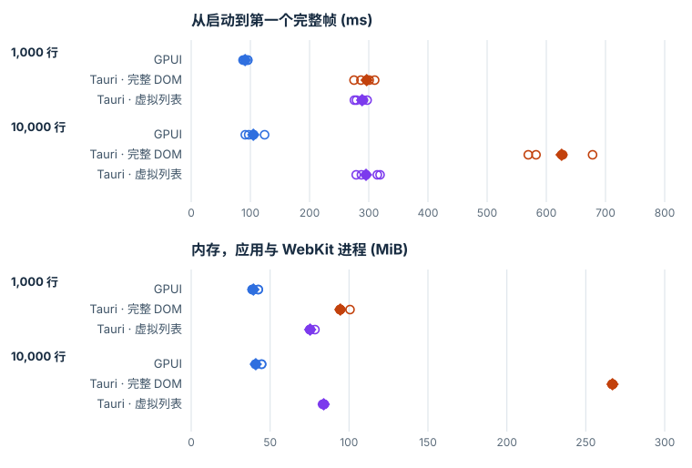

Podbag Desktop 是一个 Tauri 2 应用。界面是在系统 WebView 中运行的 HTML、CSS 和 JavaScript。[GPUI](https://github.com/zed-industries/zed/tree/main/crates/gpui) 是 Zed 编辑器的 Rust UI 框架。它不使用 WebView，而是用 GPU 绘制界面。我们用两者做了同一个界面并进行测量。

## 我们做了什么

两个原型都显示侧边栏、搜索框和容器表格。表格包含名称、镜像、状态、端口和创建时间。行数据是生成的，所以两个应用显示相同的内容。在搜索框中输入会在所有列中筛选。

- **GPUI**：`uniform_list` 只绘制可见的行。
- **Tauri · 完整 DOM**：JavaScript 为每个容器创建一行。Podbag Desktop 目前就是这样绘制列表的。
- **Tauri · 虚拟列表**：JavaScript 只在页面中保留可见的行。

两个应用使用相同的窗口大小和 Podbag Desktop 的 release 配置。当包含完整表格的第一帧显示在屏幕上时，每个应用输出一行。脚本启动应用并等待这一行。3 秒后读取内存，再测量 10 秒的 CPU。然后通过标准输入在搜索框中输入 `web-0004`。

Apple M5 · 24 GB · macOS 27.2.1 · Rust 1.96.0 · gpui 0.2.2 (`runtime_shaders`) · Tauri 2.12.7 · 每种情况预热后运行 5 次，取中位数

## 结果

| 1,000 行 | GPUI | Tauri · 完整 DOM | Tauri · 虚拟列表 |
|---|---:|---:|---:|
| 从启动到第一个完整帧 | {{n:91}} ms | {{n:296}} ms | {{n:289}} ms |
| 内存（应用与 WebKit 进程） | {{n:39.4}} MiB | {{n:94.5}} MiB | {{n:75.4}} MiB |
| 绘制行 | {{n:19}} ms | {{n:49}} ms | {{n:44}} ms |
| 筛选到 2 行 | {{n:11}} ms | {{n:19}} ms | {{n:12}} ms |

| 10,000 行 | GPUI | Tauri · 完整 DOM | Tauri · 虚拟列表 |
|---|---:|---:|---:|
| 从启动到第一个完整帧 | {{n:105}} ms | {{n:626}} ms | {{n:295}} ms |
| 内存（应用与 WebKit 进程） | {{n:40.9}} MiB | {{n:266.9}} MiB | {{n:83.9}} MiB |
| 绘制行 | {{n:20}} ms | {{n:344}} ms | {{n:41}} ms |
| 筛选到 2 行 | {{n:13}} ms | {{n:38}} ms | {{n:16}} ms |

GPUI 启动快了约 3 倍，内存约为 Tauri 虚拟列表的一半。从 1,000 行增加到 10,000 行，它的数字几乎不变。完整 DOM 的 Tauri 页面随着行数增加而变慢、变大。同一个 Tauri 应用改用虚拟列表后，启动时间和内存几乎保持不变，但 WebKit 进程仍额外占用约 45 MiB。内存是应用进程以及随它启动的 `com.apple.WebKit.*` 服务的物理占用（physical footprint）。

在 1,000 行和 10,000 行时，空闲时 Tauri 占用的 CPU 更少，最多 {{n:0.2}}%，GPUI 为 {{n:0.5}}–{{n:0.6}}%。不过光标闪烁会改变结果。搜索框获得焦点时，WebKit 的光标闪烁让 Tauri 的空闲 CPU 升到约 {{n:3}}%，GPU 进程也从约 {{n:15}} MiB 增加到 {{n:57}} MiB。GPUI 搜索框的光标不闪烁，所以表格比较的是两个应用都没有焦点时的情况。

## 体积与构建

| Release 构建 | GPUI | Tauri |
|---|---:|---:|
| 可执行文件 | {{n:2.7}} MB | {{n:3.4}} MB |
| 全新构建 | {{n:53}} 秒 | {{n:43}} 秒 |
| 依赖树中的 crate 数 | {{n:452}} | {{n:220}} |
| 原型代码 | {{n:1121}} 行 | {{n:392}} 行 |

GPUI 可执行文件自带渲染器。Tauri 使用 macOS 自带的 WebView。GPUI 代码有一半以上是搜索框。gpui 0.2.2 没有现成的输入框，所以我们改写了 GPUI 仓库中的输入示例。IME 组合输入由 GPUI 的输入处理器处理。

## 对 Podbag Desktop 意味着什么

- GPUI 启动更快、绘制更快、内存更少。空闲时 Tauri 占用的 CPU 更少。
- 迁移需要重写约 {{n:4600}} 行界面代码（JavaScript、HTML 和 CSS）、7 种语言的字符串文件（每种 {{n:422}} 行），以及约 {{n:1000}} 行基于浏览器的 UI 测试。
- gpui 0.2.2 包含 macOS、Linux 和 Windows 的平台代码。这次只在 macOS 上测试。
- GPUI 的 API 仍在 1.0 之前，文档主要是 Zed 的源码和示例。

成本最低的改进就在现有应用中。改用虚拟列表后，10,000 行的启动时间从 {{n:626}} ms 降到 {{n:295}} ms，内存从 {{n:266.9}} MiB 降到 {{n:83.9}} MiB。我们会继续关注 GPUI，特别是稳定的 API。

## 局限

这是在一台 Mac 上做的两个小原型，而不是两个完整的应用。绘制和筛选时间是在各应用内部测量的，从行进入界面层开始，到下一帧为止。在 Tauri 中，这不包括把行从 Rust 传到 JavaScript 的时间。从启动到第一帧的时间是从外部测量的，包含全部过程。我们没有测量 Linux、Windows、滚动流畅度或长时间使用。

## 复现

[基准测试脚本](run.py) · [汇总脚本](summary.py) · [每次运行的数据](results.json) · [版本与命令](reproduce.txt) · [原型源码](prototypes.tar.gz)

[GPUI](https://github.com/zed-industries/zed/tree/main/crates/gpui) · [Tauri](https://tauri.app/)
