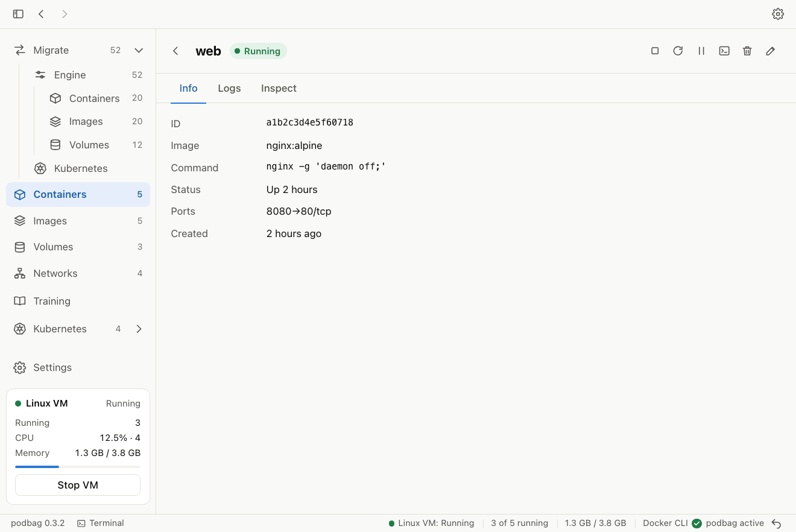

Open **Containers** in the sidebar. The list shows each container's name and ID, its image, its state, its ports and when it was created.

**Time** 5 minutes.

## Start and stop a container

The buttons at the end of a row change with the container's state.

- **Running:** **Stop**, **Restart**, **Pause**, **Logs**, **Open shell** and **Remove**.
- **Paused:** **Resume**, **Stop**, **Logs** and **Remove**.
- **Stopped:** **Start**, **Logs** and **Remove**.

**Pause**, **Resume** and **Rename** show when the engine can do them. podbag can. The state in the list changes when the action is done.

## Open a container

Click a row. The details have three tabs.

- **Info:** the ID, the image, the command, the status, the ports and when the container was created.
- **Logs:** the container's output. With **Follow**, new lines show at the bottom.
- **Inspect:** all that the engine knows about the container, as JSON.

The buttons at the top right act on this container. **Rename** is also there. Press `Esc` or click the back arrow to go back to the list.

## Open a shell

**Open shell** opens a terminal with a shell in a running container. When the app finds no terminal app, it shows the command. Click **Copy** and run the command in a terminal.

## Remove a container

Click **Remove**. The app asks first. A running container is stopped, then removed.

## Clean up

**Clean up** at the top of the list removes all stopped containers. The app asks first. Then it shows how many it removed and how much space it freed.

## Next

[Pull and manage images](../gui-images/).
