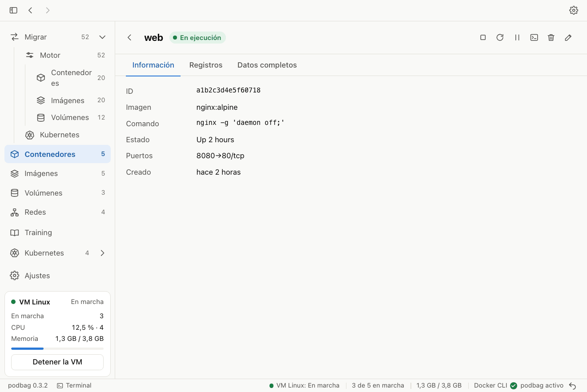
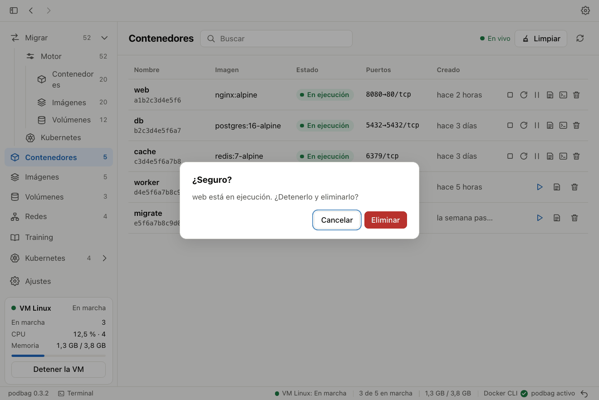

Abre **Contenedores** en la barra lateral. La lista muestra el nombre y el ID de cada contenedor, su imagen, su estado, sus puertos y cuándo se creó.

**Tiempo** 5 minutos.

## Inicia y detén un contenedor

Los botones al final de una fila cambian según el estado del contenedor.

- **En ejecución:** **Detener**, **Reiniciar**, **Pausar**, **Registros**, **Abrir shell** y **Eliminar**.
- **En pausa:** **Reanudar**, **Detener**, **Registros** y **Eliminar**.
- **Detenido:** **Iniciar**, **Registros** y **Eliminar**.

**Pausar**, **Reanudar** y **Cambiar nombre** aparecen cuando el motor puede hacerlo. podbag puede. El estado de la lista cambia cuando termina la acción.

## Abre un contenedor

Haz clic en una fila. Los detalles tienen tres pestañas.

- **Información:** el ID, la imagen, el comando, el estado, los puertos y cuándo se creó el contenedor.
- **Registros:** la salida del contenedor. Con **Seguir**, las líneas nuevas aparecen abajo.
- **Datos completos:** todo lo que el motor sabe del contenedor, en JSON.

Los botones de arriba a la derecha actúan sobre este contenedor. **Cambiar nombre** también está ahí. Pulsa `Esc` o haz clic en la flecha de atrás para volver a la lista.

## Abre una shell

**Abrir shell** abre una terminal con una shell en un contenedor en ejecución. Si la app no encuentra ninguna app de terminal, muestra el comando. Haz clic en **Copiar** y ejecuta el comando en una terminal.

## Elimina un contenedor

Haz clic en **Eliminar**. La app pregunta antes. Si el contenedor está en ejecución, primero lo detiene y luego lo elimina.

## Limpia

**Limpiar**, arriba en la lista, elimina todos los contenedores detenidos. La app pregunta antes. Después muestra cuántos eliminó y cuánto espacio liberó.

## Siguiente

[Descarga y gestiona imágenes](../gui-images/).
