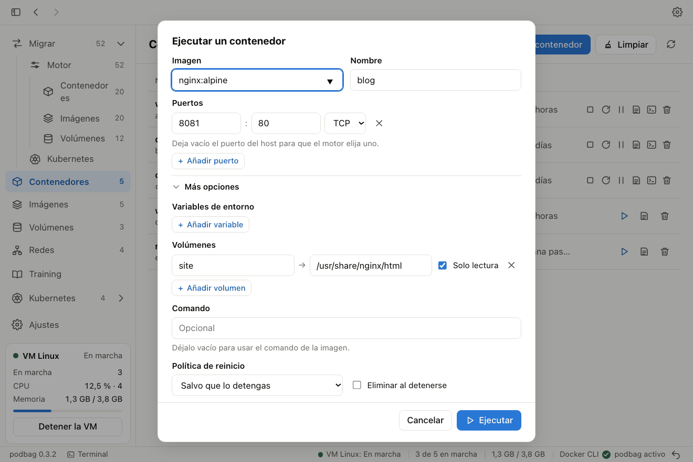
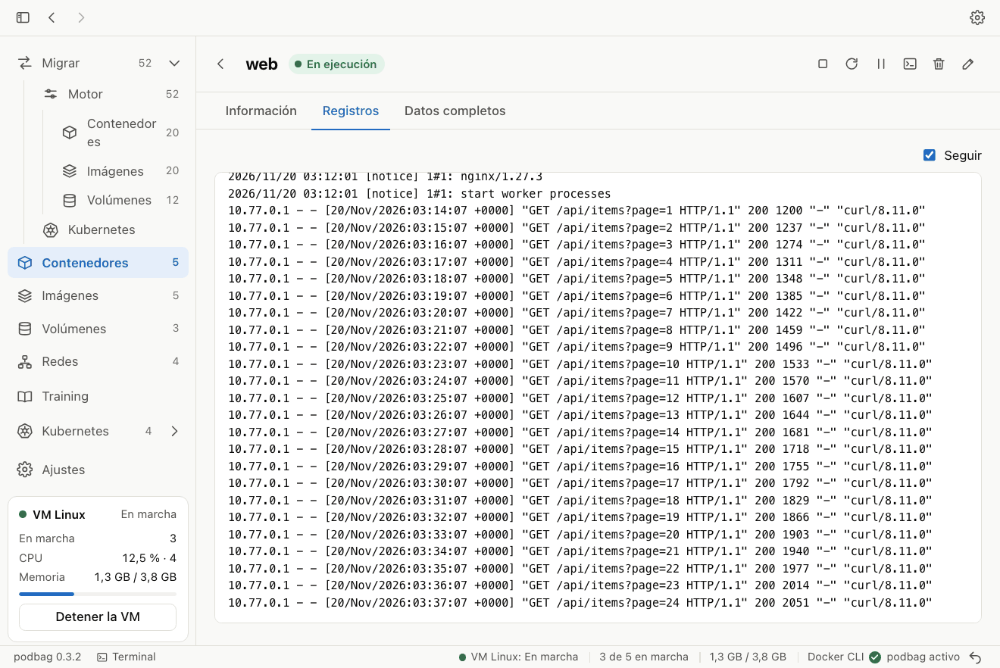

Abre **Contenedores** en la barra lateral. La lista muestra el nombre y el ID de cada contenedor, su imagen, su estado, sus puertos y cuándo se creó.

**Tiempo** 5 minutos.

## Ejecuta un contenedor

Haz clic en **Ejecutar contenedor** en la parte de arriba de la lista. Se abre un formulario.

1. Escribe la **Imagen**, por ejemplo `nginx:alpine`. El campo sugiere las imágenes que ya tienes.
2. Escribe un **Nombre**. Puedes dejarlo vacío.
3. En **Puertos**, escribe un puerto del host y un puerto del contenedor, por ejemplo `8081` y `80`. Elige TCP o UDP. Deja vacío el puerto del host para que el motor elija uno. **Añadir puerto** añade una fila.
4. Haz clic en **Ejecutar**.

**Más opciones** muestra más campos.

- **Variables de entorno:** un `KEY=VALUE` en cada fila.
- **Volúmenes:** un nombre de volumen o una ruta completa del host, y después la ruta en el contenedor. Marca **Solo lectura** si el contenedor no debe escribir ahí.
- **Comando:** déjalo vacío para usar el comando de la imagen.
- **Política de reinicio:** **No reiniciar**, **Si falla**, **Siempre** o **Salvo que lo detengas**.
- **Eliminar al detenerse:** elimina el contenedor cuando se detiene. Esta opción desactiva la política de reinicio.

El formulario revisa lo que escribes antes de enviar nada. Si el motor no tiene la imagen, la app la descarga primero. Usa tu inicio de sesión del registro, igual que **Descargar imagen**. Después se abre el nuevo contenedor con sus registros.

## Inicia y detén un contenedor

Los botones al final de una fila cambian según el estado del contenedor.

- **En ejecución:** **Detener**, **Reiniciar**, **Pausar**, **Registros**, **Abrir shell** y **Eliminar**.
- **En pausa:** **Reanudar**, **Detener**, **Registros** y **Eliminar**.
- **Detenido:** **Iniciar**, **Registros** y **Eliminar**.

**Pausar**, **Reanudar** y **Cambiar nombre** aparecen cuando el motor puede hacerlo. podbag puede. El estado de la lista cambia cuando termina la acción.

## Abre un contenedor

Haz clic en una fila. Los detalles tienen tres pestañas.

- **Información:** el ID, la imagen, el comando, el estado, los puertos y cuándo se creó el contenedor.
- **Registros:** la salida del contenedor. Con **Seguir**, las líneas nuevas aparecen abajo.
- **Datos completos:** todo lo que el motor sabe del contenedor, en JSON.

Los botones de arriba a la derecha actúan sobre este contenedor. **Cambiar nombre** también está ahí. Pulsa `Esc` o haz clic en la flecha de atrás para volver a la lista.

## Abre una shell

**Abrir shell** abre una terminal con una shell en un contenedor en ejecución. Si la app no encuentra ninguna app de terminal, muestra el comando. Haz clic en **Copiar** y ejecuta el comando en una terminal.

## Elimina un contenedor

Haz clic en **Eliminar**. La app pregunta antes. Si el contenedor está en ejecución, primero lo detiene y luego lo elimina.

## Limpia

**Limpiar**, arriba en la lista, elimina todos los contenedores detenidos. La app pregunta antes. Después muestra cuántos eliminó y cuánto espacio liberó.

## Siguiente

[Descarga y gestiona imágenes](../gui-images/).
