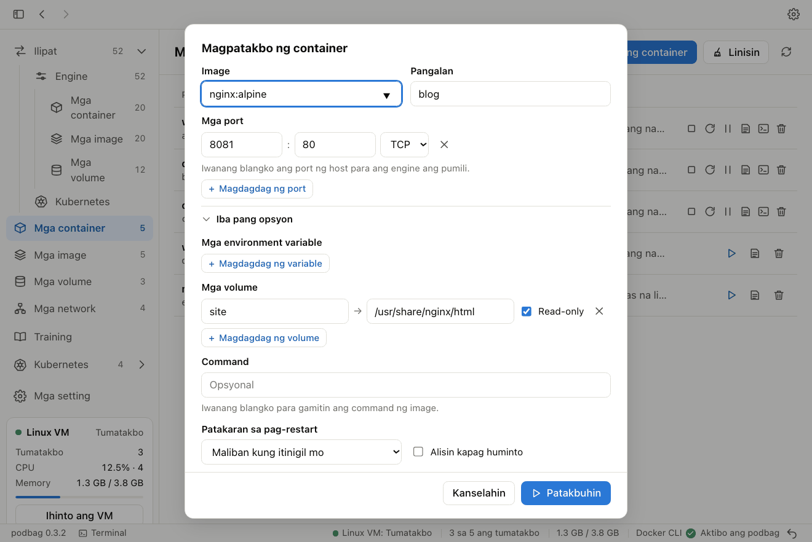
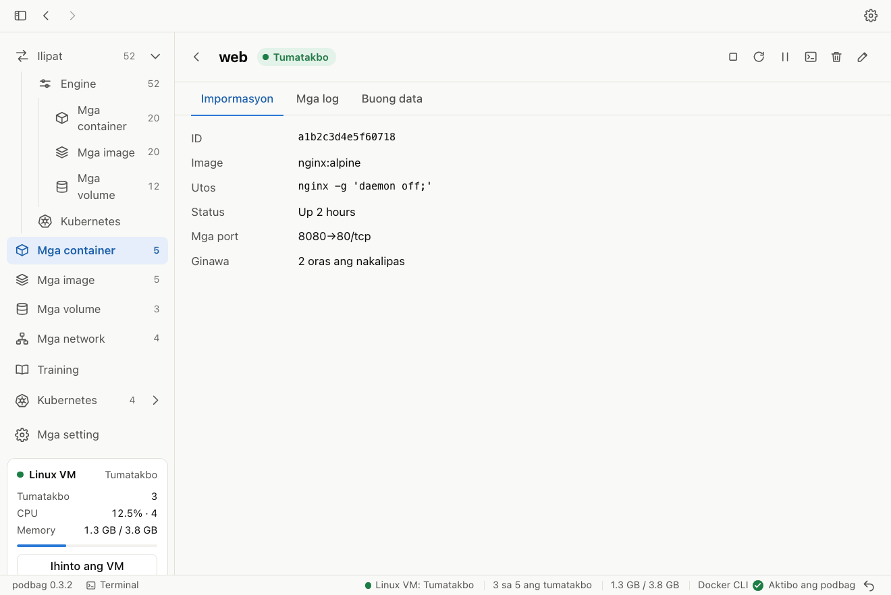
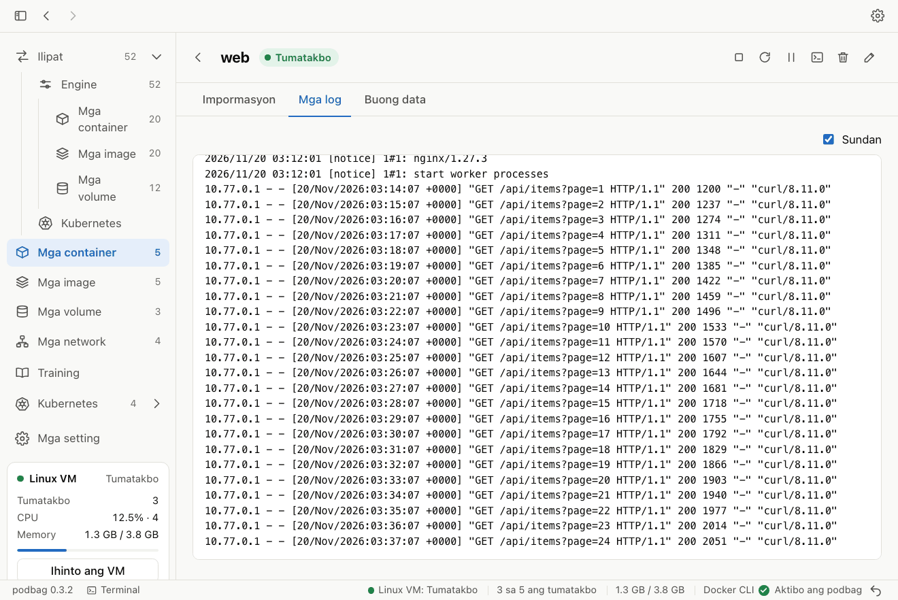
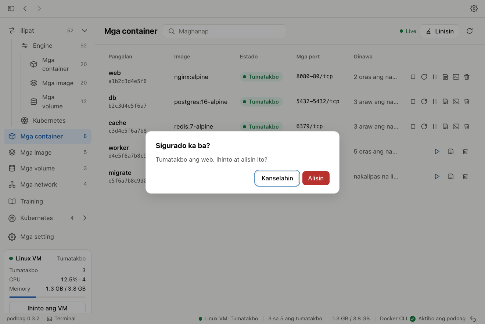

Buksan ang **Mga container** sa sidebar. Ipinapakita ng listahan ang pangalan at ID ng bawat container, ang image nito, ang estado nito, ang mga port nito at kung kailan ito ginawa.

**Oras** 5 minuto.

## Magpatakbo ng container

I-click ang **Patakbuhin ang container** sa itaas ng listahan. Bubukas ang isang form.

1. I-type ang **Image**, halimbawa `nginx:alpine`. Iminumungkahi ng field ang mga image na mayroon ka na.
2. I-type ang **Pangalan**. Puwede mo itong iwanang blangko.
3. Sa **Mga port**, i-type ang port ng host at ang port ng container, halimbawa `8081` at `80`. Piliin ang TCP o UDP. Iwanang blangko ang port ng host para ang engine ang pumili. Nagdaragdag ng row ang **Magdagdag ng port**.
4. I-click ang **Patakbuhin**.

Nagpapakita ng iba pang field ang **Iba pang opsyon**.

- **Mga environment variable:** isang `KEY=VALUE` sa bawat row.
- **Mga volume:** pangalan ng volume o buong path sa host, tapos ang path sa loob ng container. I-check ang **Read-only** kung hindi dapat magsulat ang container doon.
- **Command:** iwanang blangko para gamitin ang command ng image.
- **Patakaran sa pag-restart:** **Huwag i-restart**, **Kapag pumalya**, **Palagi** o **Maliban kung itinigil mo**.
- **Alisin kapag huminto:** inaalis ang container kapag huminto ito. Pinapatay nito ang patakaran sa pag-restart.

Sinusuri ng form ang ilalagay mo bago ito magpadala ng anuman. Kapag walang image ang engine, kinukuha muna ito ng app. Ginagamit nito ang login mo sa registry, tulad ng **Kunin ang image**. Pagkatapos, bubukas ang bagong container kasama ang mga log nito.

## Simulan at ihinto ang container

Nagbabago ang mga button sa dulo ng row ayon sa estado ng container.

- **Tumatakbo:** **Ihinto**, **I-restart**, **I-pause**, **Mga log**, **Buksan ang shell** at **Alisin**.
- **Naka-pause:** **Ituloy**, **Ihinto**, **Mga log** at **Alisin**.
- **Nakahinto:** **Simulan**, **Mga log** at **Alisin**.

Lumalabas ang **I-pause**, **Ituloy** at **Palitan ang pangalan** kapag kaya ng engine ang mga ito. Kaya ito ng podbag. Nagbabago ang estado sa listahan kapag tapos na ang aksyon.

## Magbukas ng container

I-click ang row. May tatlong tab ang mga detalye.

- **Impormasyon:** ang ID, ang image, ang command, ang status, ang mga port at kung kailan ginawa ang container.
- **Mga log:** ang output ng container. Kapag naka-on ang **Sundan**, lumalabas ang mga bagong linya sa ibaba.
- **Buong data:** lahat ng alam ng engine tungkol sa container, bilang JSON.

Gumagawa sa container na ito ang mga button sa kanang itaas. Nandoon din ang **Palitan ang pangalan**. Pindutin ang `Esc` o i-click ang arrow na pabalik para bumalik sa listahan.

## Magbukas ng shell

Nagbubukas ang **Buksan ang shell** ng terminal na may shell sa loob ng tumatakbong container. Kapag walang mahanap na terminal app ang app, ipinapakita nito ang command. I-click ang **Kopyahin** at patakbuhin ang command sa terminal.

## Alisin ang container

I-click ang **Alisin**. Nagtatanong muna ang app. Ang tumatakbong container ay ihihinto muna, saka aalisin.

## Maglinis

Inaalis ng **Linisin** sa itaas ng listahan ang lahat ng nakahintong container. Nagtatanong muna ang app. Pagkatapos, ipinapakita nito kung ilan ang inalis nito at kung gaano kalaking espasyo ang nabakante.

## Susunod

[Kumuha at pamahalaan ang mga image](../gui-images/).
