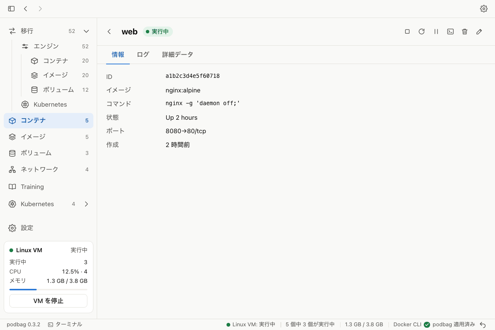
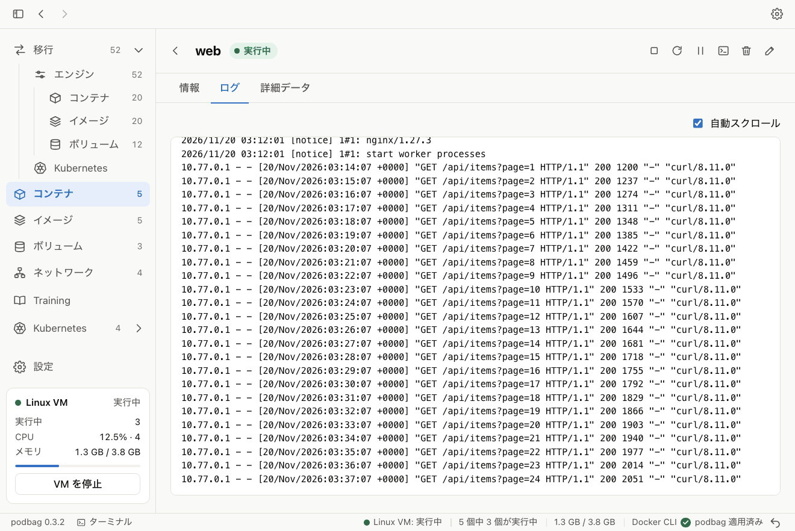
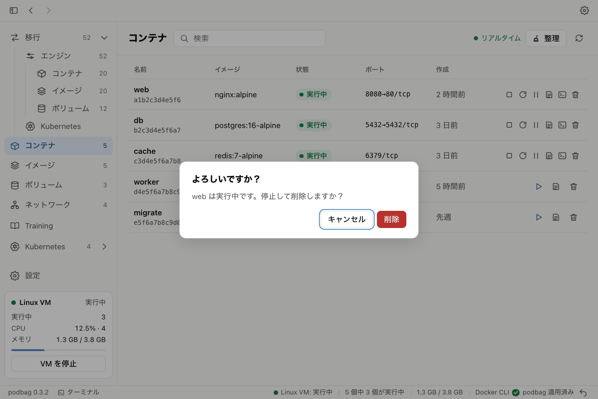

サイドバーで**コンテナ**を開きます。一覧には、コンテナごとに名前と ID、イメージ、状態、ポート、作成日時が表示されます。

**所要時間** 5 分。

## コンテナを開始、停止する

行の右端のボタンは、コンテナの状態によって変わります。

- **実行中:** **停止**、**再起動**、**一時停止**、**ログ**、**シェルを開く**、**削除**
- **一時停止中:** **再開**、**停止**、**ログ**、**削除**
- **停止:** **開始**、**ログ**、**削除**

**一時停止**、**再開**、**名前を変更**は、エンジンが対応しているときに表示されます。podbag は対応しています。操作が終わると、一覧の状態が変わります。

## コンテナを開く

行をクリックします。詳細には 3 つのタブがあります。

- **情報:** ID、イメージ、コマンド、状態、ポート、作成日時
- **ログ:** コンテナの出力です。**自動スクロール**をオンにすると、新しい行が下に続けて表示されます。
- **詳細データ:** エンジンがこのコンテナについて持つすべての情報です。JSON で表示されます。

右上のボタンは、このコンテナを操作します。**名前を変更**もここにあります。`Esc` を押すか、戻る矢印をクリックすると、一覧に戻ります。

## シェルを開く

**シェルを開く**は、実行中のコンテナのシェルをターミナルで開きます。ターミナルアプリが見つからないときは、アプリがコマンドを表示します。**コピー**をクリックし、ターミナルでそのコマンドを実行します。

## コンテナを削除する

**削除**をクリックします。アプリは先に確認します。実行中のコンテナは、停止してから削除します。

## 整理する

一覧の上の**整理**は、停止中のコンテナをすべて削除します。アプリは先に確認します。そのあと、削除した数と空いた容量を表示します。

## 次へ

[イメージを取得して管理する](../gui-images/)。
