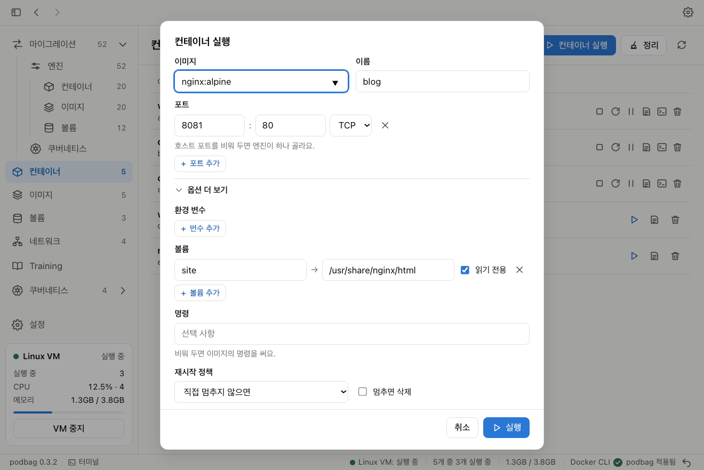
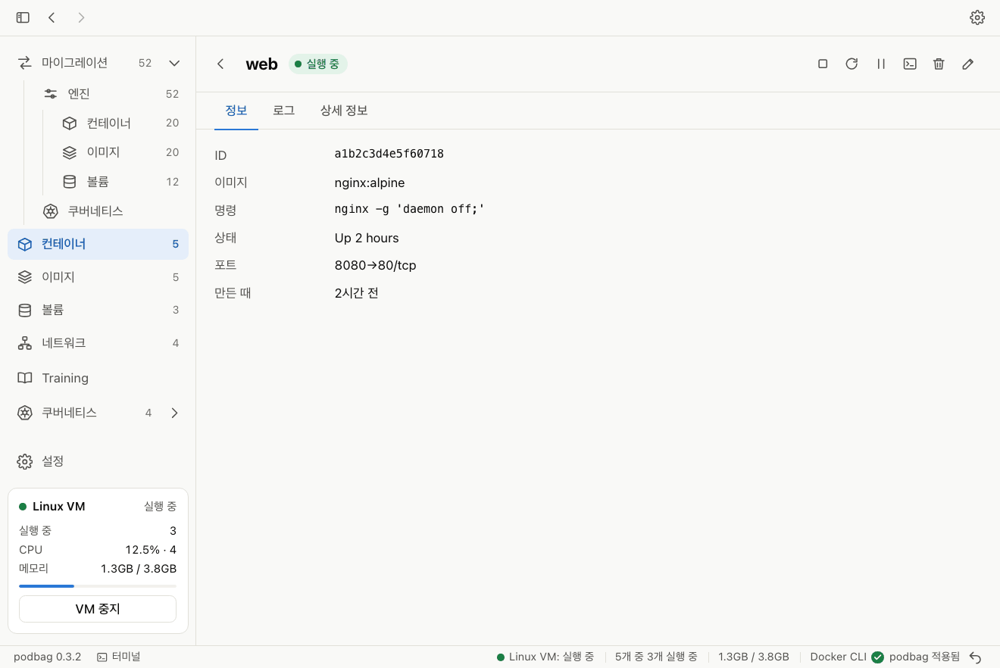
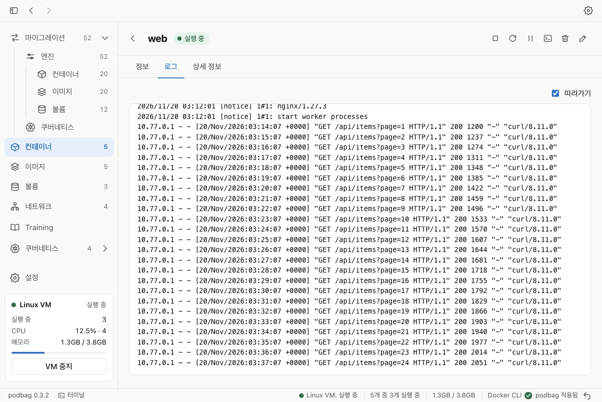
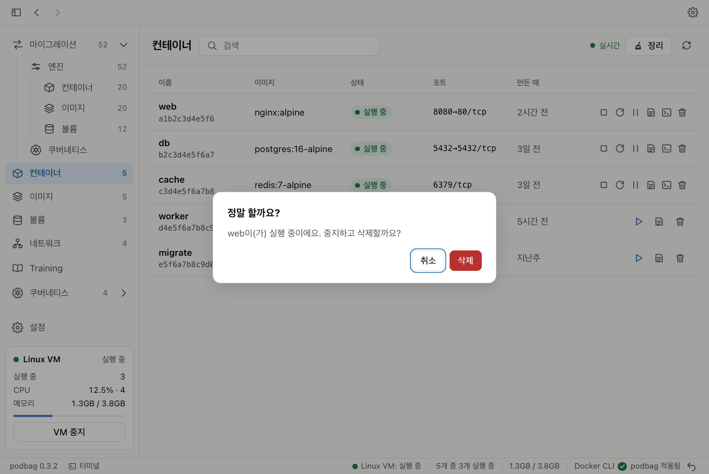

사이드바에서 **컨테이너**를 엽니다. 목록에는 컨테이너마다 이름과 ID, 이미지, 상태, 포트, 만든 시간이 보입니다.

**예상 시간** 5분.

## 컨테이너 실행하기

목록 위쪽의 **컨테이너 실행**을 클릭합니다. 입력 창이 열립니다.

1. **이미지**를 입력합니다. 예: `nginx:alpine`. 이미 있는 이미지는 입력란이 추천해 줍니다.
2. **이름**을 입력합니다. 비워 둘 수 있습니다.
3. **포트**에 호스트 포트와 컨테이너 포트를 입력합니다. 예: `8081`과 `80`. TCP나 UDP를 고릅니다. 호스트 포트를 비워 두면 엔진이 하나 고릅니다. **포트 추가**는 줄을 하나 더합니다.
4. **실행**을 클릭합니다.

**옵션 더 보기**를 누르면 입력란이 더 나옵니다.

- **환경 변수:** 한 줄에 `KEY=VALUE` 하나
- **볼륨:** 볼륨 이름이나 전체 호스트 경로, 그다음 컨테이너 안의 경로입니다. 컨테이너가 쓰면 안 되는 곳이면 **읽기 전용**을 체크합니다.
- **명령:** 비워 두면 이미지의 명령을 씁니다.
- **재시작 정책:** **재시작 안 함**, **실패하면**, **항상**, **직접 멈추지 않으면**
- **멈추면 삭제:** 컨테이너가 멈추면 삭제합니다. 이 옵션을 켜면 재시작 정책은 꺼집니다.

앱은 보내기 전에 입력을 확인합니다. 엔진에 이미지가 없으면 앱이 먼저 이미지를 받습니다. **이미지 받기**처럼 레지스트리 로그인을 씁니다. 그다음 새 컨테이너가 로그와 함께 열립니다.

## 컨테이너 시작하기와 중지하기

줄 끝의 버튼은 컨테이너 상태에 따라 바뀝니다.

- **실행 중:** **중지**, **재시작**, **일시 중지**, **로그**, **셸 열기**, **삭제**
- **일시 중지됨:** **다시 시작**, **중지**, **로그**, **삭제**
- **중지됨:** **시작**, **로그**, **삭제**

**일시 중지**, **다시 시작**, **이름 바꾸기**는 엔진이 지원할 때 보입니다. podbag은 지원합니다. 작업이 끝나면 목록의 상태가 바뀝니다.

## 컨테이너 열기

줄을 클릭합니다. 상세 정보에는 탭이 세 개 있습니다.

- **정보:** ID, 이미지, 명령, 상태, 포트, 만든 시간
- **로그:** 컨테이너의 출력입니다. **따라가기**를 켜면 새 줄이 아래에 이어서 보입니다.
- **상세 정보:** 엔진이 이 컨테이너에 대해 아는 모든 내용입니다. JSON으로 보입니다.

오른쪽 위의 버튼은 이 컨테이너에 작업합니다. **이름 바꾸기**도 여기에 있습니다. `Esc`를 누르거나 뒤로 화살표를 클릭하면 목록으로 돌아갑니다.

## 셸 열기

**셸 열기**는 실행 중인 컨테이너의 셸을 터미널에서 엽니다. 앱이 터미널 앱을 찾지 못하면 명령을 보여줍니다. **복사**를 클릭하고 터미널에서 그 명령을 실행합니다.

## 컨테이너 삭제하기

**삭제**를 클릭합니다. 앱이 먼저 묻습니다. 실행 중인 컨테이너는 중지한 뒤 삭제합니다.

## 정리하기

목록 위쪽의 **정리**는 멈춘 컨테이너를 모두 삭제합니다. 앱이 먼저 묻습니다. 그다음 몇 개를 삭제했고 공간을 얼마나 비웠는지 보여줍니다.

## 다음

[이미지 받기와 다루기](../gui-images/).
