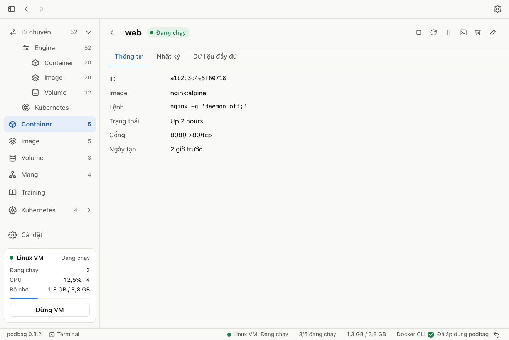
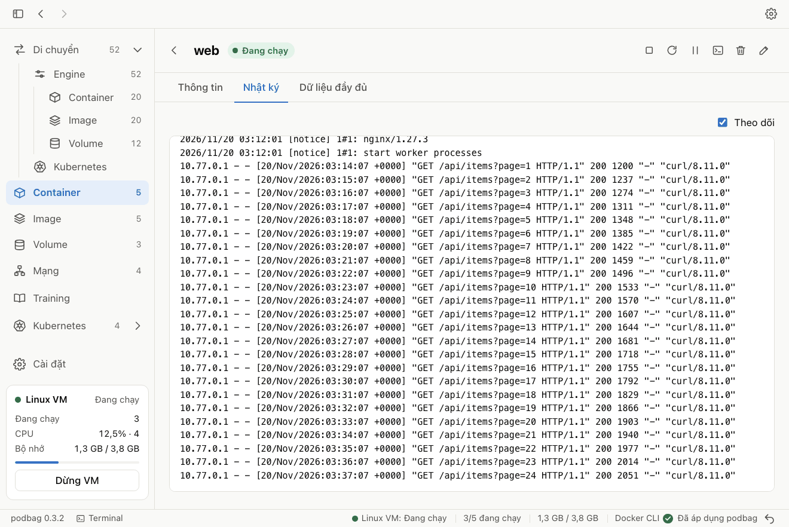

Mở **Container** trên thanh bên. Danh sách hiện tên và ID, image, trạng thái, cổng và ngày tạo của mỗi container.

**Thời gian** 5 phút.

## Chạy và dừng container

Các nút ở cuối một dòng thay đổi theo trạng thái của container.

- **Đang chạy:** **Dừng**, **Khởi động lại**, **Tạm dừng**, **Nhật ký**, **Mở shell** và **Xóa**.
- **Tạm dừng:** **Tiếp tục**, **Dừng**, **Nhật ký** và **Xóa**.
- **Đã dừng:** **Chạy**, **Nhật ký** và **Xóa**.

**Tạm dừng**, **Tiếp tục** và **Đổi tên** chỉ hiện khi engine hỗ trợ các thao tác này. podbag có hỗ trợ. Trạng thái trong danh sách thay đổi khi thao tác xong.

## Mở một container

Nhấp vào một dòng. Phần chi tiết có ba tab.

- **Thông tin:** ID, image, lệnh, trạng thái, cổng và ngày tạo container.
- **Nhật ký:** đầu ra của container. Khi bật **Theo dõi**, các dòng mới hiện ở dưới cùng.
- **Dữ liệu đầy đủ:** mọi thông tin engine có về container, ở dạng JSON.

Các nút ở góc trên bên phải thao tác với container này. Nút **Đổi tên** cũng ở đây. Nhấn `Esc` hoặc nhấp vào mũi tên lùi để quay lại danh sách.

## Mở shell

**Mở shell** mở một terminal với shell bên trong container đang chạy. Khi ứng dụng không tìm thấy ứng dụng terminal, nó hiện lệnh. Nhấp vào **Sao chép** và chạy lệnh đó trong terminal.

## Xóa container

Nhấp vào **Xóa**. Ứng dụng hỏi trước. Container đang chạy sẽ bị dừng, rồi bị xóa.

## Dọn dẹp

**Dọn dẹp** ở phía trên danh sách xóa tất cả container đã dừng. Ứng dụng hỏi trước. Sau đó, ứng dụng cho biết đã xóa bao nhiêu container và giải phóng bao nhiêu dung lượng.

## Tiếp theo

[Tải và quản lý image](../gui-images/).
