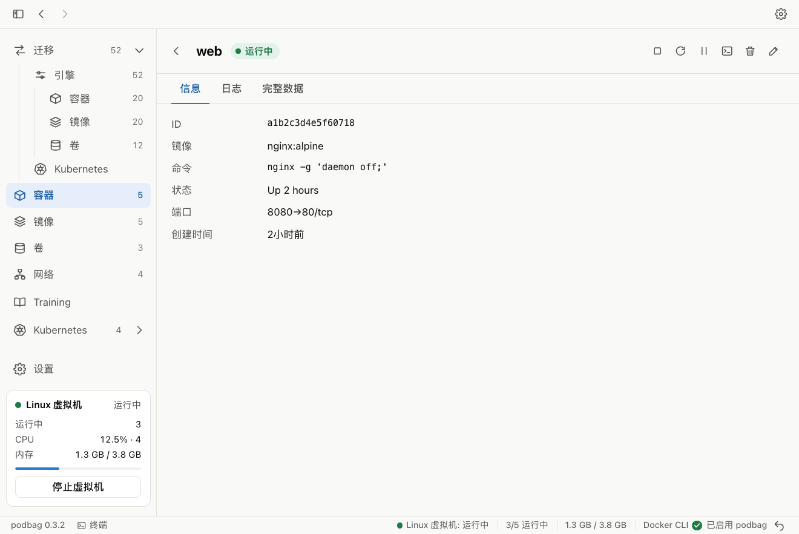

在侧边栏中打开**容器**。列表显示每个容器的名称和 ID、镜像、状态、端口和创建时间。

**预计用时** 5 分钟。

## 启动和停止容器

行末的按钮会随容器的状态变化。

- **运行中：** **停止**、**重启**、**暂停**、**日志**、**打开终端**和**删除**。
- **已暂停：** **恢复**、**停止**、**日志**和**删除**。
- **已停止：** **启动**、**日志**和**删除**。

只有当引擎支持时，才会显示**暂停**、**恢复**和**重命名**。podbag 支持它们。操作完成后，列表中的状态会改变。

## 打开容器

点击一行。详情有三个标签页。

- **信息：** ID、镜像、命令、状态、端口和创建时间。
- **日志：** 容器的输出。开启**自动滚动**后，新的行会显示在底部。
- **完整数据：** 引擎知道的关于这个容器的全部内容，以 JSON 格式显示。

右上角的按钮对这个容器进行操作。**重命名**也在这里。按 `Esc` 或点击后退箭头，可以回到列表。

## 打开 shell

**打开终端**会打开一个终端，并在运行中的容器里启动 shell。如果应用找不到终端应用，它会显示命令。点击**复制**，然后在终端中运行这条命令。

## 删除容器

点击**删除**。应用会先询问你。运行中的容器会先停止，再删除。

## 清理

列表顶部的**清理**会删除所有已停止的容器。应用会先询问你。然后它会显示删除了几个容器，以及释放了多少空间。

## 下一步

[拉取和管理镜像](../gui-images/)。
