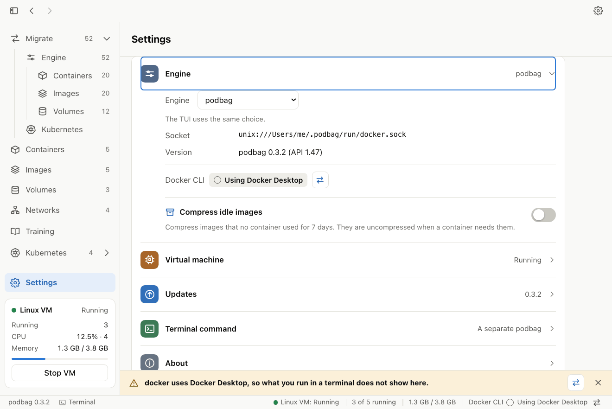
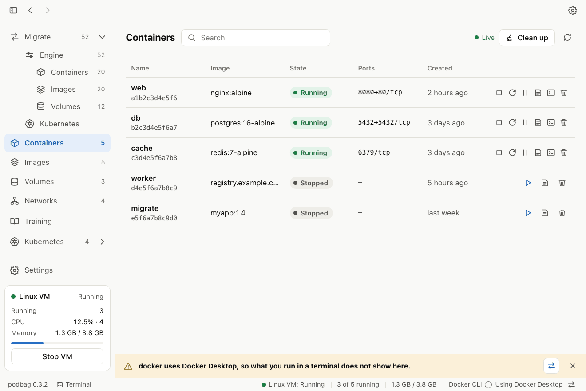
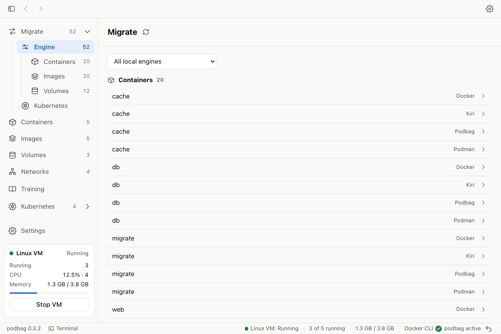
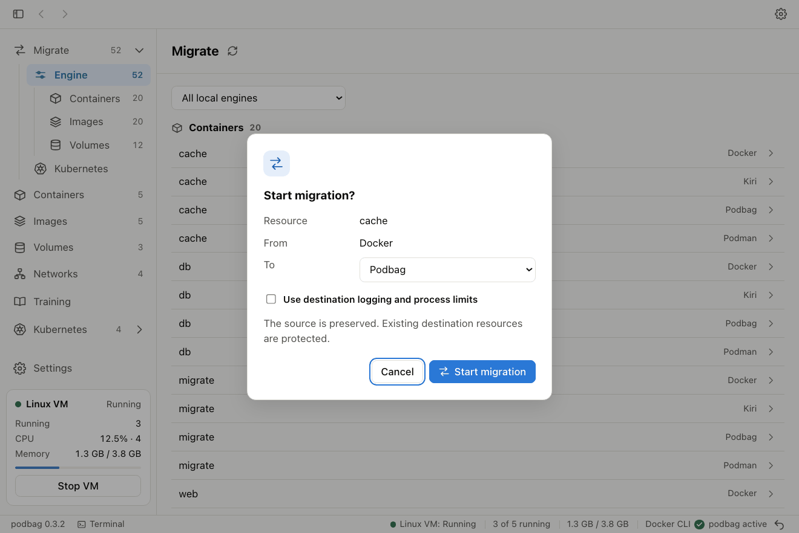

Podbag Desktop works with podbag and with other engines that have the Docker API, such as Docker, Podman and Kiri.

**Time** 5 minutes.

## Choose the engine

1. Open **Settings** and click **Engine**.
2. Choose **podbag**, **Docker**, **Podman**, **Kiri** or a Docker context. For another engine, choose **Custom Unix socket…** and enter its address, such as `unix:///path/to/docker.sock`.

The lists then show that engine. The TUI uses the same choice. **Engine** also shows the engine's socket and version.

## Send the docker command to podbag

**Docker CLI** shows where the `docker` command goes. You see it in the status bar and in **Engine**.

- **podbag active:** `docker` runs on podbag. What you run in a terminal shows in the app.
- **Using Docker Desktop:** `docker` runs on another engine. A bar at the bottom of the window says so.

Click **Use podbag for docker** to send the command to podbag. New terminals use the podbag context. Other contexts stay as they are. To go back, click the arrow at the right of the status bar: **Switch back to** the old context.

## Compress idle images

With podbag, **Engine** has **Compress idle images**. It compresses the images that no container used for 7 days. A container that needs an image gets it uncompressed. See [Compress idle images](../idle-image-compression/).

## Migrate from another engine

**Migrate** copies containers, images and volumes from one engine to another, for example from Docker to podbag.

1. Open **Migrate** in the sidebar.
2. Choose where to look: **All local engines**, one engine or a context.
3. The list shows the containers, images and volumes, with the engine of each. Click one.
4. Choose the destination in **To**. For a container, you can check **Use destination logging and process limits**.
5. Click **Start migration**. The app copies the item and checks the copy. At the end, it shows **Migration complete**.

The source is preserved. The app does not change what is already at the destination. In the sidebar, **Containers**, **Images** and **Volumes** under **Engine** show one kind only. **Kubernetes** under **Migrate** copies Kubernetes resources from one context or namespace to another in the same way.

## Next

[Kubernetes and settings](../gui-kubernetes-settings/).
