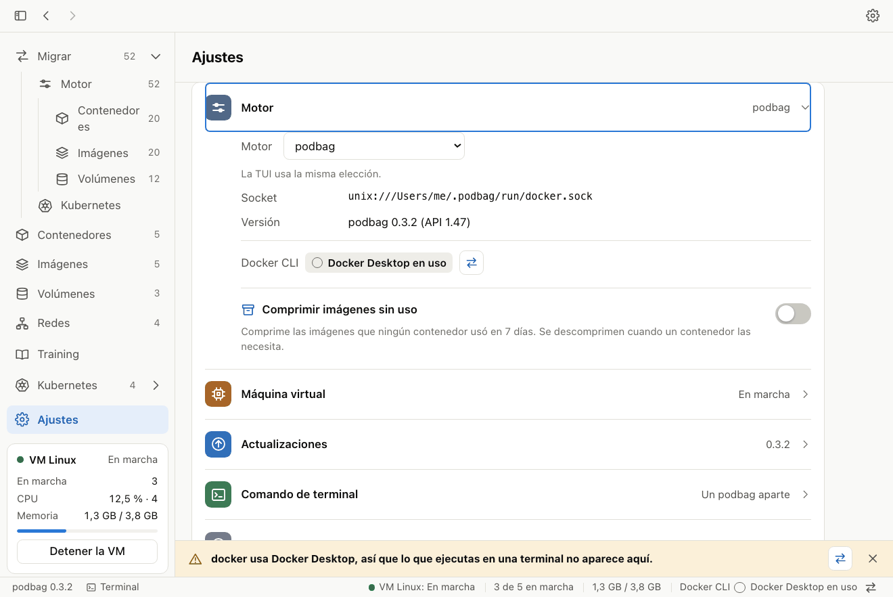
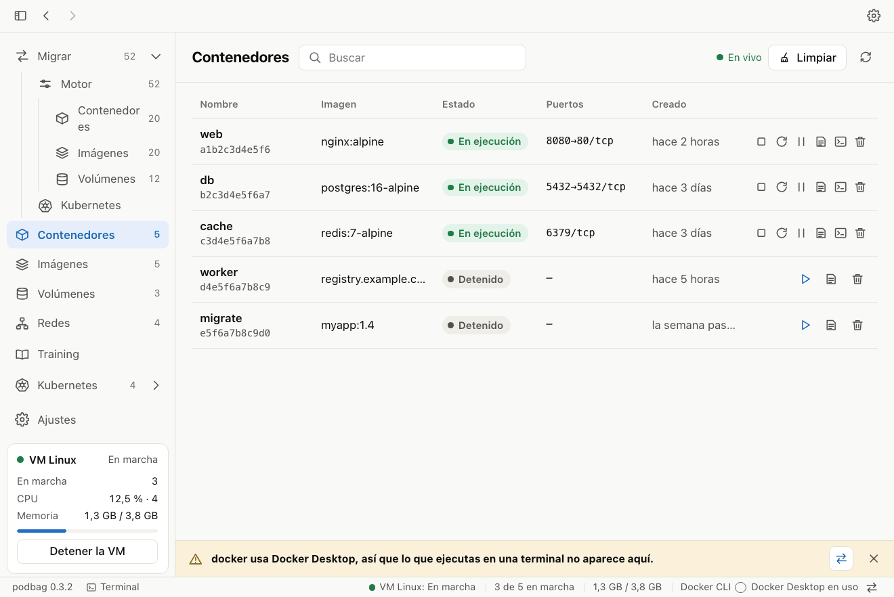
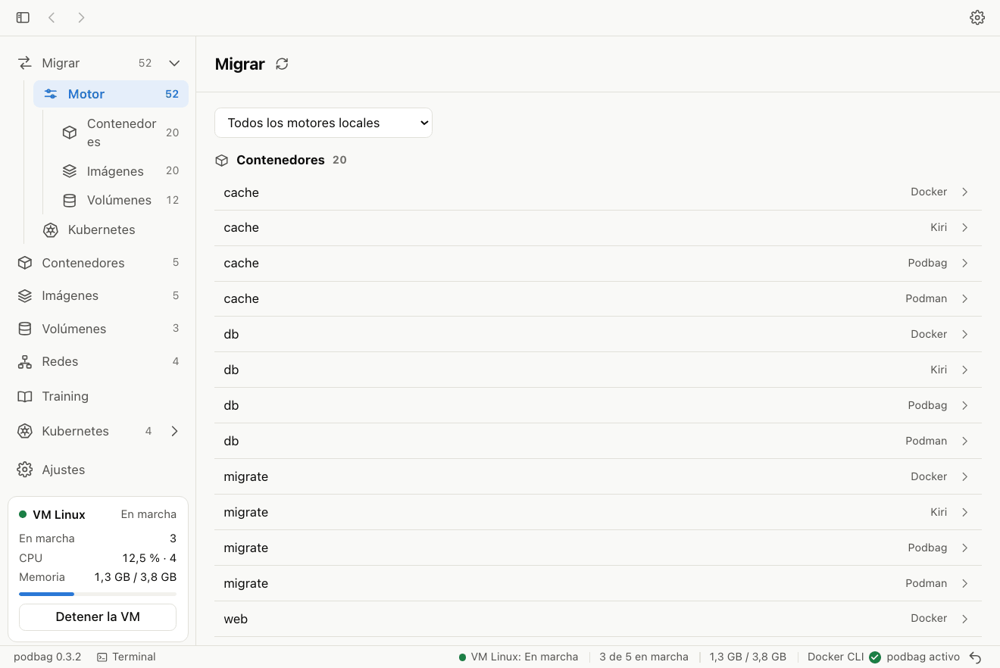
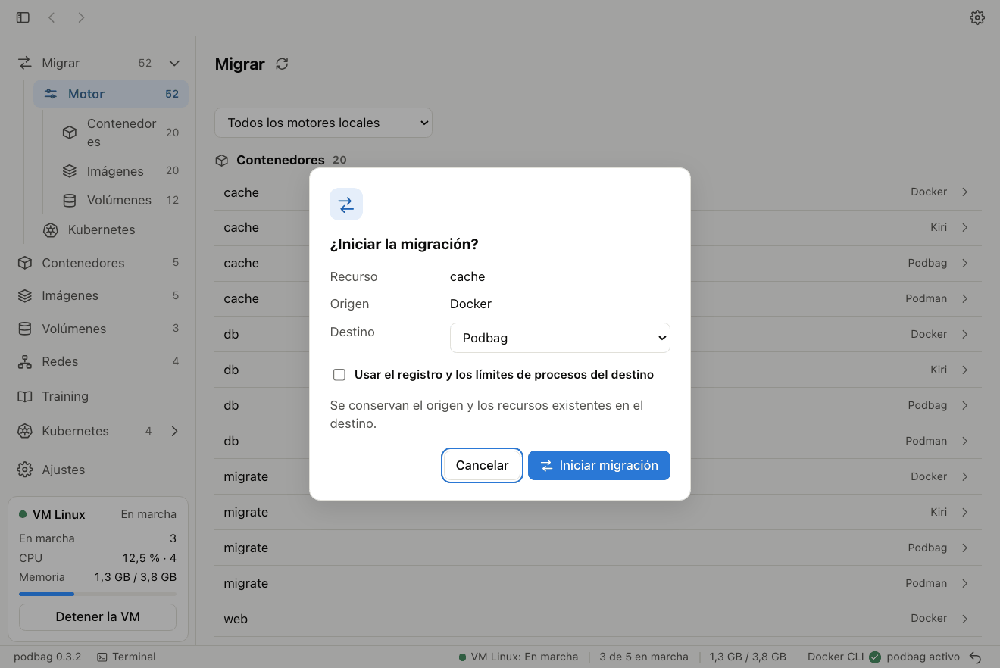

Podbag Desktop funciona con podbag y con otros motores que tienen la API de Docker, como Docker, Podman y Kiri.

**Tiempo** 5 minutos.

## Elige el motor

1. Abre **Ajustes** y haz clic en **Motor**.
2. Elige **podbag**, **Docker**, **Podman**, **Kiri** o un contexto de Docker. Para otro motor, elige **Socket Unix personalizado…** y escribe su dirección, como `unix:///path/to/docker.sock`.

Las listas muestran entonces ese motor. La TUI usa la misma elección. **Motor** también muestra el socket y la versión del motor.

## Envía el comando docker a podbag

**Docker CLI** muestra adónde va el comando `docker`. Lo ves en la barra de estado y en **Motor**.

- **podbag activo:** `docker` se ejecuta en podbag. Lo que ejecutas en una terminal aparece en la app.
- **Docker Desktop en uso:** `docker` se ejecuta en otro motor. Una barra en la parte inferior de la ventana lo indica.

Haz clic en **Usar podbag para docker** para enviar el comando a podbag. Las terminales nuevas usan el contexto de podbag. Los otros contextos no cambian. Para volver atrás, haz clic en la flecha a la derecha de la barra de estado. Elige **Volver a** el contexto anterior.

## Comprime las imágenes sin uso

Con podbag, **Motor** tiene **Comprimir imágenes sin uso**. Comprime las imágenes que ningún contenedor usó en 7 días. Si un contenedor necesita una imagen, la recibe sin comprimir. Consulta [Comprimir imágenes sin uso](../idle-image-compression/).

## Migra desde otro motor

**Migrar** copia contenedores, imágenes y volúmenes de un motor a otro, por ejemplo de Docker a podbag.

1. Abre **Migrar** en la barra lateral.
2. Elige dónde buscar: **Todos los motores locales**, un motor o un contexto.
3. La lista muestra los contenedores, las imágenes y los volúmenes, con el motor de cada uno. Haz clic en uno.
4. Elige el destino en **Destino**. Para un contenedor, puedes marcar **Usar el registro y los límites de procesos del destino**.
5. Haz clic en **Iniciar migración**. La app copia el elemento y comprueba la copia. Al final, muestra **Migración completada**.

El origen no cambia. La app no cambia lo que ya hay en el destino. En la barra lateral, **Contenedores**, **Imágenes** y **Volúmenes** bajo **Motor** muestran un solo tipo. **Kubernetes** bajo **Migrar** copia recursos de Kubernetes de un contexto o espacio de nombres a otro de la misma forma.

## Siguiente

[Kubernetes y ajustes](../gui-kubernetes-settings/).
