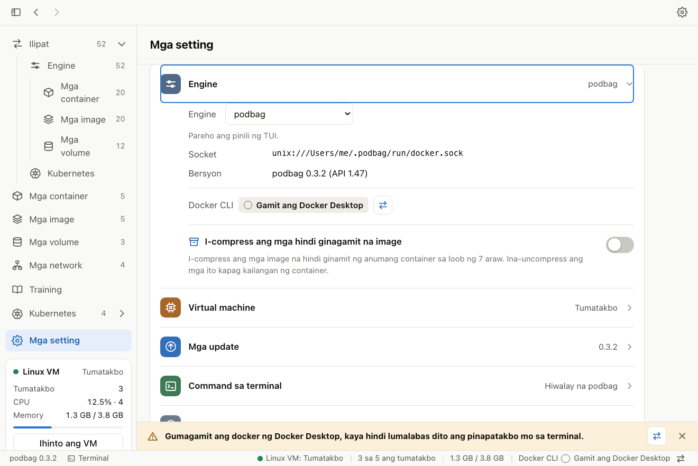
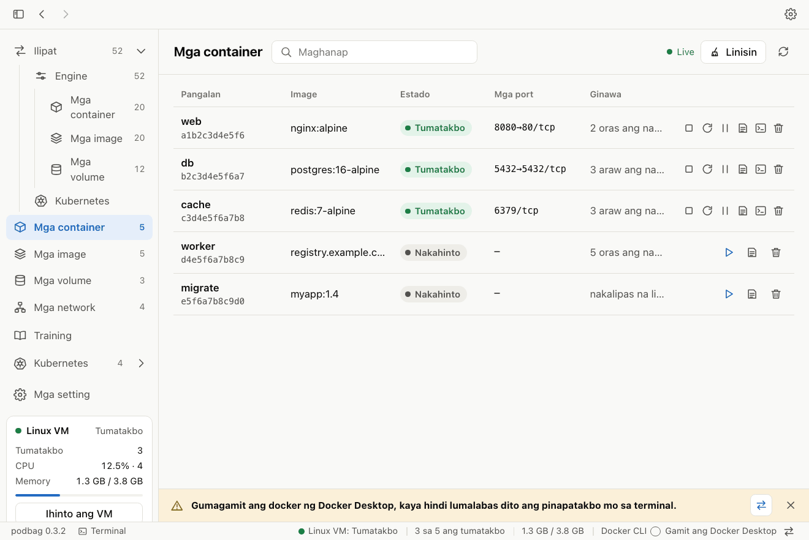
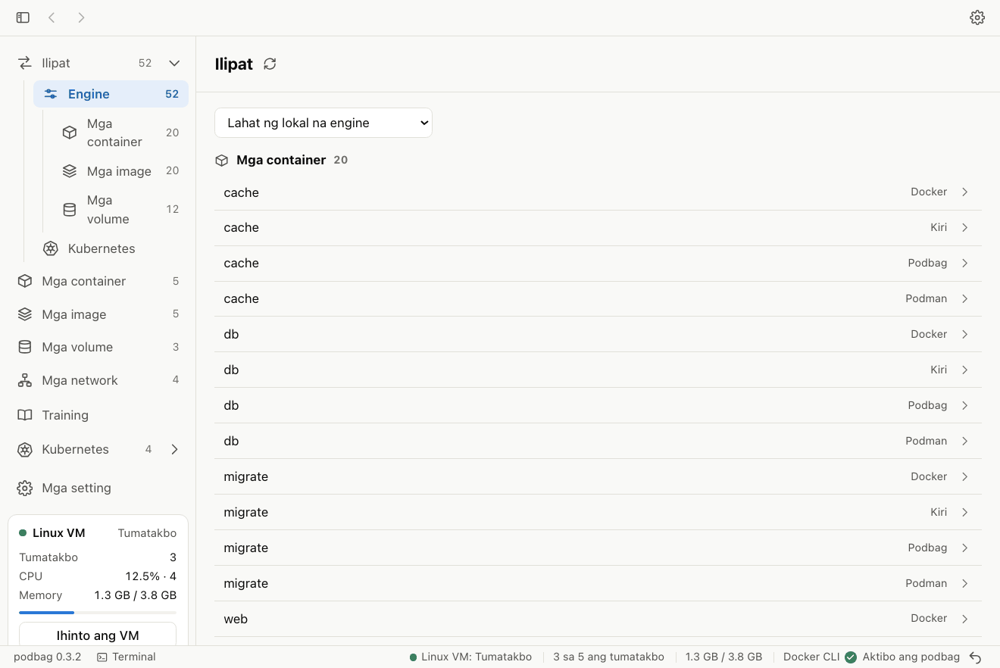
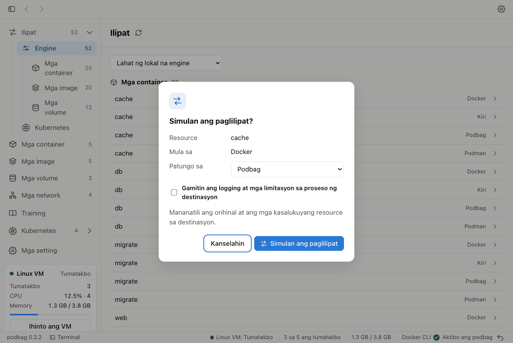

Gumagana ang Podbag Desktop sa podbag at sa iba pang engine na may Docker API, gaya ng Docker, Podman at Kiri.

**Oras** 5 minuto.

## Piliin ang engine

1. Buksan ang **Mga setting** at i-click ang **Engine**.
2. Piliin ang **podbag**, **Docker**, **Podman**, **Kiri** o isang Docker context. Para sa ibang engine, piliin ang **Pasadyang Unix socket…** at ilagay ang address nito, gaya ng `unix:///path/to/docker.sock`.

Pagkatapos, ipinapakita ng mga listahan ang engine na iyon. Pareho ang pinili ng TUI. Ipinapakita rin ng **Engine** ang socket at bersyon ng engine.

## Ipadala ang docker command sa podbag

Ipinapakita ng **Docker CLI** kung saan pumupunta ang `docker` command. Makikita mo ito sa status bar at sa **Engine**.

- **Aktibo ang podbag:** tumatakbo sa podbag ang `docker`. Lumalabas sa app ang pinapatakbo mo sa terminal.
- **Gamit ang Docker Desktop:** tumatakbo sa ibang engine ang `docker`. Sinasabi ito ng isang bar sa ibaba ng window.

I-click ang **Gamitin ang podbag para sa docker** para ipadala ang command sa podbag. Gagamitin ng mga bagong terminal ang context ng podbag. Hindi binabago ang ibang context. Para bumalik, i-click ang arrow sa kanan ng status bar: **Bumalik sa** lumang context.

## I-compress ang mga hindi ginagamit na image

Sa podbag, may **I-compress ang mga hindi ginagamit na image** ang **Engine**. Kino-compress nito ang mga image na hindi ginamit ng anumang container sa loob ng 7 araw. Kapag kailangan ng container ang image, makukuha nito ang image nang hindi naka-compress. Tingnan ang [I-compress ang mga hindi ginagamit na image](../idle-image-compression/).

## Lumipat mula sa ibang engine

Kinokopya ng **Ilipat** ang mga container, image at volume mula sa isang engine papunta sa iba, halimbawa mula sa Docker papunta sa podbag.

1. Buksan ang **Ilipat** sa sidebar.
2. Piliin kung saan titingin: **Lahat ng lokal na engine**, isang engine o isang context.
3. Ipinapakita ng listahan ang mga container, image at volume, kasama ang engine ng bawat isa. I-click ang isa.
4. Piliin ang destinasyon sa **Patungo sa**. Para sa container, puwede mong i-check ang **Gamitin ang logging at mga limitasyon sa proseso ng destinasyon**.
5. I-click ang **Simulan ang paglilipat**. Kinokopya ng app ang item at sinusuri nito ang kopya. Sa dulo, ipinapakita nito ang **Tapos na ang paglilipat**.

Mananatili ang orihinal. Hindi binabago ng app ang nasa destinasyon na. Sa sidebar, isang uri lang ang ipinapakita ng **Mga container**, **Mga image** at **Mga volume** sa ilalim ng **Engine**. Sa parehong paraan, kinokopya ng **Kubernetes** sa ilalim ng **Ilipat** ang mga resource ng Kubernetes mula sa isang context o namespace papunta sa iba.

## Susunod

[Kubernetes at mga setting](../gui-kubernetes-settings/).
